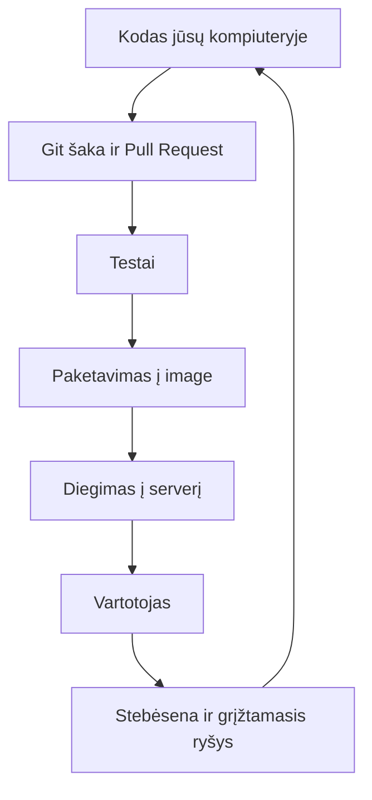
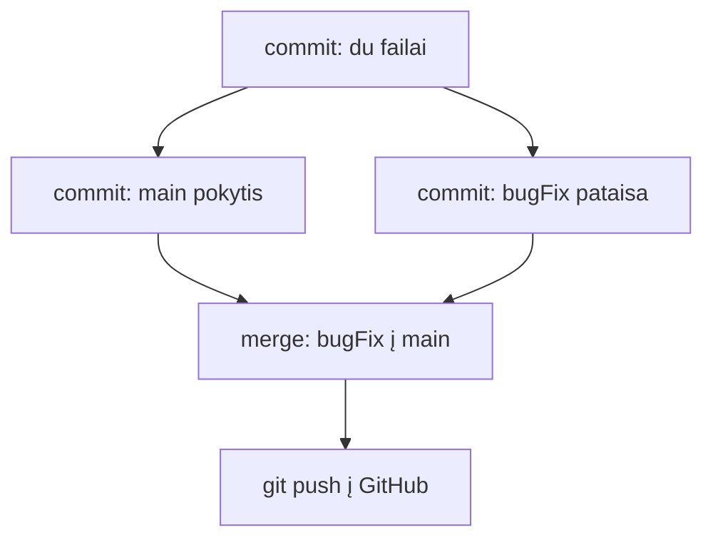

# 01 Kas yra DevOps

Data: 2026-11-11 (trečiadienis)

## Klasės darbas

Visa paskaita telpa į 3 val.: teorija ir darbas gyvai ~90 min. plius pertrauka ~15 min., savarankiškos užduotys ~1 val. 15 min. (likęs laikas yra rezervas).

1. Prisistatymas (~5 min): dėstytojas prisistato per skaidres `apie-mane-skaidres.html` (šalia šio failo): kas esu, stack ir įrankiai, projektai, su kuo dirbau, GitHub ir LinkedIn
2. Apklausa ir susipažinimas (~10 min): paskutinė `apie-mane-skaidres` skaidrė „Susipažinkime“; kiekvienas atsako pristatydamasis, o dėstytojas užrašo Google lentelėje:
   1. Rankų pakėlimas: Windows ar Mac?
   2. Rankų pakėlimas: ar kompiuteris asmeninis (ne mokyklos ar darbo)? Tai svarbu dėl administratoriaus teisių diegiant WSL
   3. Rankų pakėlimas: ar veikia Ubuntu (WSL) Windows arba Terminalas Mac?
   4. Rankų pakėlimas: ar turite GitHub paskyrą?
   5. Patirtis 1–5 pirštais (1 – nieko, 5 – laisvai), keturis kartus: Git, Linux, Python, Docker
   6. Susipažinimas: 3–4 savanoriai pasako vardą ir ko tikisi iš kurso
3. Kurso eiga ir kaip dirbsime (~10 min):
   1. 80 paskaitų, 7 etapai, po kiekvieno atsiskaitymas (testas + praktika); patvirtinti atsiskaitymai: 2026-11-30 ir 2026-12-17
   2. Kasdienių užduočių dėstytojas netikrina: pamokos pradžioje parodo sprendimą gyvai, jūs darote užduotis, kitą kartą aptariame, kas liko neaišku
   3. Kas savaitę `git pull` iš `devops-kursas` (žr. `README.md`)
   4. Diegimas fone (jums nieko iš anksto nesiunčiama, aplinka ruošiama pamokoje): kol dėstytojas pasakoja 3 ir 4 punktus (~30 min), Windows studentai PowerShell kaip administratorius paleidžia `wsl --install`, Mac studentai terminale paleidžia `xcode-select --install`
   5. DI taisyklės: ką galima (paaiškinti klaidą, pasiūlyti komandą); kaip tikrinti (paleisti, perskaityti, patikrinti dokumentacijoje); ko niekada nekelti į DI ar į Git (slaptažodžių, raktų, tokenų, `.env`)
4. Kas yra DevOps (~20 min):
   1. Kodo kelias nuo kūrėjo iki vartotojo: kodas → versijų kontrolė → testai → paketavimas → diegimas → stebėsena → grįžtamasis ryšys
   2. Kodėl atsirado: kūrėjai nori keisti greitai, administratoriai nori stabilumo; DevOps juos sujungia automatizavimu
   3. Ką daro DevOps inžinierius ir kur matysime tai per metus: Linux ir Git → Docker → GitHub Actions → Kubernetes → Azure
   4. [roadmap.sh/devops](https://roadmap.sh/devops) (~5 min): visas kelias vienoje diagramoje; parodyti, kurią dalį apims kursas, o ne aiškinti kiekvieną langelį
   5. Kurso projektas: vienas Python (Flask) web API su MySQL, kurį visą kursą pakeisime, supakuosime ir paleisime; savo kopiją jo susikursite 02 pamokoje
5. Pertrauka (~15 min): Windows studentai perkrauna kompiuterį ir vieną kartą paleidžia Ubuntu (sukuria vartotoją); Mac studentai patikrina, ar baigėsi `xcode-select` diegimas
6. Aplinkos patikra (~10 min) po pertraukos, pagal `README.md` skyrių „Aplinka“:
   1. Visi paleidžia `git --version` ir `gh auth status`
   2. Kam dar trūksta WSL ar `gh`, tas diegia dabar (kam trūksta GitHub paskyros, susikuria), likusieji tęsia. Jei WSL nepavyksta, žr. `README.md` skyrių „Jei WSL nepavyko“
   3. Git vardas ir el. paštas (`user.name`, `user.email`; el. paštui galima GitHub „noreply“ adresas: GitHub Settings → Emails) ir numatytoji šaka `main` (`init.defaultBranch`). Jei dar neprisijungta, `gh auth login` (HTTPS); GitHub paprasto slaptažodžio nebepriima
   4. Visi kurso failai laikomi vienoje vietoje: aplankas `~/devops`, ne `/mnt/c` ir (Mac) ne `Desktop` ar `Documents`
7. Git per užduotis (~30 min): užduotys skelbiamos po vieną Teams'e. Prieš kiekvieną dėstytojas gyvai parodo kitu pavyzdžiu (`a.txt`, `b.txt`, šaka `bugFix`), tada jūs darote savo (`pastabos.txt`, `idejos.txt`, šaka `papildymas`) ir gavę patvirtinimą ar baigę gaunate kitą. Komandos yra skyriuje „Komandos“. Pradžia yra **greitas pakartojimas** to, ką jau mokėjote, todėl daug nesiaiškiname; daugiau laiko šakoms
   1. Keturi žodžiai (~2 min, tik prisiminti): **repozitorija** (aplankas, kurio istoriją saugo Git), **commit** (išsaugotas pakeitimų taškas), **šaka (branch)** (atskira darbo linija, `main` lieka nepaliesta), **GitHub** (nuotolinė repozitorijos kopija, kurią mato kiti)
   2. Demonstracija ir Užduotis 1 „Nuo aplanko iki GitHub“ (~8 min, pakartojimas): aplankas, du failai, commit, `gh repo create`; repozitorijos yra **Public**: jokių slaptažodžių, raktų, `.env`
   3. Demonstracija ir Užduotis 2 „Šaka ir sujungimas“ (~20 min, naujiena): šaka, pakeitimas, `main` pokytis, `merge`, `branch -d`, `push`, `git log --oneline --graph --all`
   4. Užduotis 3 „DevOps dokumentas ir `/health`“ skelbiama po 8 punkto (~1 val.)
   5. Nuorodos: [GitHub Hello World](https://docs.github.com/en/get-started/start-your-journey/hello-world), [Learn Git Branching](https://learngitbranching.js.org/), [Pro Git knyga](https://git-scm.com/book/en/v2)
8. Python kodo skaitymas (~5 min): dėstytojas atidaro [`app.py` šablone](https://github.com/dkoncius/devops-projektas-starter-template/blob/main/app.py) naršyklėje ir randa maršrutą `/health`; ką jis grąžina ir kam reikalingas, jūs išsiaiškinate Užduotyje 3 (žr. skyrių „Schemos“ ir skyrių „Užduotys“)
9. Kita paskaita: Linux terminalas: navigacija, failai, teisės; pradėsime nuo savo `devops-projektas` susikūrimo iš šablono

## Schemos

Kodo kelias nuo kūrėjo iki vartotojo (kurso pabaigoje visa grandinė veiks automatiškai):



Git šaka ir sujungimas (šios pamokos pavyzdys):



Python ištrauka skaitymo užduočiai (tokia pati kaip projekto `app.py`):

```python
@app.route("/health")
def health():
    return {"status": "ok"}, 200
```

## Užduotys

Jei kas neveikia: perskaitykite klaidą, ieškokite dokumentacijoje arba klauskite LLM, ir užsirašykite, kas padėjo. Nuorodos yra klasės darbe. Komandos yra skyriuje „Komandos“: žiūrėkite tik įstrigę.

Užduotis skelbiu po vieną (Teams). Pirmiausia parodau gyvai kitu pavyzdžiu, tada darote savo kompiuteryje ir tik baigę gaunate kitą. Vardas ir el. paštas (`git config`), aplankas `~/devops` ir `gh auth login` padaromi aplinkos patikroje. Projekto šablono klonavimas bus 02 pamokoje.

### 1️⃣ Git: nuo aplanko iki GitHub

1. **Tikslas:** Pakartoti žinomą Git kelią: aplankas su failais → commit → jūsų repozitorija GitHub'e.
2. Sukurkite aplanką `~/devops/git-bandymas` ir jame du failai: `pastabos.txt` ir `idejos.txt` (kiekviename bent viena eilutė).
3. Paverskite aplanką Git repozitorija ir padarykite pirmą commit su abiem failais.
4. Sukurkite repozitoriją GitHub'e (Public: jokių slaptažodžių, raktų, `.env`) ir nusiųskite commit'ą.
5. Atidarykite repozitoriją naršyklėje; terminale patikrinkite nuotolinę nuorodą ir commit istoriją.

### 2️⃣ Git: šaka ir sujungimas

1. **Tikslas:** Padaryti pakeitimą atskiroje šakoje, tuo pačiu metu pakeisti `main` ir sujungti.
2. Sukurkite šaką `papildymas` ir persijunkite į ją.
3. Šakoje papildykite `pastabos.txt` viena eilute ir padarykite commit.
4. Grįžkite į `main` ir įsitikinkite, kad `pastabos.txt` vėl be naujos eilutės.
5. Šakoje `main` papildykite `idejos.txt` viena eilute ir padarykite commit.
6. Sujunkite `papildymas` į `main` ir ištrinkite šaką.
7. Nusiųskite `main` į GitHub ir peržiūrėkite commit grafiką: turi matytis dvi šakos, kurios susijungia.

### 3️⃣ Git: DevOps dokumentas ir `/health`

1. **Tikslas:** Per šaką sukurti pirmą dokumentą apie DevOps, sujungti jį į `main` ir nusiųsti į GitHub.
2. Aplanke `~/devops/git-bandymas` sukurkite šaką `devops-docs` iš `main`.
3. Šakoje sukurkite `docs/devops.md`: 3–4 sakiniai savais žodžiais, kas yra DevOps; numeruotas sąrašas „nuo kodo iki vartotojo“ (5–7 žingsniai) ir 2 vietos, kur grandinė gali lūžti, kiekviena su vienu sakiniu kodėl. Padarykite commit.
4. Naršyklėje atidarykite [`app.py`](https://github.com/dkoncius/devops-projektas-starter-template/blob/main/app.py) iš projekto šablono ir suraskite maršrutą `/health`. Faile `docs/devops.md` paaiškinkite, ką jis grąžina (atsakymą ir kodą) ir kam toks maršrutas reikalingas. Padarykite commit.
5. Išsiaiškinkite pagal oficialią dokumentaciją, kuo skiriasi šakos trynimas mažąja ir didžiąja raide (žingsnių čia nėra, tik tikslas). Atsakymą užrašykite `docs/devops.md` skyriuje „Git“ ir padarykite commit. **Šakos `devops-docs` netrinkite**: ji reikalinga savitikrai.
6. Sujunkite šaką į `main` ir nusiųskite `main` į GitHub.
7. Patikrinkite, kad faile ir repozitorijoje nėra slaptažodžių, raktų ar realių IP.
8. **Papildomai:** pažaiskite [Learn Git Branching](https://learngitbranching.js.org/) pirmą lygių grupę arba parašykite `docs/devops.md`, kas yra merge commit.

## Komandos

## 1️⃣ Nuo aplanko iki GitHub

2. Aplankas ir failai:

   ```bash
   mkdir -p ~/devops/git-bandymas
   cd ~/devops/git-bandymas
   echo "pirma pastaba" > pastabos.txt
   echo "pirma idėja" > idejos.txt
   ```

3. Git repozitorija ir commit:

   ```bash
   git init
   git status
   git add .
   git commit -m "Du failai"
   ```

4. Repozitorija GitHub'e ir nusiuntimas:

   ```bash
   gh repo create git-bandymas --public --source . --push
   ```

5. Patikra:

   ```bash
   git remote -v
   git log --oneline
   ```

## 2️⃣ Šaka ir sujungimas

2. `git switch -c papildymas`
3. `echo "papildymas" >> pastabos.txt`, tada `git commit -am "Papildytas pastabos.txt"`
4. `git switch main`, tada `cat pastabos.txt`
5. `echo "pokytis" >> idejos.txt`, tada `git commit -am "Pakeistas idejos.txt"`
6. `git merge papildymas -m "Sujungta papildymas"`, tada `git branch -d papildymas` (be `-m` atsidaro redaktorius: išeiti `:wq`)
7. `git push`, tada `git log --oneline --graph --all`

## 3️⃣ DevOps dokumentas ir `/health`

2. `git switch -c devops-docs`
3. `mkdir -p docs`, failą kurkite redaktoriumi, tada `git add docs/devops.md` ir `git commit -m "..."`
5. `git branch --help` (skyrius apie `-d` ir `-D`) arba Pro Git knyga
6. `git switch main`, `git merge devops-docs -m "..."`, `git push`

## Sprendimas (dėstytojui)

Patikrinta: visa klasės ir užduoties Git eiga (`git init`, commit, šaka, `merge`, `push`) paleista macOS (bash 3.2) su laikina nuotoline repozitorija vietoj GitHub. Nepatikrinta: `gh repo create` ir GitHub dalis (reali paskyra, Public, `GH007` dėl privataus el. pašto) bei WSL2 Ubuntu; daroma ranka prieš pamoką.

### Apklausa ir susipažinimas

Žodinė, ~10 min. Atsakymus užrašykite Google lentelėje (rezultatas reikalingas 02 pamokai); klausimai rodomi paskutinėje apie-mane skaidrėje. Klausimai ir ką daryti pagal atsakymus:

1. Windows ar Mac? Jei Windows daugiau nei pusė, 02 ir 03 demonstruokite WSL terminale ir primename `~/devops` (ne `/mnt/c`) ir CRLF klaidas; jei Mac dauguma, rodykite Terminale, o WSL klaidas minėkite trumpai.
2. Ar kompiuteris asmeninis (ne mokyklos ar darbo)? Mokyklos kompiuteriuose tikėtina, kad nėra administratoriaus teisių, todėl `wsl --install` gali nepavykti. Tiems, kas atsakė „ne“, iškart priminkite skyrių „Jei WSL nepavyko“ `README.md`.
3. Ar veikia Ubuntu (WSL) / Terminalas? Kas atsakė „ne“ ar „nežinau“, tam skirkite diegimo laiką aplinkos patikros metu (~10 min); jei „ne“ daugiau nei ~5 žmonės, apsvarstykite 5 min. bendrą WSL diegimo parodymą visai grupei.
4. Ar turite GitHub paskyrą? Kas neturi, susikuria ją aplinkos patikros metu (~5 min.), kol kiti tvarkosi; jei neturinčių daug, paprašykite jų tai padaryti jau pertraukoje.
5. Patirtis 1–5 pirštais (Git, Linux, Python, Docker):
   1. Git daug 1–2: GitHub gyvai dalį eikite lėčiau, daugiau laiko šakai ir PR, poromis „stipresnis su silpnesniu“.
   2. Linux daug 1–2: 02 pamokoje daugiau demonstracijos laiko, užduotį galima pradėti klasėje.
   3. Python daug 1–2: `/health` aiškinti eilutė po eilutės (dekoratorius, žodynas, kodas 200).
   4. Docker nepažįsta, tai tikėtina: nieko keisti nereikia, Docker prasideda 11 pamokoje.
6. Susipažinimas: 3–4 savanoriai pasako vardą ir ko tikisi. Užsirašykite 3–4 dažniausias lūkesčių temas ir atsakykite į jas 02 pamokos pradžioje arba artimiausioje pertraukoje.

Pastabos 02 pamokai pagal apklausos rezultatus (tik užrašyti, pamokos nekeisti). Jei kas liko su Git Bash be WSL, tai išspręsti prieš 02. Jei Windows daug, pridėti rodymą WSL terminale; jei Linux patirtis žema, skirti daugiau laiko failų ir teisių demonstracijai; jei daug neturi `gh` ar GitHub, pradėti 02 trumpu prisijungimo pasitikrinimu.

### Kaip rodyti klasėje

Šios pamokos pradžioje praeitos pamokos sprendimo nėra. Studentams niekas iš anksto nesiunčiama: visa aplinka ruošiama pamokoje. Pamoka telpa į 3 val.: ~90 min. gyvai plius ~15 min. pertrauka, užduotys ~1 val. 15 min.

Pavyzdinė laiko juosta (pradžia 17:30):

| Laikas | Trukmė | Kas |
|---|---|---|
| 17:30 | 5 min | Prisistatymas |
| 17:35 | 10 min | Apklausa ir susipažinimas |
| 17:45 | 10 min | Kurso eiga, DI taisyklės; **Windows paleidžia `wsl --install`, Mac `xcode-select --install`** |
| 17:55 | 20 min | Kas yra DevOps (roadmap.sh ~5 min.; diegimas vyksta fone) |
| ~18:15 | ~15 min | Pertrauka: Windows perkrauna ir vieną kartą paleidžia Ubuntu; Mac patikrina diegimą |
| ~18:30 | 10 min | Aplinkos patikra, `git config`, `~/devops` |
| ~18:40 | 30 min | Git per užduotis: demonstracija + Užduotis 1 ir 2 (Teams) |
| ~19:10 | 5 min | `/health` skaitymas |
| ~19:15 | ~1 val. 15 min | Užduotis 3 (iki ~20:30; rezervas iki 20:40) |

1. (~5 min) Prisistatymas: atidarykite `apie-mane-skaidres.html` ir pereikite 4 skaidres (pastabos dėstytojui: klavišas N).
2. (~10 min) Apklausa ir susipažinimas (žr. skyrių aukščiau). Dažna klaida: klausimai skaitomi per ilgai; rodykite juos lentoje ir klauskite greitai.
3. (~10 min) Kurso eiga: 80 paskaitų, 7 etapai, atsiskaitymai 2026-11-30 ir 2026-12-17, `git pull` iš `devops-kursas`, sprendimas kitos pamokos pradžioje, DI taisyklės. Vertinimo procentų nesakykite: jie nepatvirtinti. Šio žingsnio pabaigoje paprašykite Windows studentų PowerShell kaip administratoriui paleisti `wsl --install`, o Mac studentų `xcode-select --install`. Dažna klaida (Windows): PowerShell paleista ne kaip administratorius; arba virtualizacija išjungta BIOS (tada `wsl --install` nepasileis).
4. (~20 min) Kas yra DevOps: schema „kodas → vartotojas“ iš `pamoka.md`; kitas pavyzdys nei mokinių (mokiniai rašo apie `/health`; rodykite, kur lūžta mobilios programos atnaujinimas). roadmap.sh/devops: ~5 min.: parodykite visą diagramą, pažymėkite kurso etapus (Linux ir Git, Docker, CI/CD, Kubernetes, Azure) ir kad visko nereikia išmokti iš karto; nekalbėkite apie kiekvieną langelį. Diegimas tuo metu vyksta fone.
5. (~15 min) Pertrauka: Windows studentai perkrauna ir vieną kartą paleidžia Ubuntu (sukuria vartotoją ir slaptažodį; slaptažodžio niekam nerodyti). Mac patikrina `xcode-select` diegimą.
6. (~10 min) Aplinkos patikra: visi paleidžia `git --version` ir `gh auth status`; kas neturi GitHub paskyros, susikuria; kam trūksta `gh`, įdiegia pagal `README.md` (oficiali GitHub CLI dokumentacija). Tada visi: `git config --global user.name`, `user.email` (galima GitHub „noreply“ adresas), **`git config --global init.defaultBranch main`**, `mkdir -p ~/devops`. Dažna klaida: Windows studentas dirba PowerShell arba yra `/mnt/c`; WSL po `wsl --install` dar neperkrautas; Mac `Desktop` (iCloud).
   1. Atsarginis variantas, jei WSL negalima (pvz. kompiuteris be administratoriaus teisių ar be virtualizacijos): 01 pamokai pakanka Git for Windows (Git Bash); instrukcija studentui yra `README.md` skyriuje „Jei WSL nepavyko“. Jis tinka `git`, `gh`, šakai ir `merge`. Dažna klaida: studentas lieka Git Bash be sprendimo; **WSL klausimas turi būti išspręstas prieš 02 pamoką**, nes 02–03 komandos tikrinamos Ubuntu/Mac.
7. (~30 min) Git per užduotis. Užduotis skelbiate po vieną Teams'e: prieš kiekvieną parodote gyvai savo pavyzdžiu, mokiniai daro savo, baigę gauna kitą. Jūsų pavyzdys: `a.txt`, `b.txt`, šaka `bugFix`; mokinių: `pastabos.txt`, `idejos.txt`, šaka `papildymas`. Komandos studentams yra skyriuje „Komandos“. Pradžia yra pakartojimas (jie `init/add/commit/push` jau moka), todėl nesustokite ties paaiškinimais; ties šakomis lėčiau.
   1. (~2 min) Keturi žodžiai (repozitorija, commit, šaka, GitHub) tik prisiminti.
   2. (~8 min) Demonstracija ir Užduotis 1: `mkdir -p ~/devops/git-bandymas`, `cd`, `git init`, du failai, `git status`, `git add .`, `git commit -m`, `gh repo create git-bandymas --public --source . --push`, repozitorijos atidarymas naršyklėje, `git remote -v`. Priminkite: Public, jokių slaptažodžių, raktų, `.env`. Dažna klaida: `git commit` be `git add` („nothing added to commit“); Git klausia `user.name`, jei nenustatyta; šaka vadinasi `master` (neįrašytas `init.defaultBranch`: `git branch -m main`); `gh` neprisijungęs (`gh auth login`); push atmestas dėl privataus el. pašto (`GH007`): `user.email` pakeisti į GitHub „noreply“ ir padaryti naują commit'ą; komanda paleista ne aplanke su `.git`.
   3. (~20 min) Demonstracija ir Užduotis 2: `git switch -c bugFix`, pakeitimas `a.txt`, `git commit -am`, `git switch main` (parodykite, kad `a.txt` vėl senas), dar vienas commit `main` šakoje, `git merge bugFix -m "..."`, `git branch -d bugFix`, `git push`, `git log --oneline --graph --all`. Dažna klaida: `git merge` be `-m` atidaro vim; šakos pavadinime tarpas; `git commit -am` neįtraukia naujų (neseklomų) failų.
8. (~5 min) `/health` skaitymas: atidarykite šablono `app.py` naršyklėje, raskite maršrutą ir paaiškinkite, ką grąžina. Mokiniai tą patį daro užduotyje.
9. Užduotis 3 (~1 val.), skelbiate po `/health` skaitymo; kitą pamoką parodote sprendimą. Dažna klaida: šaka `devops-docs` ištrinta (`git branch -d`) anksčiau nei sujungta; arba sujungta, bet `git push` nepadarytas.

### Sprendimas pagal darbus

| Darbas | Kur sprendime |
|---|---|
| Šaka `devops-docs` iš `main` | `git branch` rodo `devops-docs` |
| `docs/devops.md`: DevOps paaiškinimas, grandinė, 2 lūžimo vietos | `docs/devops.md` |
| `/health` skaitymas | `docs/devops.md`, skyrius `/health` |
| `git branch -d` ir `-D` | `docs/devops.md`, skyrius „Git“ |
| Šaka sujungta į `main` ir `push` | `git log --oneline --graph --all` rodo sujungimą |
| Slaptų duomenų nėra | `docs/devops.md` ir repo be slaptažodžių, raktų, tokenų, realių IP |

Vardas ir el. paštas bei `~/devops` daromi aplinkos patikroje (`git config --global --list`, `gh auth status`) ir į užduotis neįeina. `git init`, `gh repo create` ir pirmas `merge` yra Užduotyse 1 ir 2; lentelė žemiau apie Užduotį 3. Dėstytojas kasdienių užduočių netikrina, tik rodo sprendimą; tikrinimas yra tik atsiskaitymuose (vertinimas.md).

### Pavyzdiniai failai

#### `docs/devops.md`

````markdown
# Kas yra DevOps

DevOps yra būdas, kaip kūrėjai ir sistemų administratoriai dirba kartu, kad programa greitai ir saugiai pasiektų vartotoją. Pagrindinė idėja: kuo daugiau žingsnių automatizuoti ir kuo dažniau išleisti mažus pakeitimus. Tai ne vienas įrankis, o darbo kultūra ir procesas.

## Nuo kodo iki vartotojo

1. Kūrėjas parašo kodą savo kompiuteryje.
2. Kodas išsaugomas Git šakoje ir nusiunčiamas į GitHub.
3. Atidaromas Pull Request, kitas žmogus peržiūri pakeitimus.
4. Automatiniai testai patikrina, ar nieko nesulaužyta.
5. Programa supakuojama ir įdiegiama į serverį.
6. Vartotojas ją naudoja, o stebėsena rodo, ar viskas gerai.

Kur gali lūžti:

1. Testai: jei jų nėra, klaida pasiekia vartotoją.
2. Diegimas: ranka diegiant, galima pamiršti žingsnį ir serveris veiks kitaip nei kompiuteryje.

## /health

Maršrutas `/health` grąžina JSON `{"status": "ok"}` ir HTTP kodą 200. Jis skirtas patikrinti, ar programa gyva: pvz. monitoringas ar Kubernetes gali kreiptis į jį ir žinoti, ar programą reikia perkrauti.

## Git

`git branch -d` ištrina šaką tik jei ji jau sujungta į dabartinę šaką, todėl nepaleistų pakeitimų neprarandame. `git branch -D` ištrina šaką priverstinai, net jei ji nesujungta, ir tada jos commit'ai gali dingti. Todėl įprastai naudojamas `-d`.
````
