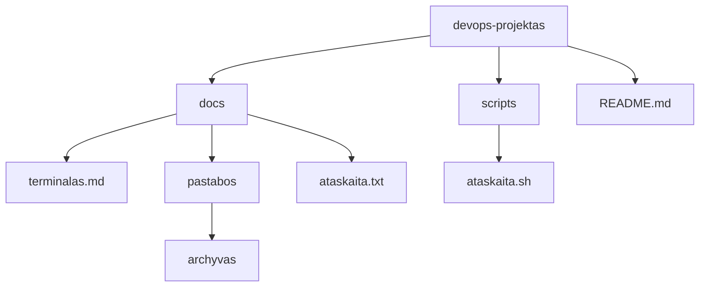
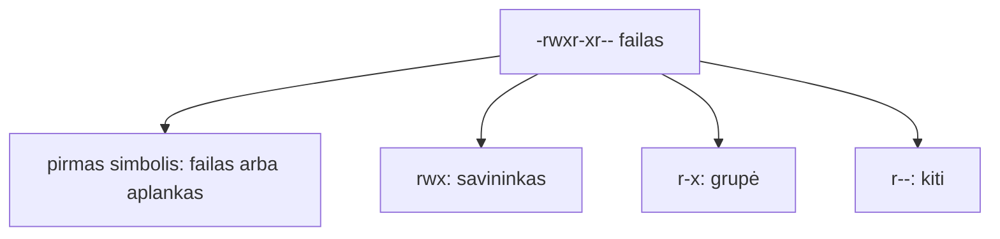

# 02 Linux terminalas

Data: 2026-11-12 (ketvirtadienis)

## Klasės darbas

3 val. Skaidrėse **N** rodo pastabas. Ritmas kiekvienai temai: teorija (skaidrės) → dėstytojas gyvai parodo **kitu pavyzdžiu** (aplankas `demo`, kiti failų vardai) → Teams'e paskelbiama užduotis → jūs darote savo `devops-projektas`. Užduotys sudaro vieną giją: savo projekte užpildote pastabas, jas apdorojate srautais, tada viską automatizuojate skriptu ir pateikiate per Pull Request. Kitą užduotį gaunate tik baigę ankstesnę. Terminalą, `cp`, `mv`, `grep`, `chmod` ir Git jau mokėte (Edgaras): einame greitai. Naujovė: savo projektas iš šablono, srautai, teisių skaitymas, pirmas skriptas ir Pull Request.

1. Pasitikrinimas po 01 (~5 min): kam kas liko neaišku su šaka ir `merge`; dėstytojas parodo 01 sprendimą gyvai (01 `pamoka.md`, skyrius „Pamokos eiga“)
2. Savo projektas (~5 min teorijos ir demonstracijos), tada Užduotis 1 (~10 min): [skaidrės](https://raw.githack.com/dkoncius/Techin-DevOps/main/kursas/02%20Linux%20terminalas/skaidres/skaidres.html), 1–4 skaidrės
   - Kodėl terminalas: serveris neturi pelės, o tekstines komandas galima įrašyti į skriptą ir kartoti
   - Šablonas ir jūsų kopija: **Use this template** (kopija be senos istorijos) ir `git clone` (kopija į kompiuterį)
   - Demonstracija: dėstytojas atlieka „Savo projektas“ su kitu pavyzdžiu (~5 min)
3. Komanda ir navigacija (~10 min teorijos ir demonstracijos), tada Užduotis 2 (~25 min): skaidrės 5–8
   - Komanda, parametrai, argumentai; pagalba: `man KOMANDA` (Mac ir Ubuntu), `KOMANDA --help` (tik Ubuntu / WSL; Mac jo nepalaiko), [GNU Coreutils dokumentacija](https://www.gnu.org/software/coreutils/manual/)
   - Kur esu ir kas čia: `pwd`, `ls -la`, `cd`; Tab užbaigimas ir istorija (rodyklė aukštyn, `Ctrl+R`)
   - Keliai: `/`, `~`, `.`, `..`; absoliutus ir santykinis kelias
   - Failai: `mkdir -p`, `touch`, `cp`, `mv`; kodėl pirma kopijuoti, o ne trinti (`rm -rf` šiame kurse nenaudojame)
   - Demonstracija: dėstytojas atlieka „Navigacija ir failai“ savo `demo-a` (aplankas `demo/vaisiai`, kiti failų vardai) (~8 min)
4. Srautai ir paieška (~10 min teorijos ir demonstracijos), tada Užduotis 3 (~25 min): skaidrės 9–10
   - Peržiūra: `cat`, `head`, `tail`, `wc -l`, `sort`
   - Srautai: `|`, `>`, `>>`; kodėl viena komanda daro vieną darbą, o vamzdis jas jungia
   - Paieška: `grep` (tekstas faile), `find -name` (failas pagal vardą)
   - Demonstracija: dėstytojas atlieka „Srautai ir paieška“ su failu `vaisiai.txt` (~8 min); mokiniai tą patį daro su savo `komandos.txt`
5. Pertrauka (~15 min)
6. Teisės ir pirmas skriptas (~15 min teorijos ir demonstracijos), tada Užduotis 4 (~30 min): skaidrės 11–12
   - Vartotojas, grupė, kiti; `r`, `w`, `x` ir skaičiai (`644`, `755`, `600`)
   - `ls -l` skaitymas; `chmod`
   - Kodėl `.sh` failas negali būti paleistas be `x`; kodėl `.env` ir privatūs raktai neturi būti skaitomi kitų
   - Skripto pradžia: `#!/usr/bin/env bash`
   - Demonstracija: dėstytojas atlieka „Teisės ir pirmas skriptas“ su `labas.sh` (~8 min); mokiniai automatizuoja savo žingsnius skriptu `ataskaita.sh`
7. Pull Request (~5 min demonstracijos), tada Užduotis 5 (~20 min): skaidrės 13–14 (Pull Request, dažnos klaidos)
   - Kodėl darbas eina per šaką ir PR, o ne tiesiai į `main`
   - Demonstracija: dėstytojas atlieka „Pull Request“ savo `demo-a` kopijoje (~5 min)
8. Kita paskaita: Procesai, aplinkos kintamieji, paketų tvarkyklė

Nuorodos: [GitHub: creating a repository from a template](https://docs.github.com/en/repositories/creating-and-managing-repositories/creating-a-repository-from-a-template), [GitHub: about pull requests](https://docs.github.com/en/pull-requests/collaborating-with-pull-requests/proposing-changes-to-your-work-with-pull-requests/about-pull-requests), [GNU Coreutils](https://www.gnu.org/software/coreutils/manual/)

## Kur skiriasi (Mac / Ubuntu)

Pamokos komandos parinktos taip, kad veiktų abiejose sistemose. Šie dalykai skiriasi, todėl kurse jų venkite arba naudokite abi versijas:

| Veiksmas | Mac (Terminalas) | Ubuntu (WSL) |
|---|---|---|
| Spalvotas `ls` | `ls -G` | `ls --color=auto` |
| Failo teisės skaičiumi | `stat -f %Lp failas` | `stat -c %a failas` |
| Atidaryti aplanką programoje | `open .` | `explorer.exe .` |
| Kopijuoti į iškarpinę | `pbcopy` | `clip.exe` |

Kurse naudokite tik tai, kas veikia abiejose: `ls -la`, `ls -l`, `cp`, `mv`, `cat`, `grep`, `find . -name`, `chmod`.

## Schemos

Aplankų medis, nuo kurio dirbsime (jūsų projekte; `docs/` ir `scripts/` sukursite patys):



Teisių skaitymas `ls -l` išvestyje:



## Užduotys

Užduotys yra atskiruose failuose `uzduotys/1-uzduotis.md` … `5-uzduotis.md` (jas dėstytojas skelbia Teams'e po vieną: pirma demonstracija, tada darbas). Jos eina viena gija: savo projekto kopija → navigacija → srautai → skriptas → Pull Request. Komandų užduotyse nėra; dėstytojo sprendimai su komandomis: `uzduotys/N-uzduotis-sprendimas.md`.

## Pamokos eiga (dėstytojui)

Patikrinta (2026-11-12): macOS (bash 3.2): visi `uzduotys/N-uzduotis-sprendimas.md` kodo blokai paleisti iš eilės su tikru šablonu `devops-projektas-starter-template` (klonuotas) ir laikina nuotoline repozitorija vietoj GitHub: šaka, `mkdir -p`, `cp`, `mv`, `sort`, `>`/`>>`, `grep -rn --exclude-dir`, `find`, skriptas su `Permission denied` ir po `chmod +x`, `chmod 600`, 4 commit'ai, push, šakos trynimas. Nepatikrinta: **Use this template**, Pull Request GitHub svetainėje (ir `gh pr`), WSL2 Ubuntu (`/mnt/c`, CRLF); išbandyti ranka prieš pamoką.

### Demonstracijos žingsniai

Laiko juosta (~155 min be pertraukos, rezervas ~25 min). Kiekviena tema: skaidrės → jūsų demonstracija su KITU pavyzdžiu (`demo-a`, `demo/vaisiai`, `vaisiai.txt`, `labas.sh`) → skelbiate užduotį Teams'e → mokiniai daro savo.

| Trukmė | Kas |
|---|---|
| 5 min | 01 sprendimas gyvai |
| 5 + 10 min | Užduotis 1: šablonas ir klonavimas |
| 10 + 25 min | Užduotis 2: navigacija ir failai |
| 10 + 25 min | Užduotis 3: srautai ir paieška |
| 15 min | Pertrauka |
| 15 + 30 min | Užduotis 4: teisės ir skriptas |
| 5 + 20 min | Užduotis 5: Pull Request |

**Kaip naudoti.** Kiekviena dalis žemiau yra tos pačios komandos, kurios rodomos atitinkamoje skaidrėje (pavadinimas nurodytas), ta pačia tvarka. Galite rodyti arba iš skaidrių, arba iš šio failo: jie vienas kitą dubliuoja. Demonstracija vyksta viename terminalo lange, vienas po kito, be papildomo pasiruošimo.

**1. (~5 min) 01 sprendimas.** Parodykite 01 `pamoka.md` skyrių „Pamokos eiga“ ir `uzduotys/N-uzduotis-sprendimas.md`: `devops-dokumentas.md` ir `git log --oneline --graph --all`. Mokiniai lygina su savo `git-bandymas`. Pasakykite: šiandien užduotys eina viena gija (pastabos → srautai → skriptas → PR).

**2. Savo projektas (~5 min demonstracija, tada Užduotis 1 ~10 min).** Skaidrė „Savo projekto klonavimas“. Pirma naršyklėje: šablonas → **Use this template** → `demo-a`, **Public**. `<vartotojas>` pakeiskite savo GitHub vardu.

```bash
cd ~/devops
git clone https://github.com/<vartotojas>/demo-a.git
cd demo-a
```

```bash
git remote -v
ls
```

```bash
git switch -c pamoka-02
git branch
```

Paskelbkite 1 užduotį. Dažna klaida: klonuojamas pats šablonas (`starter-template`); klonuojama į `/mnt/c` (WSL): perkelti į `~/devops`.

**3. Navigacija ir failai (~10 min demonstracija, tada Užduotis 2 ~25 min).** Skaidrės „Komanda, parametrai, argumentai“, „Kur esu ir kas čia“, „Keliai“, „Failai ir aplankai“.

```bash
ls
```

```bash
ls -l
```

```bash
ls -l a.txt
```

```bash
pwd
```

```bash
ls -la
```

```bash
cd ..
```

```bash
cd demo-a
```

```bash
cd ~
cd ~/devops/demo-a
cd ..
cd demo-a
```

```bash
mkdir -p demo/vaisiai
touch demo/vaisiai/obuolys.txt
cp demo/vaisiai/obuolys.txt demo/vaisiai/kriause.txt
mv demo/vaisiai/kriause.txt demo/slyva.txt
ls -R demo
```

Paskelbkite 2 užduotį. Dažna klaida: tarpas aplanko varde be kabučių (`cd Mano aplankas`); `cd` į neegzistuojantį aplanką: `pwd`, `ls`, Tab; `cp` / `mv` be paskirties aplanko arba iš ne to aplanko.

**4. Srautai ir paieška (~10 min demonstracija, tada Užduotis 3 ~25 min).** Skaidrės „Srautai: vamzdis ir nukreipimas“, „Ką parodys failas?“ (leiskite spėlioti prieš paleisdami).

```bash
printf 'obuolys\nanasas\nslyva\nbanana\n' > vaisiai.txt
cat vaisiai.txt
sort vaisiai.txt > rusiuota.txt
echo "slyva" >> vaisiai.txt
cat vaisiai.txt | grep an
```

```bash
echo "a" > lapas.txt
echo "b" >> lapas.txt
echo "c" > lapas.txt
cat lapas.txt
```

Paskelbkite 3 užduotį. Dažna klaida: `>` perrašo failą, o `>>` prideda, mokiniai praranda turinį. `grep -rn` be `--exclude-dir` į rezultatą įtraukia `.git` ir paties rezultato failą.

**5. (~15 min) Pertrauka.**

**6. Teisės ir pirmas skriptas (~15 min demonstracija, tada Užduotis 4 ~30 min).** Skaidrės „Teisės: kas gali ką“ (lentelė pildoma balsu), „Pirmas skriptas“. Skriptas `labas.sh` kitoks nei mokinių `ataskaita.sh`.

```bash
echo '#!/usr/bin/env bash' > labas.sh
echo 'echo "Labas, $(pwd)"' >> labas.sh
./labas.sh
```

```bash
chmod +x labas.sh
ls -l labas.sh
./labas.sh
```

Pirmas paleidimas turi parodyti `Permission denied` (zsh: `zsh: permission denied: ./labas.sh`). Paskelbkite 4 užduotį. Dažna klaida: `bash ataskaita.sh` veikia ir be `x`, o `./scripts/ataskaita.sh` ne. Skriptas paleistas ne projekto šaknyje, `app.py` nerandamas. Windows: CRLF (`bad interpreter`): kurti WSL redaktoriumi arba `.gitattributes` su `*.sh text eol=lf`.

**7. Pull Request (~5 min demonstracija, tada Užduotis 5 ~20 min).** Skaidrė „Pull Request“; Pull Request sujungiamas naršyklėje (**Compare & pull request**, **Files changed**, **Merge pull request**).

```bash
git add .
git commit -m "Demo: pirmas pakeitimas"
git push -u origin pamoka-02
```

```bash
git switch main
git pull
git branch -d pamoka-02
```

Paskelbkite 5 užduotį. Dažna klaida: PR sulietas GitHub'e, bet `main` kompiuteryje neatnaujintas (`git pull`); `git branch -d` atsisako, jei `main` neatnaujintas.

Sprendimai pagal užduotis: `uzduotys/1-uzduotis-sprendimas.md` … `5-uzduotis-sprendimas.md`. Dėstytojas kasdienių užduočių netikrina, tik rodo sprendimą; tikrinimas yra tik atsiskaityme.
