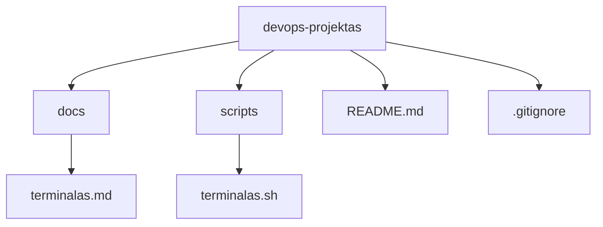
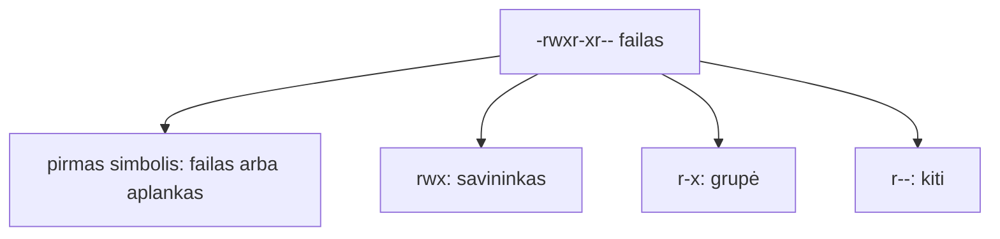

# 02 Linux terminalas

Data: 2026-11-12 (ketvirtadienis)

## Klasės darbas

Pamoka eina per užduotis: dėstytojas trumpai paaiškina temą ir gyvai parodo kitu pavyzdžiu (aplankas `demo`, kiti failų vardai), tada Teams'e paskelbia užduotį. Jūs ją darote savo `devops-projektas`, o baigę gaunate kitą. Užduotys ir komandos yra žemiau, skyriuose „Užduotys“ ir „Komandos“.

1. Pasitikrinimas po 01 paskaitos (~5 min): kam kas liko neaišku su `git-bandymas`, šaka ir `merge`; dėstytojas trumpai parodo 01 sprendimą gyvai
2. Užduotis 1 „Savo projektas“ (~15 min): demonstracija ir darbas: projekto šablonas, savo `devops-projektas` kopija GitHub'e, klonavimas į `~/devops` (`README.md` skyrius „1. Susikurkite savo projektą“)
3. Terminalas ir navigacija (~10 min teorijos ir demonstracijos), tada Užduotis 2:
   1. Kas yra terminalas, apvalkalas (shell) ir Bash; kodėl DevOps darbas vyksta terminale
   2. Komanda, parametrai, argumentai; pagalba: `--help`, `man`, [GNU Coreutils dokumentacija](https://www.gnu.org/software/coreutils/manual/)
   3. Kur esu ir kas čia: `pwd`, `ls`, `ls -l`, `ls -a`; judėjimas: `cd`, `~`, `.`, `..`, absoliutūs ir santykiniai keliai
   4. Tab užbaigimas ir istorija (rodyklė aukštyn, `Ctrl+R`)
4. Failai, aplankai ir srautai (~10 min teorijos ir demonstracijos), tada Užduotis 3:
   1. Kūrimas: `mkdir`, `mkdir -p`, `touch`
   2. Kopijavimas ir perkėlimas: `cp`, `mv` (kodėl kopijuoti saugiau nei trinti)
   3. Turinio peržiūra: `cat`, `less`, `head`, `tail`
   4. Paieška: `grep`, `find` (tik pagal vardą)
   5. Srautai: `|`, `>`, `>>`
   6. Jokių `rm -rf` iš atminties: ką daro trynimas ir kodėl šiame kurse jo vengiame
5. Pertrauka (~15 min)
6. Teisės ir pirmas skriptas (~15 min teorijos ir demonstracijos), tada Užduotis 4:
   1. Vartotojas, grupė, kiti; `r`, `w`, `x` ir skaičiai (`644`, `755`)
   2. `ls -l` skaitymas; `chmod`
   3. Kodėl `.sh` failas negali būti paleistas be `x`
   4. Kodėl `.env` ir privatūs raktai neturi būti skaitomi kitų
   5. Skripto pradžia: `#!/usr/bin/env bash`
7. Python kodo skaitymas ir pirmas Pull Request (~5 min demonstracijos), tada Užduotis 5: trumpa Flask ištrauka su maršrutu `/items` (žr. skyrių „Užduotys“)
8. Kita paskaita: Procesai, aplinkos kintamieji, paketų tvarkyklė

## Kur skiriasi (Mac / Ubuntu)

Pamokos komandos parinktos taip, kad veiktų abiejose sistemose. Šie dalykai skiriasi, todėl kurse jų venkite arba naudokite abi versijas:

| Veiksmas | Mac (Terminalas) | Ubuntu (WSL) |
|---|---|---|
| Spalvotas `ls` | `ls -G` | `ls --color=auto` |
| Failų dydžiai žmonėms | `ls -lh` (veikia abiejose) | `ls -lh` |
| Rūšiavimas pagal dydį | `ls -lS` (veikia abiejose) | `ls -lS` |
| Failo teisės skaičiumi | `stat -f %Lp failas` | `stat -c %a failas` |
| Pakeisti tekstą faile vietoje | `sed -i '' 's/a/b/' f` | `sed -i 's/a/b/' f` (kurse nenaudojame) |
| Atidaryti failą programoje | `open failas` | `xdg-open failas` arba `explorer.exe failas` |
| Kopijuoti į iškarpinę | `pbcopy` | `clip.exe` (WSL) |

Kurse naudokite tik tai, kas veikia abiejose: `ls -la`, `cp`, `mv`, `cat`, `grep`, `find . -name`, `chmod`.

## Schemos

Aplankų medis, nuo kurio dirbsime (jūsų projekte; tikrasis starteris gali skirtis):



Teisių skaitymas `ls -l` išvestyje:



## Užduotys

Jei kas neveikia: perskaitykite klaidą, ieškokite dokumentacijoje arba klauskite LLM, ir užsirašykite, kas padėjo. Nuorodos yra klasės darbe. Komandos yra skyriuje „Komandos“: žiūrėkite tik įstrigę.

Užduotis skelbiu po vieną (Teams). Pirmiausia parodau gyvai kitu pavyzdžiu, tada darote savo `devops-projektas` ir tik baigę gaunate kitą.

### 1️⃣ Savo projektas

1. **Tikslas:** Pasidaryti savo projekto kopiją iš šablono ir nusiklonuoti į kompiuterį.
2. GitHub'e iš šablono [`devops-projektas-starter-template`](https://github.com/dkoncius/devops-projektas-starter-template) sukurkite savo **Public** repozitoriją `devops-projektas` (žingsniai: `README.md` skyrius „1. Susikurkite savo projektą“).
3. Terminale eikite į `~/devops` ir nusiklonuokite **savo** repozitoriją (ne šablono).
4. Patikrinkite, kad nuotolinė nuoroda rodo jūsų vardą ir `devops-projektas`, ne `starter-template`.

### 2️⃣ Navigacija ir šaka

1. **Tikslas:** Apžiūrėti projektą terminale ir pradėti darbą atskiroje šakoje.
2. Eikite į `~/devops/devops-projektas` ir pasižiūrėkite, kur esate ir kas čia yra, įskaitant paslėptus failus.
3. Pereikite į `docs` (jei aplanko nėra, į kitą aplanką) ir grįžkite į projekto šaknį dviem būdais: santykiniu ir absoliučiu keliu.
4. Sukurkite šaką `pamoka-02` iš atnaujinto `main`.

### 3️⃣ Failai ir srautai

1. **Tikslas:** Išmokti kurti, kopijuoti, perkelti failus ir aplankus, peržiūrėti turinį ir ieškoti. Darbas vykdomas terminale.
2. Savo `~/devops` aplanke sukurkite aplanką `bandymas`.
3. Aplanke `bandymas` sukurkite failus: `f1.txt`, `f2.txt`, `f3.txt`, `ff1.txt`, `ff2.txt`.
4. Pažiūrėkite aplanko `bandymas` turinį.
5. Savo `~/devops` aplanke sukurkite aplanką `tikslas`.
6. Nukopijuokite failus `f1.txt`, `f3.txt` ir `ff2.txt` iš `bandymas` į `tikslas`.
7. Pažiūrėkite aplanko `tikslas` turinį.
8. Pervadinkite failą `f1.txt` aplanke `tikslas` į `file1.txt` ir perkelkite jį į `bandymas`.
9. Į failą `bandymas/sorting.txt` įrašykite eilutes: `apples`, `oranges`, `pears`, `kiwis`, `bananas` (po vieną eilutėje).
10. Išveskite `sorting.txt` turinį į ekraną ir tada surūšiuotą pagal abėcėlę.
11. Pridėkite į `sorting.txt` dar vieną eilutę nepersirašydami senų ir suskaičiuokite eilutes faile.
12. Išveskite pirmas 2 ir paskutines 2 `sorting.txt` eilutes.
13. Raskite, kur failų sistemoje (jūsų `~/devops` aplanke) yra failas `ff2.txt`.
14. Grįžkite į `devops-projektas`, sukurkite (jei reikia) aplanką `docs/` ir faile `docs/terminalas.md` su pirma eilute „# Terminalas“.
15. Suraskite terminalo komandą, kuri į failą `docs/failai.txt` išrašo visų `.md` failų sąrašą projekte (pagal oficialią dokumentaciją; žingsnių čia nėra, tik tikslas). Komandą užrašykite `docs/terminalas.md`.
16. Suraskite, kurioje projekto failo eilutėje yra žodis `health` (arba kitas pasirinktas) ir komandą taip pat užrašykite `docs/terminalas.md`.

### 4️⃣ Teisės ir pirmas skriptas

1. **Tikslas:** Parašyti pirmą Bash skriptą, padaryti jį vykdomą ir paaiškinti teises.
2. Sukurkite aplanką `scripts/` (jei jo nėra) ir faile `scripts/terminalas.sh` parašykite skriptą, kuris išveda aplanką, kuriame paleistas, failų ir aplankų skaičių jame ir kelias paskutines Git commit žinutes.
3. Pabandykite paleisti jį iš projekto šaknies. Kas atsitiko ir kodėl? Atsakymą užrašykite `docs/terminalas.md`.
4. Padarykite skriptą vykdomą ir paleiskite.
5. Faile `docs/terminalas.md` paaiškinkite, ką reiškia `-rwxr-xr-x` jūsų skripto eilutėje `ls -l` išvestyje (savininkas, grupė, kiti).
6. Padarykite du commit'us: `scripts/terminalas.sh` atskirai nuo `docs/`.
7. **Papildomai:** išbandykite `man ls` ir suraskite, kaip surikiuoti failus pagal dydį; arba nuimkite skriptui vykdymo teisę ir paaiškinkite, kodėl jis nebeveikia.

### 5️⃣ `/items` ir Pull Request

1. **Tikslas:** Perskaityti Python kodą ir pirmą kartą pateikti darbą per Pull Request.
2. Faile `docs/terminalas.md` paaiškinkite, ką daro šis kodas (kuris adresas, koks HTTP metodas, ką grąžina) (suderinti su starteriu, kai jis bus), ir padarykite commit:

   ```python
   ITEMS = [{"id": 1, "name": "pirmas"}]


   @app.route("/items", methods=["GET"])
   def list_items():
       return {"items": ITEMS}
   ```

3. Patikrinkite, kad nėra slaptažodžių, raktų, tokenų ar `.env` turinio.
4. Nusiųskite šaką į GitHub ir atidarykite Pull Request į `main`.
5. Sulieskite Pull Request GitHub'e ir kompiuteryje atnaujinkite `main`.

## Komandos

## 1️⃣ Savo projektas

3. `cd ~/devops`, tada `git clone https://github.com/<JŪSŲ-VARDAS>/devops-projektas.git` ir `cd devops-projektas`
4. `git remote -v`

## 2️⃣ Navigacija ir šaka

2. `cd ~/devops/devops-projektas`, `pwd`, `ls -la`
3. `cd docs`, `cd ..` (santykinis); `cd ~/devops/devops-projektas` (absoliutus)
4. `git switch main`, `git pull`, `git switch -c pamoka-02`, `git branch`

## 3️⃣ Failai ir srautai

2. `mkdir ~/devops/bandymas`
3. `cd ~/devops/bandymas`, `touch f1.txt f2.txt f3.txt ff1.txt ff2.txt`
4. `ls`
5. `mkdir ~/devops/tikslas`
6. `cp f1.txt f3.txt ff2.txt ~/devops/tikslas`
7. `ls ~/devops/tikslas`
8. `mv ~/devops/tikslas/f1.txt ~/devops/tikslas/file1.txt`, tada `mv ~/devops/tikslas/file1.txt .`
9. `echo "apples" > sorting.txt`, toliau `echo "oranges" >> sorting.txt` ir t. t. (`>` perrašo, `>>` prideda)
10. `cat sorting.txt`, `sort sorting.txt`
11. `echo "grapes" >> sorting.txt`, `wc -l sorting.txt`
12. `head -n 2 sorting.txt`, `tail -n 2 sorting.txt`
13. `find ~/devops -name ff2.txt`
14. `cd ~/devops/devops-projektas`, `mkdir -p docs`, `echo "# Terminalas" > docs/terminalas.md`
15. `find` su `-name`, rezultatas į failą su `>`; `man find` arba `find --help`
16. `grep -rn "health" .`

## 4️⃣ Teisės ir pirmas skriptas

2. `mkdir -p scripts`; skripto pirma eilutė `#!/usr/bin/env bash`; naudingos: `pwd`, `ls | wc -l`, `git log --oneline -n 3`
3. `./scripts/terminalas.sh`
4. `ls -l scripts/terminalas.sh`, `chmod +x scripts/terminalas.sh`, `./scripts/terminalas.sh`
6. `git add scripts/terminalas.sh`, `git commit -m "..."`, tada `git add docs`, `git commit -m "..."`; `git log --oneline`
7. `man ls`; `chmod 644 scripts/terminalas.sh`

## 5️⃣ `/items` ir Pull Request

4. `git push -u origin pamoka-02`, tada GitHub'e **Compare & pull request**
5. Sulieti GitHub'e, tada `git switch main`, `git pull`

## Sprendimas (dėstytojui)

Patikrinta: `scripts/terminalas.sh` paleistas macOS (bash) fiktyviame Git repo. Nepatikrinta: Ubuntu (WSL2), prieš pamoką išbandyti abiejose sistemose.

### Kaip rodyti klasėje

Pamoka eina per 5 užduotis, skelbiamas Teams'e po vieną: trumpa teorija, jūsų demonstracija (kitas pavyzdys: `/tmp/demo` su kitais failų vardais), mokiniai daro savo `devops-projektas`, baigę gauna kitą. Laiko juosta (~157 min. be pertraukos; rezervas ~8 min.):

| Trukmė | Kas |
|---|---|
| 5 min | Praeitos pamokos (01) sprendimas gyvai |
| 5 + 15 min | Užduotis 1: šablonas ir klonavimas (demonstracija + darbas) |
| 10 + 10 min | Terminalas, navigacija, Užduotis 2 |
| 10 + 25 min | Failai ir srautai, Užduotis 3 |
| 15 min | Pertrauka |
| 15 + 30 min | Teisės ir skriptas, Užduotis 4 |
| 5 + 30 min | `/items` skaitymas, Užduotis 5 (PR) |

1. (~5 min) Praeitos pamokos (01) sprendimas gyvai: parodykite 01 pamokos sprendimą (skyrius „Sprendimas“): `devops-dokumentas.md` bei `git log --oneline --graph --all` pavyzdyje. Mokiniai lygina su savo `git-bandymas`.
2. Užduotis 1 (~5 min demonstracija, ~15 min darbas): **Use this template** → savo `devops-projektas` (Public) → klonavimas į `~/devops` → `git remote -v`. Dažna klaida: klonuojamas pats šablonas arba `devops-kursas`; arba klonuojama į `/mnt/c`. Žingsniai ir klaidų lentelė: `README.md` skyrius „1. Susikurkite savo projektą“.
3. Navigacija (~10 min) ir Užduotis 2 (~10 min): `pwd`, `ls -la`, `cd`, `..`, šaka `pamoka-02`. Komandos veikia ir Mac, ir Ubuntu; skirtumai lentelėje „Kur skiriasi“ `pamoka.md`. Dažna klaida: tarpas aplanko varde be kabučių (`cd Mano aplankas`). Windows: studentas WSL terminale pateko į `/mnt/c/...`, o ne į `~/`; šaka kuriama iš neatnaujinto `main`.
4. Failai ir srautai (~10 min) ir Užduotis 3 (~25 min): `mkdir -p`, `touch`, `cp`, `mv`, `cat`, `grep`, `>` ir `>>`, `find` į failą. Dažna klaida: `>` perrašo failą, o `>>` prideda; mokiniai praranda turinį.
5. (~15 min) Pertrauka.
6. Teisės ir skriptas (~15 min) ir Užduotis 4 (~30 min): `ls -l`, `chmod +x`, `#!/usr/bin/env bash`, `set -euo pipefail`. Sukurkite `labas.sh` (kitas nei mokinių `terminalas.sh`), paleiskite be `x` (`Permission denied`), pridėkite `x`. Dažna klaida: `bash labas.sh` veikia ir be `x`, mokiniai nesupranta skirtumo. Dažna klaida: skriptas paleistas ne Git repo aplanke ir `git log` rodo klaidą. Dažna klaida (Windows): failas sukurtas Windows redaktoriumi turi CRLF ir meta `bad interpreter`; sprendimas: kurti WSL redaktoriumi arba `.gitattributes` su `*.sh text eol=lf`.
7. `/items` skaitymas (~5 min) ir Užduotis 5 (~30 min): GET, JSON, 200; tada `git push -u origin pamoka-02`, PR, sulieti, `git pull`. Dažna klaida: mokinys šaką sulieja, bet `main` kompiuteryje neatnaujina (`git pull`).

### Sprendimas pagal darbus

| Darbas | Kur sprendime |
|---|---|
| Savo `devops-projektas` ir klonavimas (Užduotis 1) | `git remote -v` rodo mokinio vardą |
| Aplanko apžiūra terminale | `ls -la` rodo `.git`, `README.md` ir kt. |
| Šaka `pamoka-02` | `git branch` rodo `pamoka-02` |
| `cp`, `mv`, `>>`, `grep` (Užduotis 3) | `docs/terminalas.md`, skyrius „Failai ir srautai“ |
| Skriptas `terminalas.sh` | `scripts/terminalas.sh` |
| Paleidimas be `x` ir po `chmod +x` | `docs/terminalas.md`, skyrius „Teisės“ |
| Vykdoma teisė ir paleidimas | `ls -l` rodo `x`; `./scripts/terminalas.sh` išveda 3 eilutes |
| Teisių paaiškinimas | `docs/terminalas.md`, skyrius „Teisės“ |
| Failų sąrašas į `docs/failai.txt` (Užduotis 3) | `docs/terminalas.md`, skyrius „Failų sąrašas“ |
| `/items` skaitymas | `docs/terminalas.md`, skyrius `/items` |
| ≥ 2 commit'ai ir sulietas PR | `git log --oneline` ir GitHub **Merged** |

Dėstytojas kasdienių užduočių netikrina, tik rodo sprendimą; tikrinimas yra tik atsiskaitymuose (vertinimas.md).

### Pavyzdiniai failai

#### `docs/terminalas.md`

````markdown
# Terminalas

## Failai ir srautai

Kopija ir perkėlimas: `cp docs/terminalas.md docs/terminalas.bak`, tada `mv docs/terminalas.bak docs/atsargine.md`. Eilutės pridėjimas: `echo "Antra eilutė" >> docs/terminalas.md` (`>` perrašytų failą). Žodžio paieška: `grep -rn "health" .` (`-r` ieško aplankuose, `-n` rodo eilutės numerį).

## Teisės

Pirmas paleidimas be `x`: `./scripts/terminalas.sh` rašo „Permission denied“, nes failas dar nėra vykdomas; po `chmod +x scripts/terminalas.sh` veikia.


`-rwxr-xr-x` reiškia: pirmas simbolis `-` yra paprastas failas; `rwx` savininkas gali skaityti, rašyti ir vykdyti; `r-x` grupė gali skaityti ir vykdyti; `r-x` kiti taip pat. Be `x` skriptas nebūtų paleidžiamas kaip `./scripts/terminalas.sh` (rašytų „Permission denied“).

## Failų sąrašas

Komanda: `find . -name "*.md" -not -path "./.git/*" > docs/failai.txt`

## /items

Kodas atsako į `GET` užklausą adresu `/items` ir grąžina JSON su sąrašu `ITEMS` (pvz. `{"items": [{"id": 1, "name": "pirmas"}]}`), o HTTP kodas bus 200, nes nenurodytas kitas.
````

#### `scripts/terminalas.sh`

````bash
#!/usr/bin/env bash
# terminalas.sh – parodo, kur esame, kiek čia failų ir paskutinius commit'us.
# Naudojimas: ./scripts/terminalas.sh
set -euo pipefail

echo "Aplankas: $(pwd)"
echo "Failų ir aplankų čia: $(ls | wc -l | tr -d ' ')"
echo "Paskutiniai commit'ai:"
git log --oneline -n 3
````
