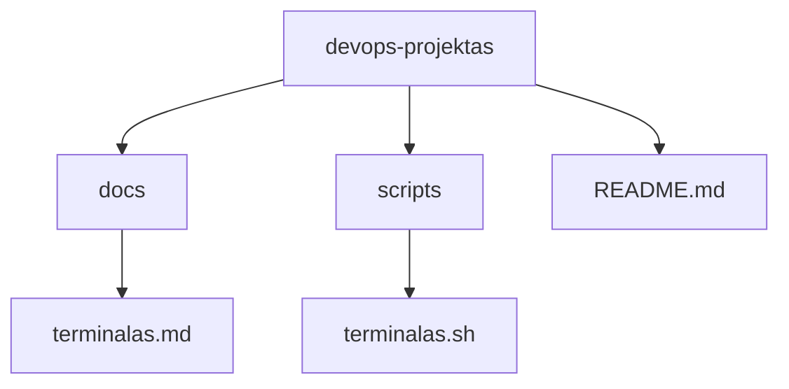
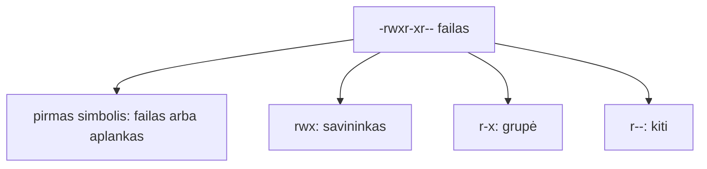

# 02 Linux terminalas

Data: 2026-11-12 (ketvirtadienis)

## Klasės darbas

3 val. Skaidrėse **N** rodo pastabas. Ritmas kiekvienai temai: teorija (skaidrės) → dėstytojas gyvai parodo **kitu pavyzdžiu** (aplankas `demo`, kiti failų vardai) → Teams'e paskelbiama užduotis → jūs darote savo `devops-projektas`. Kitą užduotį gaunate tik baigę ankstesnę. Terminalą, `cp`, `mv`, `grep`, `chmod` ir Git jau mokėte (Edgaras): einame greitai. Naujovė: savo projektas iš šablono, srautai, teisių skaitymas, pirmas skriptas ir Pull Request.

1. Pasitikrinimas po 01 (~5 min): kam kas liko neaišku su šaka ir `merge`; dėstytojas parodo 01 sprendimą gyvai (01 `pamoka.md`, skyrius „Sprendimas“)
2. Savo projektas (~5 min teorijos ir demonstracijos), tada Užduotis 1 (~10 min): [skaidrės](https://raw.githack.com/dkoncius/Techin-DevOps/main/kursas/02%20Linux%20terminalas/skaidres/skaidres.html), 1–4 skaidrės
   1. Kodėl terminalas: serveris neturi pelės, o tekstines komandas galima įrašyti į skriptą ir kartoti
   2. Šablonas ir jūsų kopija: **Use this template** (kopija be senos istorijos) ir `git clone` (kopija į kompiuterį)
   3. Demonstracija: dėstytojas atlieka „Savo projektas“ su kitu pavyzdžiu (~5 min)
3. Komanda ir navigacija (~10 min teorijos ir demonstracijos), tada Užduotis 2 (~25 min): skaidrės 5–8
   1. Komanda, parametrai, argumentai; pagalba: `--help`, `man`, [GNU Coreutils dokumentacija](https://www.gnu.org/software/coreutils/manual/)
   2. Kur esu ir kas čia: `pwd`, `ls -la`, `cd`; Tab užbaigimas ir istorija (rodyklė aukštyn, `Ctrl+R`)
   3. Keliai: `/`, `~`, `.`, `..`; absoliutus ir santykinis kelias
   4. Failai: `mkdir -p`, `touch`, `cp`, `mv`; kodėl pirma kopijuoti, o ne trinti (`rm -rf` šiame kurse nenaudojame)
   5. Demonstracija: dėstytojas atlieka „Navigacija ir failai“ aplanke `demo` (~8 min)
4. Srautai ir paieška (~10 min teorijos ir demonstracijos), tada Užduotis 3 (~25 min): skaidrės 9–10
   1. Peržiūra: `cat`, `head`, `tail`, `wc -l`, `sort`
   2. Srautai: `|`, `>`, `>>`; kodėl viena komanda daro vieną darbą, o vamzdis jas jungia
   3. Paieška: `grep` (tekstas faile), `find -name` (failas pagal vardą)
   4. Demonstracija: dėstytojas atlieka „Srautai ir paieška“ su failu `vaisiai.txt` (~8 min)
5. Pertrauka (~15 min)
6. Teisės ir pirmas skriptas (~15 min teorijos ir demonstracijos), tada Užduotis 4 (~30 min): skaidrės 11–12
   1. Vartotojas, grupė, kiti; `r`, `w`, `x` ir skaičiai (`644`, `755`, `600`)
   2. `ls -l` skaitymas; `chmod`
   3. Kodėl `.sh` failas negali būti paleistas be `x`; kodėl `.env` ir privatūs raktai neturi būti skaitomi kitų
   4. Skripto pradžia: `#!/usr/bin/env bash`
   5. Demonstracija: dėstytojas atlieka „Teisės ir pirmas skriptas“ su `labas.sh` (~8 min)
7. Pull Request (~5 min demonstracijos), tada Užduotis 5 (~20 min): skaidrė 13 (dažnos klaidos)
   1. Kodėl darbas eina per šaką ir PR, o ne tiesiai į `main`
   2. Demonstracija: dėstytojas atlieka „Pull Request“ savo `demo-projektas` kopijoje (~5 min)
8. Kita paskaita: Procesai, aplinkos kintamieji, paketų tvarkyklė

Nuorodos: [GitHub: creating a repository from a template](https://docs.github.com/en/repositories/creating-and-managing-repositories/creating-a-repository-from-a-template), [GitHub: about pull requests](https://docs.github.com/en/pull-requests/collaborating-with-pull-requests/proposing-changes-to-your-work-with-pull-requests/about-pull-requests), [GNU Coreutils](https://www.gnu.org/software/coreutils/manual/)

## Kur skiriasi (Mac / Ubuntu)

Pamokos komandos parinktos taip, kad veiktų abiejose sistemose. Šie dalykai skiriasi, todėl kurse jų venkite arba naudokite abi versijas:

| Veiksmas | Mac (Terminalas) | Ubuntu (WSL) |
|---|---|---|
| Spalvotas `ls` | `ls -G` | `ls --color=auto` |
| Failo teisės skaičiumi | `stat -f %Lp failas` | `stat -c %a failas` |
| Atidaryti aplanką programoje | `open .` | `explorer.exe .` |
| Kopijuoti į iškarpinę | `pbcopy` | `clip.exe` |

Kurse naudokite tik tai, kas veikia abiejose: `ls -la`, `ls -l`, `cp`, `mv`, `cat`, `grep`, `find . -name`, `chmod`.

## Schemos

Aplankų medis, nuo kurio dirbsime (jūsų projekte; `docs/` ir `scripts/` sukursite patys):



Teisių skaitymas `ls -l` išvestyje:



## Užduotys

Jei kas neveikia: perskaitykite klaidą, ieškokite dokumentacijoje ir užsirašykite, kas padėjo (1 etape dirbtinio intelekto užduotyse nenaudojame; DI leidžiamas nuo Docker etapo). Nuorodos yra klasės darbe. Komandos yra skyriuje „Komandos“: žiūrėkite tik įstrigę.

Užduotis skelbiu po vieną (Teams). Pirmiausia parodau gyvai kitu pavyzdžiu, tada darote savo kompiuteryje ir tik baigę gaunate kitą. Atsakymus į „Kodėl“ rašote faile `docs/terminalas.md` savo projekte.

### 1️⃣ Savo projektas

1. **Tikslas:** Pasidaryti savo projekto kopiją iš šablono, nusiklonuoti ir pradėti darbą atskiroje šakoje.
2. Naršyklėje atidarykite šabloną [`devops-projektas-starter-template`](https://github.com/dkoncius/devops-projektas-starter-template).
3. Iš šablono sukurkite savo **Public** repozitoriją `devops-projektas` (mygtukas **Use this template**).
4. Terminale eikite į aplanką `~/devops`.
5. Nusiklonuokite **savo** repozitoriją `devops-projektas` (ne šablono).
6. Pereikite į aplanką `devops-projektas`.
7. Patikrinkite, kad nuotolinė nuoroda rodo jūsų vardą ir `devops-projektas`, o ne `starter-template`.
8. Sukurkite šaką `pamoka-02` ir persijunkite į ją.
9. Sukurkite aplanką `docs` ir faile `docs/terminalas.md` parašykite antraštę „# Terminalas“ ir skyrių „## Projektas“.
10. **Kodėl:** skyriuje „Projektas“ vienu sakiniu užrašykite, kodėl dirbame savo kopijoje, o ne tiesiai šablone.

### 2️⃣ Navigacija ir failai

1. **Tikslas:** Judėti po aplankus ir kurti, kopijuoti bei perkelti failus.
2. Eikite į `~/devops/devops-projektas` ir pažiūrėkite, kur esate ir kas čia yra, įskaitant paslėptus failus.
3. Pereikite į aplanką `static`.
4. Grįžkite į projekto šaknį santykiniu keliu.
5. Pereikite į `~/devops` absoliučiu keliu.
6. Aplanke `~/devops` sukurkite aplanką `bandymas`.
7. Aplanke `~/devops` sukurkite aplanką `tikslas`.
8. Aplanke `bandymas` sukurkite failus: `f1.txt`, `f2.txt`, `f3.txt`, `ff1.txt`, `ff2.txt`.
9. Pažiūrėkite aplanko `bandymas` turinį.
10. Nukopijuokite `f1.txt`, `f3.txt` ir `ff2.txt` iš `bandymas` į `tikslas`.
11. Pažiūrėkite aplanko `tikslas` turinį.
12. Pervadinkite `f1.txt` aplanke `tikslas` į `file1.txt` ir perkelkite jį į `bandymas`.
13. Viena komanda sukurkite aplanke `bandymas` aplankų grandinę `a/b/c`.
14. **Kodėl:** faile `docs/terminalas.md` pridėkite skyrių „## Failai“ ir vienu sakiniu užrašykite, kodėl šiame kurse pirma kopijuojame, o ne trinam.
15. **Papildomai:** pagal `man ls` suraskite, kaip surūšiuoti failus pagal dydį, ir išbandykite aplanke `static`.

### 3️⃣ Srautai ir paieška

1. **Tikslas:** Peržiūrėti failus, sujungti komandas per srautus ir rasti failą bei tekstą.
2. Aplanke `bandymas` į failą `sorting.txt` įrašykite eilutes po vieną: `apples`, `oranges`, `pears`, `kiwis`, `bananas`.
3. Išveskite `sorting.txt` turinį į ekraną, o tada surūšiuotą pagal abėcėlę.
4. Surūšiuotą turinį įrašykite į naują failą `sorting-rusiuota.txt`.
5. Į `sorting.txt` pridėkite eilutę `grapes` nepersirašydami senų.
6. Suskaičiuokite `sorting.txt` eilutes.
7. Išveskite pirmas 2 ir paskutines 2 `sorting.txt` eilutes.
8. Viena komanda su vamzdžiu (`|`) išveskite tik tas `sorting.txt` eilutes, kuriose yra `an`.
9. Raskite, kur `~/devops` yra failas `ff2.txt`.
10. Projekto šaknyje suraskite, kuriuose failuose ir kuriose eilutėse yra žodis `health`.
11. Suraskite komandą, kuri į failą `docs/failai.txt` įrašo visų `.md` failų sąrašą projekte, be `.git` aplanko (pagal oficialią dokumentaciją; žingsnių čia nėra, tik tikslas).
12. **Kodėl:** faile `docs/terminalas.md` pridėkite skyrių „## Srautai“, užrašykite komandą iš 11 žingsnio ir vienu sakiniu, kuo `>` skiriasi nuo `>>` ir ką prarastumėte per klaidą pasirinkę `>`.

### 4️⃣ Teisės ir pirmas skriptas

1. **Tikslas:** Parašyti pirmą Bash skriptą, padaryti jį vykdomą ir paaiškinti teises.
2. Projekte sukurkite aplanką `scripts` ir faile `scripts/terminalas.sh` parašykite skriptą, kuris išveda aplanką, kuriame paleistas, failų ir aplankų skaičių jame ir 3 paskutinius Git commit'us.
3. Paleiskite skriptą iš projekto šaknies kaip programą.
4. Faile `docs/terminalas.md` pridėkite skyrių „## Teisės“ ir užrašykite, kas atsitiko 3 žingsnyje ir kodėl.
5. Padarykite skriptą vykdomą ir paleiskite iš naujo.
6. Pažiūrėkite skripto teises ilguoju sąrašu ir skyriuje „Teisės“ paaiškinkite, ką reiškia `-rwxr-xr-x` (savininkas, grupė, kiti).
7. Aplanke `bandymas` sukurkite failą `slaptas.txt` ir nustatykite teises taip, kad jį galėtų skaityti ir keisti tik savininkas. Patikrinkite ilguoju sąrašu.
8. **Kodėl:** skyriuje „Teisės“ vienu sakiniu užrašykite, kodėl `.env` ir privatūs raktai neturi būti skaitomi kitų.
9. Padarykite du commit'us: pirmas tik `scripts/terminalas.sh` (žinutė „Pridėtas terminalas.sh“), antras visas `docs` aplankas (žinutė „Pridėtas terminalas.md“).
10. **Papildomai:** nuimkite skriptui vykdymo teisę, paleiskite per `bash` ir paaiškinkite, kodėl jis vis tiek veikia; tada grąžinkite teisę.

### 5️⃣ Pull Request

1. **Tikslas:** Pateikti pakeitimus per Pull Request ir sujungti juos į `main`.
2. Patikrinkite, kad `docs` ir `scripts` nėra slaptažodžių, raktų, tokenų ar `.env` turinio.
3. Nusiųskite šaką `pamoka-02` į GitHub.
4. GitHub'e atidarykite Pull Request iš `pamoka-02` į `main` pavadinimu „Terminalas“.
5. Pull Request aprašyme (Description) vienu sakiniu parašykite, ką pakeitėte ir kodėl.
6. Sulieskite Pull Request GitHub'e.
7. Kompiuteryje persijunkite į `main` ir atnaujinkite jį iš GitHub.
8. Patikrinkite, kad `main` yra `scripts/terminalas.sh` ir `docs/terminalas.md`, o commit istorijoje matyti abu commit'ai.
9. Ištrinkite šaką `pamoka-02` kompiuteryje ir GitHub'e.

## Komandos

Žiūrėkite tik įstrigę. Numeriai atitinka užduoties žingsnius.

## 1️⃣ Savo projektas

4. `cd ~/devops`
5. `git clone https://github.com/<JŪSŲ-VARDAS>/devops-projektas.git`
6. `cd devops-projektas`
7. `git remote -v`
8. `git switch -c pamoka-02`
9. `mkdir docs`, tada redaktoriumi arba `echo "# Terminalas" > docs/terminalas.md` ir `echo "" >> docs/terminalas.md`, `echo "## Projektas" >> docs/terminalas.md`

## 2️⃣ Navigacija ir failai

2. `cd ~/devops/devops-projektas`, `pwd`, `ls -la`
3. `cd static`
4. `cd ..`
5. `cd ~/devops`
6–7. `mkdir bandymas`, `mkdir tikslas`
8. `cd bandymas`, `touch f1.txt f2.txt f3.txt ff1.txt ff2.txt`
9. `ls`
10. `cp f1.txt f3.txt ff2.txt ../tikslas`
11. `ls ../tikslas`
12. `mv ../tikslas/f1.txt ../tikslas/file1.txt`, tada `mv ../tikslas/file1.txt .`
13. `mkdir -p a/b/c`
15. `man ls` (išeiti `q`); `ls -lS static`

## 3️⃣ Srautai ir paieška

2. `echo "apples" > sorting.txt`, toliau `echo "oranges" >> sorting.txt` ir t. t.
3. `cat sorting.txt`, `sort sorting.txt`
4. `sort sorting.txt > sorting-rusiuota.txt`
5. `echo "grapes" >> sorting.txt`
6. `wc -l sorting.txt`
7. `head -n 2 sorting.txt`, `tail -n 2 sorting.txt`
8. `cat sorting.txt | grep an`
9. `find ~/devops -name ff2.txt`
10. `cd ~/devops/devops-projektas`, `grep -rn "health" .`
11. `find .` su `-name`, rezultatas `>` į failą; `man find`. Kad nepatektų `.git`: `-not -path "./.git/*"`
12. `docs/terminalas.md` redaguokite redaktoriumi arba `>>`

## 4️⃣ Teisės ir pirmas skriptas

2. `mkdir scripts`; pirma eilutė `#!/usr/bin/env bash`; naudingos: `pwd`, `ls | wc -l`, `git log --oneline -n 3`
3. `./scripts/terminalas.sh`
5. `chmod +x scripts/terminalas.sh`, `./scripts/terminalas.sh`
6. `ls -l scripts/terminalas.sh`
7. `touch ~/devops/bandymas/slaptas.txt`, `chmod 600 ~/devops/bandymas/slaptas.txt`, `ls -l ~/devops/bandymas/slaptas.txt`
9. `git add scripts/terminalas.sh`, `git commit -m "Pridėtas terminalas.sh"`, tada `git add docs`, `git commit -m "Pridėtas terminalas.md"`; `git log --oneline`
10. `chmod -x scripts/terminalas.sh`, `bash scripts/terminalas.sh`, `chmod +x scripts/terminalas.sh`

## 5️⃣ Pull Request

3. `git push -u origin pamoka-02`
4–6. GitHub'e **Compare & pull request**, pavadinimas, aprašymas, **Merge pull request**
7. `git switch main`, `git pull`
8. `ls docs scripts`, `git log --oneline`
9. `git branch -d pamoka-02`, `git push origin --delete pamoka-02` (arba GitHub'e mygtukas **Delete branch** po sujungimo)

## Sprendimas (dėstytojui)

Patikrinta: macOS (bash 3.2) su laikina nuotoline repozitorija vietoj GitHub: klonavimas, šaka, `mkdir -p`, `cp`, `mv`, `sort`, `>`/`>>`, `grep`, `find`, `chmod`, skriptas (`Permission denied` ir po `chmod +x`), du commit'ai, sujungimas, šakos trynimas. Nepatikrinta: **Use this template**, Pull Request GitHub svetainėje, `gh`, WSL2 Ubuntu (`/mnt/c`, CRLF); išbandyti ranka prieš pamoką.

### Kaip rodyti klasėje

Laiko juosta (~155 min be pertraukos, rezervas ~25 min):

| Trukmė | Kas |
|---|---|
| 5 min | 01 sprendimas gyvai |
| 5 + 10 min | Užduotis 1: šablonas ir klonavimas |
| 10 + 25 min | Navigacija ir failai (demonstracija + Užduotis 2) |
| 10 + 25 min | Srautai ir paieška (demonstracija + Užduotis 3) |
| 15 min | Pertrauka |
| 15 + 30 min | Teisės ir skriptas (demonstracija + Užduotis 4) |
| 5 + 20 min | Pull Request (demonstracija + Užduotis 5) |

1. (~5 min) 01 sprendimas: parodykite 01 `pamoka.md` skyrių „Sprendimas“: `devops-dokumentas.md` ir `git log --oneline --graph --all`. Mokiniai lygina su savo `git-bandymas`.
2. Užduotis 1 (~5 min demonstracija, ~10 min darbas): sava demo kopija `demo-projektas` (kitas pavadinimas nei `devops-projektas`): **Use this template** → `git clone` → `git remote -v`. Dažna klaida: klonuojamas pats šablonas (`starter-template`) vietoje savo kopijos; klonuojama į `/mnt/c` (WSL): perkelti į `~/devops`.
3. Navigacija ir failai (~10 min demonstracija, ~25 min Užduotis 2): aplanke `~/devops/demo` sukurkite `apelsinai.txt`, `obuoliai.txt`, `cp`, `mv`, `mkdir -p x/y/z`, `cd ..`, `cd ~`. Dažna klaida: tarpas aplanko varde be kabučių (`cd Mano aplankas`); `cd` į neegzistuojantį aplanką: patikrinti `pwd` ir `ls`, naudoti Tab.
4. Srautai ir paieška (~10 min demonstracija, ~25 min Užduotis 3): `vaisiai.txt` su 5 vaisiais: `sort`, `sort > rusiuota.txt`, `>>`, `wc -l`, `grep`, `find`. Dažna klaida: `>` perrašo failą, o `>>` prideda; mokiniai praranda turinį. `find` randa du `ff2.txt` (`bandymas` ir `tikslas`): tai teisingai.
5. (~15 min) Pertrauka.
6. Teisės ir skriptas (~15 min demonstracija, ~30 min Užduotis 4): sukurkite `labas.sh` (kitas nei mokinių `terminalas.sh`), paleiskite be `x` (`Permission denied`), `ls -l`, `chmod +x`, paleiskite. Parodykite `ls -l run.sh` projekte: jis jau `-rwxr-xr-x`. Dažna klaida: `bash labas.sh` veikia ir be `x`, o `./labas.sh` ne; mokiniai nesupranta skirtumo. Dažna klaida: skriptas paleistas ne Git aplanke, `git log` meta klaidą. Dažna klaida (Windows): CRLF (`bad interpreter`); kurti WSL redaktoriumi arba `.gitattributes` su `*.sh text eol=lf`.
7. Pull Request (~5 min demonstracija, ~20 min Užduotis 5): `demo-projektas`: `push -u origin`, **Compare & pull request**, **Merge**, `git switch main`, `git pull`. Dažna klaida: PR sulietas GitHub'e, bet `main` kompiuteryje neatnaujintas (`git pull`); `git branch -d` atsisako, jei `main` neatnaujintas.

### Sprendimas pagal darbus

| Darbas | Kur sprendime |
|---|---|
| Savo `devops-projektas` ir klonavimas (Užduotis 1) | `git remote -v` rodo mokinio vardą ir `devops-projektas` |
| Šaka `pamoka-02` | `git branch` rodo `pamoka-02` |
| Judėjimas ir `bandymas`, `tikslas` (Užduotis 2) | `ls` aplankuose; `bandymas` turi `file1.txt` ir `a/b/c` |
| `sorting.txt`, `sort`, `>>`, `head`, `tail`, `grep` (Užduotis 3) | `sorting.txt` turi 6 eilutes; `sorting-rusiuota.txt` 5 |
| `docs/failai.txt` | `docs/terminalas.md`, skyrius „Srautai“ |
| Skriptas `terminalas.sh` ir `chmod +x` (Užduotis 4) | `scripts/terminalas.sh`; `ls -l` rodo `x` |
| `slaptas.txt` su teisėmis `600` | `ls -l` rodo `-rw-------` |
| „Kodėl“ atsakymai | `docs/terminalas.md`, skyriai „Projektas“, „Failai“, „Srautai“, „Teisės“ |
| ≥ 2 commit'ai ir sulietas PR (Užduotis 5) | `git log --oneline` ir GitHub **Merged** |

Dėstytojas kasdienių užduočių netikrina, tik rodo sprendimą; tikrinimas yra tik atsiskaitymuose.

### Pavyzdiniai failai

#### `docs/terminalas.md`

````markdown
# Terminalas

## Projektas

Dirbame savo kopijoje, nes šablonas priklauso kitam ir mes negalime (ir neturime) jo keisti; kopija yra mūsų darbo vieta.

## Failai

Pirma kopijuojame, nes kopija nieko nesugadina, o ištrintą ar perrašytą failą atgauti sunku.

## Srautai

Komanda: `find . -name "*.md" -not -path "./.git/*" > docs/failai.txt`

`>` perrašo failą, o `>>` prideda gale; per klaidą pasirinkus `>` prarastume visą ankstesnį turinį.

## Teisės

Pirmas paleidimas `./scripts/terminalas.sh` parašė „Permission denied“, nes failas dar neturėjo vykdymo teisės `x`; po `chmod +x` veikia.

`-rwxr-xr-x` reiškia: pirmas `-` yra paprastas failas; `rwx` savininkas gali skaityti, rašyti ir vykdyti; `r-x` grupė gali skaityti ir vykdyti; `r-x` kiti taip pat.

`.env` ir privatūs raktai turi turėti `600`, nes juose slaptos reikšmės, kurių kiti vartotojai kompiuteryje neturi matyti.
````

#### `scripts/terminalas.sh`

````bash
#!/usr/bin/env bash
# terminalas.sh – parodo, kur esame, kiek čia failų ir paskutinius commit'us.
# Naudojimas: ./scripts/terminalas.sh
set -euo pipefail

echo "Aplankas: $(pwd)"
echo "Failų ir aplankų čia: $(ls | wc -l | tr -d ' ')"
echo "Paskutiniai commit'ai:"
git log --oneline -n 3
````
