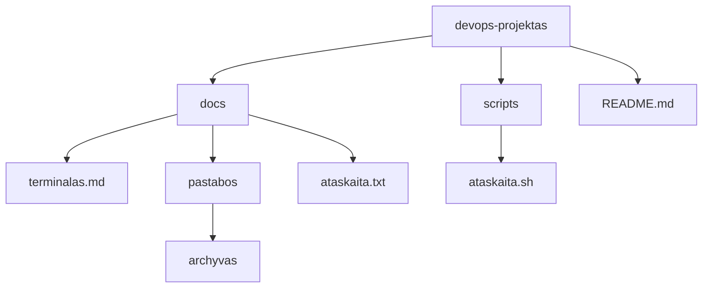
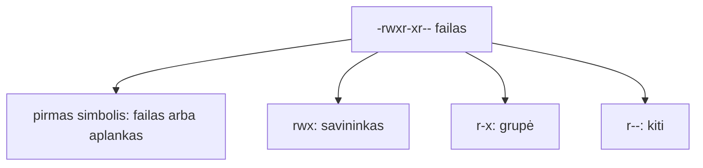

# 02 Linux terminalas

Data: 2026-11-12 (ketvirtadienis)

## Klasės darbas

3 val. Skaidrėse **N** rodo pastabas. Ritmas kiekvienai temai: teorija (skaidrės) → dėstytojas gyvai parodo **kitu pavyzdžiu** (aplankas `demo`, kiti failų vardai) → Teams'e paskelbiama užduotis → jūs darote savo `devops-projektas`. Užduotys sudaro vieną giją: savo projekte užpildote pastabas, jas apdorojate srautais, tada viską automatizuojate skriptu ir pateikiate per Pull Request. Kitą užduotį gaunate tik baigę ankstesnę. Terminalą, `cp`, `mv`, `grep`, `chmod` ir Git jau mokėte (Edgaras): einame greitai. Naujovė: savo projektas iš šablono, srautai, teisių skaitymas, pirmas skriptas ir Pull Request.

1. Pasitikrinimas po 01 (~5 min): kam kas liko neaišku su šaka ir `merge`; dėstytojas parodo 01 sprendimą gyvai (01 `pamoka.md`, skyrius „Sprendimas“)
2. Savo projektas (~5 min teorijos ir demonstracijos), tada Užduotis 1 (~10 min): [skaidrės](https://raw.githack.com/dkoncius/Techin-DevOps/main/kursas/02%20Linux%20terminalas/skaidres/skaidres.html), 1–4 skaidrės
   1. Kodėl terminalas: serveris neturi pelės, o tekstines komandas galima įrašyti į skriptą ir kartoti
   2. Šablonas ir jūsų kopija: **Use this template** (kopija be senos istorijos) ir `git clone` (kopija į kompiuterį)
   3. Demonstracija: dėstytojas atlieka „Savo projektas“ su kitu pavyzdžiu (~5 min)
3. Komanda ir navigacija (~10 min teorijos ir demonstracijos), tada Užduotis 2 (~25 min): skaidrės 5–8
   1. Komanda, parametrai, argumentai; pagalba: `--help`, `man`, [GNU Coreutils dokumentacija](https://www.gnu.org/software/coreutils/manual/)
   2. Kur esu ir kas čia: `pwd`, `ls -la`, `cd`; Tab užbaigimas ir istorija (rodyklė aukštyn, `Ctrl+R`)
   3. Keliai: `/`, `~`, `.`, `..`; absoliutus ir santykinis kelias
   4. Failai: `mkdir -p`, `touch`, `cp`, `mv`; kodėl pirma kopijuoti, o ne trinti (`rm -rf` šiame kurse nenaudojame)
   5. Demonstracija: dėstytojas atlieka „Navigacija ir failai“ savo `demo-projektas` (aplankas `demo/pastabos`, kiti failų vardai) (~8 min)
4. Srautai ir paieška (~10 min teorijos ir demonstracijos), tada Užduotis 3 (~25 min): skaidrės 9–10
   1. Peržiūra: `cat`, `head`, `tail`, `wc -l`, `sort`
   2. Srautai: `|`, `>`, `>>`; kodėl viena komanda daro vieną darbą, o vamzdis jas jungia
   3. Paieška: `grep` (tekstas faile), `find -name` (failas pagal vardą)
   4. Demonstracija: dėstytojas atlieka „Srautai ir paieška“ su failu `vaisiai.txt` (~8 min); mokiniai tą patį daro su savo `komandos.txt`
5. Pertrauka (~15 min)
6. Teisės ir pirmas skriptas (~15 min teorijos ir demonstracijos), tada Užduotis 4 (~30 min): skaidrės 11–12
   1. Vartotojas, grupė, kiti; `r`, `w`, `x` ir skaičiai (`644`, `755`, `600`)
   2. `ls -l` skaitymas; `chmod`
   3. Kodėl `.sh` failas negali būti paleistas be `x`; kodėl `.env` ir privatūs raktai neturi būti skaitomi kitų
   4. Skripto pradžia: `#!/usr/bin/env bash`
   5. Demonstracija: dėstytojas atlieka „Teisės ir pirmas skriptas“ su `labas.sh` (~8 min); mokiniai automatizuoja savo žingsnius skriptu `ataskaita.sh`
7. Pull Request (~5 min demonstracijos), tada Užduotis 5 (~20 min): skaidrė 13 (dažnos klaidos)
   1. Kodėl darbas eina per šaką ir PR, o ne tiesiai į `main`
   2. Demonstracija: dėstytojas atlieka „Pull Request“ savo `demo-projektas` kopijoje (~5 min)
8. Kita paskaita: Procesai, aplinkos kintamieji, paketų tvarkyklė

Nuorodos: [GitHub: creating a repository from a template](https://docs.github.com/en/repositories/creating-and-managing-repositories/creating-a-repository-from-a-template), [GitHub: about pull requests](https://docs.github.com/en/pull-requests/collaborating-with-pull-requests/proposing-changes-to-your-work-with-pull-requests/about-pull-requests), [GNU Coreutils](https://www.gnu.org/software/coreutils/manual/)

## Kur skiriasi (Mac / Ubuntu)

Pamokos komandos parinktos taip, kad veiktų abiejose sistemose. Šie dalykai skiriasi, todėl kurse jų venkite arba naudokite abi versijas:

| Veiksmas | Mac (Terminalas) | Ubuntu (WSL) |
|---|---|---|
| Spalvotas `ls` | `ls -G` | `ls --color=auto` |
| Failo teisės skaičiumi | `stat -f %Lp failas` | `stat -c %a failas` |
| Atidaryti aplanką programoje | `open .` | `explorer.exe .` |
| Kopijuoti į iškarpinę | `pbcopy` | `clip.exe` |

Kurse naudokite tik tai, kas veikia abiejose: `ls -la`, `ls -l`, `cp`, `mv`, `cat`, `grep`, `find . -name`, `chmod`.

## Schemos

Aplankų medis, nuo kurio dirbsime (jūsų projekte; `docs/` ir `scripts/` sukursite patys):



Teisių skaitymas `ls -l` išvestyje:



## Užduotys

Jei kas neveikia: perskaitykite klaidą, ieškokite dokumentacijoje ir užsirašykite, kas padėjo (1 etape dirbtinio intelekto užduotyse nenaudojame; DI leidžiamas nuo Docker etapo). Nuorodos yra klasės darbe. Komandos yra skyriuje „Komandos“: žiūrėkite tik įstrigę.

Užduotis skelbiu po vieną (Teams). Pirmiausia parodau gyvai kitu pavyzdžiu, tada darote savo kompiuteryje ir tik baigę gaunate kitą. Užduotys eina viena gija ir visos vyksta jūsų `devops-projekte`: kiekviena naudoja ankstesnės rezultatą. Atsakymus į „Kodėl“ rašote faile `docs/terminalas.md`.

### 1️⃣ Savo projektas

1. **Tikslas:** Pasidaryti savo projekto kopiją iš šablono, nusiklonuoti ir paruošti vietą darbui atskiroje šakoje.
2. Naršyklėje atidarykite šabloną [`devops-projektas-starter-template`](https://github.com/dkoncius/devops-projektas-starter-template).
3. Iš šablono sukurkite savo **Public** repozitoriją `devops-projektas` (mygtukas **Use this template**).
4. Terminale eikite į aplanką `~/devops`.
5. Nusiklonuokite **savo** repozitoriją `devops-projektas` (ne šablono).
6. Pereikite į aplanką `devops-projektas`.
7. Patikrinkite, kad nuotolinė nuoroda rodo jūsų vardą ir `devops-projektas`, o ne `starter-template`.
8. Sukurkite šaką `pamoka-02` ir persijunkite į ją.
9. Sukurkite aplanką `docs` ir faile `docs/terminalas.md` parašykite antraštę „# Terminalas“ ir skyrių „## Projektas“.
10. **Kodėl:** skyriuje „Projektas“ vienu sakiniu užrašykite, kodėl dirbame savo kopijoje, o ne tiesiai šablone.
11. Padarykite commit su žinute „Pradėtas terminalas.md“.

### 2️⃣ Navigacija ir failai

1. **Tikslas:** Judėti po projektą ir sukurti jame pastabų aplankų struktūrą.
2. Eikite į `~/devops/devops-projektas` ir pažiūrėkite, kur esate ir kas čia yra, įskaitant paslėptus failus.
3. Pereikite į aplanką `static`.
4. Grįžkite į projekto šaknį santykiniu keliu.
5. Pereikite į `~/devops` absoliučiu keliu.
6. Grįžkite į `devops-projektas` keliu, kuris prasideda `~`.
7. Viena komanda sukurkite aplankų grandinę `docs/pastabos/archyvas` (aplanko `pastabos` dar nėra).
8. Aplanke `docs/pastabos` sukurkite tuščius failus: `terminalas.txt`, `git.txt`, `komandos.txt`.
9. Pažiūrėkite aplanko `docs/pastabos` turinį.
10. Nukopijuokite `terminalas.txt` ir `git.txt` į `archyvas`.
11. Pažiūrėkite aplanko `archyvas` turinį.
12. Aplanke `archyvas` pervadinkite `git.txt` į `git-senas.txt` ir perkelkite jį į `docs/pastabos`.
13. **Kodėl:** faile `docs/terminalas.md` pridėkite skyrių „## Failai“ ir vienu sakiniu užrašykite, kodėl šiame kurse pirma kopijuojame, o ne trinam.
14. **Papildomai:** pagal `man ls` suraskite, kaip surūšiuoti failus pagal dydį, ir išbandykite aplanke `static`.

### 3️⃣ Srautai ir paieška

1. **Tikslas:** Užpildyti pastabas, sujungti komandas per srautus ir išsaugoti paieškos rezultatus.
2. Į failą `docs/pastabos/komandos.txt` įrašykite komandas po vieną eilutėje: `ls`, `cd`, `cp`, `mv`, `pwd`.
3. Išveskite `komandos.txt` turinį į ekraną, o tada surūšiuotą pagal abėcėlę.
4. Surūšiuotą turinį įrašykite į naują failą `docs/pastabos/komandos-abeceles.txt`.
5. Į `komandos.txt` pridėkite eilutę `grep` nepersirašydami senų.
6. Suskaičiuokite `komandos.txt` eilutes.
7. Išveskite pirmas 2 ir paskutines 2 `komandos.txt` eilutes.
8. Viena komanda su vamzdžiu (`|`) išveskite tik tas `komandos.txt` eilutes, kuriose yra raidė `p`.
9. Į `docs/pastabos/terminalas.txt` įrašykite vieną sakinį, kas yra terminalas (perrašant failą).
10. Projekto šaknyje suraskite, kuriuose failuose ir kuriose eilutėse yra žodis `health`.
11. Tą patį paieškos rezultatą įrašykite į `docs/health.txt`, bet neįtraukite aplankų `.git` ir `docs` (pagal oficialią dokumentaciją; žingsnių čia nėra, tik tikslas).
12. Suraskite komandą, kuri į `docs/failai.txt` įrašo visų `.md` failų sąrašą projekte, be `.git` aplanko (pagal oficialią dokumentaciją; žingsnių čia nėra, tik tikslas).
13. **Kodėl:** faile `docs/terminalas.md` pridėkite skyrių „## Srautai“, užrašykite komandą iš 12 žingsnio ir vienu sakiniu, kuo `>` skiriasi nuo `>>` ir ką prarastumėte per klaidą pasirinkę `>`.
14. Padarykite commit su visu aplanku `docs` ir žinute „Pridėtos pastabos ir paieškos rezultatai“.

### 4️⃣ Teisės ir pirmas skriptas

1. **Tikslas:** Automatizuoti ranka darytus žingsnius skriptu, padaryti jį vykdomą ir paaiškinti teises.
2. Projekte sukurkite aplanką `scripts` ir faile `scripts/ataskaita.sh` parašykite skriptą, kuris išveda: aplanką, kuriame paleistas; kiek failų ir aplankų yra `docs/pastabos`; visų `.md` failų sąrašą (be `.git`); `app.py` eilutes su žodžiu `health`.
3. Paleiskite skriptą iš projekto šaknies kaip programą.
4. Faile `docs/terminalas.md` pridėkite skyrių „## Teisės“ ir užrašykite, kas atsitiko 3 žingsnyje ir kodėl.
5. Padarykite skriptą vykdomą ir paleiskite iš naujo.
6. Skripto išvestį įrašykite į failą `docs/ataskaita.txt`.
7. Pažiūrėkite skripto teises ilguoju sąrašu ir skyriuje „Teisės“ paaiškinkite, ką reiškia `-rwxr-xr-x` (savininkas, grupė, kiti).
8. Aplanke `~/devops` (ne projekte) sukurkite failą `slaptas.txt` ir nustatykite teises taip, kad jį galėtų skaityti ir keisti tik savininkas. Patikrinkite ilguoju sąrašu.
9. **Kodėl:** skyriuje „Teisės“ vienu sakiniu užrašykite, kodėl `.env` ir privatūs raktai neturi būti skaitomi kitų.
10. Padarykite du commit'us: pirmas tik `scripts/ataskaita.sh` (žinutė „Pridėtas ataskaita.sh“), antras visas `docs` aplankas (žinutė „Pridėta ataskaita“).
11. **Papildomai:** nuimkite skriptui vykdymo teisę, paleiskite per `bash` ir paaiškinkite, kodėl jis vis tiek veikia; tada grąžinkite teisę.

### 5️⃣ Pull Request

1. **Tikslas:** Pateikti visą savo darbą per Pull Request ir sujungti jį į `main`.
2. Patikrinkite, kad `docs` ir `scripts` nėra slaptažodžių, raktų, tokenų ar `.env` turinio.
3. Nusiųskite šaką `pamoka-02` į GitHub.
4. GitHub'e atidarykite Pull Request iš `pamoka-02` į `main` pavadinimu „Terminalas“.
5. Pull Request aprašyme (Description) vienu sakiniu parašykite, ką pakeitėte ir kodėl.
6. Peržiūrėkite Pull Request skirtumus (**Files changed**): turi matytis visi keturi commit'ai ir jūsų failai.
7. Sulieskite Pull Request GitHub'e.
8. Kompiuteryje persijunkite į `main` ir atnaujinkite jį iš GitHub.
9. Patikrinkite, kad `main` yra `scripts/ataskaita.sh`, `docs/ataskaita.txt` ir `docs/terminalas.md`, o commit istorijoje matyti visi commit'ai.
10. Ištrinkite šaką `pamoka-02` kompiuteryje ir GitHub'e.

## Komandos

Žiūrėkite tik įstrigę. Numeriai atitinka užduoties žingsnius.

## 1️⃣ Savo projektas

4. `cd ~/devops`
5. `git clone https://github.com/<JŪSŲ-VARDAS>/devops-projektas.git`
6. `cd devops-projektas`
7. `git remote -v`
8. `git switch -c pamoka-02`
9. `mkdir docs`, tada redaktoriumi arba `printf '# Terminalas\n\n## Projektas\n' > docs/terminalas.md`
11. `git add docs`, `git commit -m "Pradėtas terminalas.md"`

## 2️⃣ Navigacija ir failai

2. `cd ~/devops/devops-projektas`, `pwd`, `ls -la`
3. `cd static`
4. `cd ..`
5. `cd ~/devops`
6. `cd ~/devops/devops-projektas`
7. `mkdir -p docs/pastabos/archyvas`
8. `cd docs/pastabos`, `touch terminalas.txt git.txt komandos.txt`
9. `ls`
10. `cp terminalas.txt git.txt archyvas`
11. `ls archyvas`
12. `mv archyvas/git.txt archyvas/git-senas.txt`, tada `mv archyvas/git-senas.txt .`
13. `docs/terminalas.md` redaguokite redaktoriumi arba `>>`
14. `man ls` (išeiti `q`); `ls -lS ~/devops/devops-projektas/static`

## 3️⃣ Srautai ir paieška

2. `echo "ls" > komandos.txt`, toliau `echo "cd" >> komandos.txt` ir t. t. (`>` perrašo, `>>` prideda)
3. `cat komandos.txt`, `sort komandos.txt`
4. `sort komandos.txt > komandos-abeceles.txt`
5. `echo "grep" >> komandos.txt`
6. `wc -l komandos.txt`
7. `head -n 2 komandos.txt`, `tail -n 2 komandos.txt`
8. `cat komandos.txt | grep p`
9. `echo "..." > terminalas.txt`
10. `cd ~/devops/devops-projektas`, `grep -rn "health" . --exclude-dir=.git`
11. `grep -rn` su `--exclude-dir` (du kartus), rezultatas `>` į `docs/health.txt`; `man grep`
12. `find .` su `-name` ir `-not -path "./.git/*"`, rezultatas `>` į `docs/failai.txt`; `man find`
13. `docs/terminalas.md` redaguokite redaktoriumi arba `>>`
14. `git add docs`, `git commit -m "Pridėtos pastabos ir paieškos rezultatai"`

## 4️⃣ Teisės ir pirmas skriptas

2. `mkdir scripts`; pirma eilutė `#!/usr/bin/env bash`; naudingos: `pwd`, `ls docs/pastabos | wc -l`, `find`, `grep -n "health" app.py`
3. `./scripts/ataskaita.sh`
5. `chmod +x scripts/ataskaita.sh`, `./scripts/ataskaita.sh`
6. `./scripts/ataskaita.sh > docs/ataskaita.txt`
7. `ls -l scripts/ataskaita.sh`
8. `touch ~/devops/slaptas.txt`, `chmod 600 ~/devops/slaptas.txt`, `ls -l ~/devops/slaptas.txt`
10. `git add scripts/ataskaita.sh`, `git commit -m "Pridėtas ataskaita.sh"`, tada `git add docs`, `git commit -m "Pridėta ataskaita"`; `git log --oneline`
11. `chmod -x scripts/ataskaita.sh`, `bash scripts/ataskaita.sh`, `chmod +x scripts/ataskaita.sh`

## 5️⃣ Pull Request

3. `git push -u origin pamoka-02`
4–7. GitHub'e **Compare & pull request**, pavadinimas, aprašymas, **Files changed**, **Merge pull request**
8. `git switch main`, `git pull`
9. `ls docs scripts`, `git log --oneline`
10. `git branch -d pamoka-02`, `git push origin --delete pamoka-02` (arba GitHub'e mygtukas **Delete branch** po sujungimo)

## Sprendimas (dėstytojui)

Patikrinta: macOS (bash 3.2) su laikina nuotoline repozitorija vietoj GitHub: visa gija nuo klonavimo iki sujungimo (šaka, `mkdir -p`, `cp`, `mv`, `sort`, `>`/`>>`, `grep -rn --exclude-dir`, `find`, skriptas su `Permission denied` ir po `chmod +x`, `chmod 600`, 4 commit'ai, sujungimas, šakos trynimas). Nepatikrinta: **Use this template**, Pull Request GitHub svetainėje, `gh`, WSL2 Ubuntu (`/mnt/c`, CRLF); išbandyti ranka prieš pamoką.

### Kaip rodyti klasėje

Laiko juosta (~155 min be pertraukos, rezervas ~25 min):

| Trukmė | Kas |
|---|---|
| 5 min | 01 sprendimas gyvai |
| 5 + 10 min | Užduotis 1: šablonas ir klonavimas |
| 10 + 25 min | Navigacija ir failai (demonstracija + Užduotis 2) |
| 10 + 25 min | Srautai ir paieška (demonstracija + Užduotis 3) |
| 15 min | Pertrauka |
| 15 + 30 min | Teisės ir skriptas (demonstracija + Užduotis 4) |
| 5 + 20 min | Pull Request (demonstracija + Užduotis 5) |

1. (~5 min) 01 sprendimas: parodykite 01 `pamoka.md` skyrių „Sprendimas“: `devops-dokumentas.md` ir `git log --oneline --graph --all`. Mokiniai lygina su savo `git-bandymas`. Pasakykite, kad šiandien užduotys eina viena gija: pastabos → srautai → skriptas → PR.
2. Užduotis 1 (~5 min demonstracija, ~10 min darbas): sava demo kopija `demo-projektas`: **Use this template** → `git clone` → `git remote -v` → šaka `pamoka-02` → `docs/` ir pirmas commit. Dažna klaida: klonuojamas pats šablonas (`starter-template`) vietoje savo kopijos; klonuojama į `/mnt/c` (WSL): perkelti į `~/devops`.
3. Navigacija ir failai (~10 min demonstracija, ~25 min Užduotis 2): `demo-projektas`: `mkdir -p demo/pastabos/senos`, `touch`, `cp`, `mv`, `cd ..`, `cd ~`. Dažna klaida: tarpas aplanko varde be kabučių (`cd Mano aplankas`); `cd` į neegzistuojantį aplanką: patikrinti `pwd` ir `ls`, naudoti Tab. Dažna klaida: `cp` / `mv` be paskirties aplanko arba kelias nuo ne to aplanko (`archyvas` neegzistuoja).
4. Srautai ir paieška (~10 min demonstracija, ~25 min Užduotis 3): `vaisiai.txt` su 5 vaisiais: `sort`, `sort > rusiuota.txt`, `>>`, `wc -l`, `grep`, `find`. Dažna klaida: `>` perrašo failą, o `>>` prideda; mokiniai praranda turinį. `grep -rn "health" .` be `--exclude-dir` į `docs/health.txt` gali įtraukti `.git` ir `docs` failus arba (GNU grep) pranešti klaidą: priminti `--exclude-dir`.
5. (~15 min) Pertrauka.
6. Teisės ir skriptas (~15 min demonstracija, ~30 min Užduotis 4): sukurkite `labas.sh` (kitas nei mokinių `ataskaita.sh`), paleiskite be `x` (`Permission denied`), `ls -l`, `chmod +x`, paleiskite. Parodykite `ls -l run.sh` projekte: jis jau `-rwxr-xr-x`. Dažna klaida: `bash ataskaita.sh` veikia ir be `x`, o `./scripts/ataskaita.sh` ne; mokiniai nesupranta skirtumo. Dažna klaida: skriptas paleistas ne projekto šaknyje, `app.py` nerandamas. Dažna klaida (Windows): CRLF (`bad interpreter`); kurti WSL redaktoriumi arba `.gitattributes` su `*.sh text eol=lf`.
7. Pull Request (~5 min demonstracija, ~20 min Užduotis 5): `demo-projektas`: `push -u origin`, **Compare & pull request**, **Files changed**, **Merge**, `git switch main`, `git pull`. Dažna klaida: PR sulietas GitHub'e, bet `main` kompiuteryje neatnaujintas (`git pull`); `git branch -d` atsisako, jei `main` neatnaujintas.

### Sprendimas pagal darbus

| Darbas | Kur sprendime |
|---|---|
| Savo `devops-projektas`, klonavimas, šaka `pamoka-02` (Užduotis 1) | `git remote -v` rodo mokinio vardą ir `devops-projektas`; `git branch` rodo `pamoka-02` |
| Judėjimas ir `docs/pastabos/archyvas` (Užduotis 2) | `ls -R docs` rodo `git-senas.txt`, `komandos.txt`, `terminalas.txt` ir `archyvas/terminalas.txt` |
| `komandos.txt`, `sort`, `>>`, `head`, `tail`, `grep` (Užduotis 3) | `komandos.txt` turi 6 eilutes; `komandos-abeceles.txt` 5 |
| `docs/health.txt`, `docs/failai.txt` | `docs/terminalas.md`, skyrius „Srautai“ |
| Skriptas `ataskaita.sh` ir `chmod +x` (Užduotis 4) | `scripts/ataskaita.sh`; `ls -l` rodo `x`; `docs/ataskaita.txt` |
| `slaptas.txt` su teisėmis `600` | `ls -l` rodo `-rw-------` |
| „Kodėl“ atsakymai | `docs/terminalas.md`, skyriai „Projektas“, „Failai“, „Srautai“, „Teisės“ |
| 4 commit'ai ir sulietas PR (Užduotis 5) | `git log --oneline` ir GitHub **Merged** |

Dėstytojas kasdienių užduočių netikrina, tik rodo sprendimą; tikrinimas yra tik atsiskaitymuose.

### Pavyzdiniai failai

#### `docs/terminalas.md`

````markdown
# Terminalas

## Projektas

Dirbame savo kopijoje, nes šablonas priklauso kitam ir mes negalime (ir neturime) jo keisti; kopija yra mūsų darbo vieta.

## Failai

Pirma kopijuojame, nes kopija nieko nesugadina, o ištrintą ar perrašytą failą atgauti sunku.

## Srautai

Komanda: `find . -name "*.md" -not -path "./.git/*" > docs/failai.txt`

`>` perrašo failą, o `>>` prideda gale; per klaidą pasirinkus `>` prarastume visą ankstesnį turinį.

## Teisės

Pirmas paleidimas `./scripts/ataskaita.sh` parašė „Permission denied“, nes failas dar neturėjo vykdymo teisės `x`; po `chmod +x` veikia.

`-rwxr-xr-x` reiškia: pirmas `-` yra paprastas failas; `rwx` savininkas gali skaityti, rašyti ir vykdyti; `r-x` grupė gali skaityti ir vykdyti; `r-x` kiti taip pat.

`.env` ir privatūs raktai turi turėti `600`, nes juose slaptos reikšmės, kurių kiti vartotojai kompiuteryje neturi matyti.
````

#### `scripts/ataskaita.sh`

````bash
#!/usr/bin/env bash
# ataskaita.sh – trumpa projekto ataskaita.
# Naudojimas: ./scripts/ataskaita.sh
set -euo pipefail

echo "Aplankas: $(pwd)"
echo "Failų docs/pastabos: $(ls docs/pastabos | wc -l | tr -d ' ')"
echo "Markdown failai:"
find . -name "*.md" -not -path "./.git/*"
echo "Eilutės su health:"
grep -n "health" app.py
````

#### `docs/health.txt` (pavyzdinė išvestis)

````text
app.py:55:@app.route("/health")
app.py:56:def health():
README.md:17:| `GET /health` | `{"status": "ok"}`, kodas 200 |
tests/test_app.py:20:def test_health(client):
tests/test_app.py:21:    r = client.get("/health")
````

Eilučių tvarka ir numeriai priklauso nuo starterio versijos ir sistemos (`grep -r` eilė skiriasi Mac ir Ubuntu); Mac išvestyje kelias be `./`.
