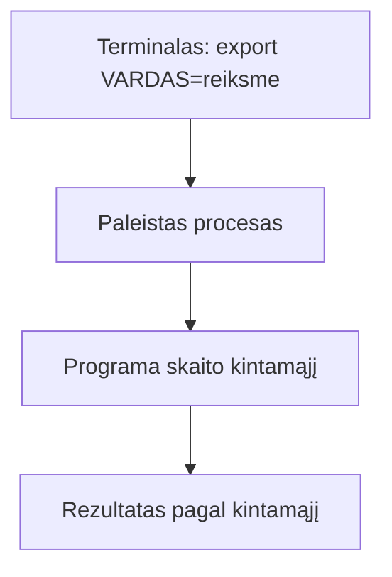
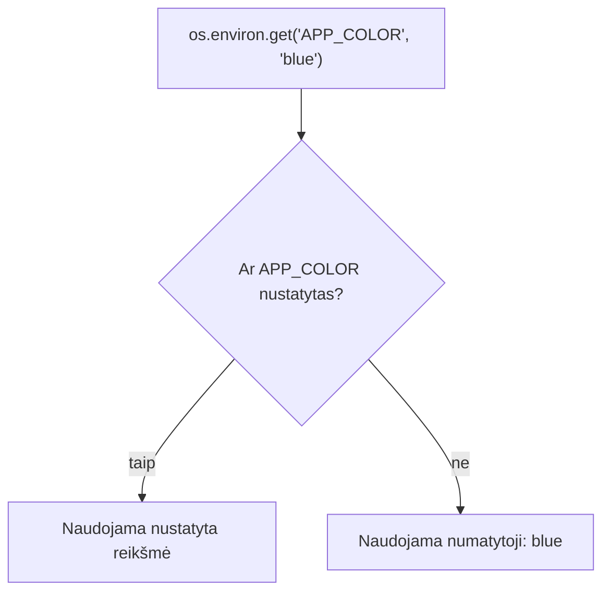

# 03 Procesai ir paketai

Data: 2026-11-16 (pirmadienis)

## Klasės darbas

3 val. Skaidrėse **N** rodo pastabas. Ritmas kiekvienai temai: teorija (skaidrės) → dėstytojas gyvai parodo **kitu pavyzdžiu** → Teams'e paskelbiama užduotis → jūs darote savo `devops-projektas`. Užduotys sudaro vieną giją: paleidžiate procesą ir jį sustabdote, parašote skriptą, kuris skaito aplinkos kintamąjį, įdiegiate paketą ir pamatote, kaip tikra programa (`app.py`) skaito savo nustatymus iš aplinkos; viską pateikiate per Pull Request. Kitą užduotį gaunate tik baigę ankstesnę. Naujovė: procesai, `PATH`, aplinkos kintamieji ir paketų tvarkyklė.

1. Pasitikrinimas po 02 (~10 min): dėstytojas parodo 02 sprendimą gyvai (02 `pamoka.md`, skyrius „Sprendimas“); kam neveikė `chmod` ar Pull Request, kartu randame priežastį
2. Procesai (~10 min teorijos ir demonstracijos), tada Užduotis 1 (~15 min): [skaidrės](https://raw.githack.com/dkoncius/Techin-DevOps/main/kursas/03%20Procesai%20ir%20paketai/skaidres/skaidres.html), 1–5 skaidrės
   1. Kas yra procesas, PID, tėvinis procesas
   2. Peržiūra: `ps`, `top`, filtravimas per `grep` (srautus jau moka iš 02)
   3. Fonas ir priekis: `&`, `jobs`, `Ctrl+C`, `Ctrl+Z`
   4. Stabdymas: `kill`, signalai (`SIGTERM` ir `SIGKILL`); kodėl pirma bandoma švelniai
   5. Kodėl Flask serveris yra tiesiog procesas, kuris klauso porto (ryšys su konteineriais vėliau)
   6. Demonstracija: dėstytojas atlieka „Procesai“ su `python3 -m http.server 8000` (~5 min)
3. Aplinkos kintamieji (~10 min teorijos ir demonstracijos), tada Užduotis 2 (~25 min): skaidrės 6–8
   1. Kas yra aplinkos kintamasis; `env`, `echo $VARDAS`
   2. `export`: kintamasis gyvena tik tame terminale; kintamasis tik vienai komandai (`VARDAS=x komanda`)
   3. `PATH`: kaip terminalas randa komandas ir kodėl `./skriptas.sh` reikia `./`
   4. Kodėl nustatymai ir slaptos reikšmės laikomos kintamuosiuose, o ne kode
   5. Demonstracija: dėstytojas atlieka „Aplinkos kintamasis skripte“ su `DEMO` ir `labas.sh` (~8 min)
4. Pertrauka (~15 min)
5. Paketų tvarkyklė (~10 min teorijos ir demonstracijos), tada Užduotis 3 (~20 min): skaidrė 9
   1. Kodėl nesisiunčiame programų iš svetainių ranka
   2. Ubuntu (WSL): `apt` ([APT dokumentacija](https://wiki.debian.org/Apt)); Mac: `brew` ([Homebrew](https://docs.brew.sh/)); ta pati užduotis, dvi komandos
   3. Paieška, įdiegimas, versija, kur įdiegta: `which`, `--version`
   4. Kodėl prieš pirmą diegimą `sudo apt update` ir kodėl `sudo` žiūrime atsargiai
   5. Demonstracija: dėstytojas atlieka „Paketas“ su `htop` (~8 min)
6. Programa skaito aplinką, Pull Request (~10 min teorijos ir demonstracijos), tada Užduotis 4 (~25 min): skaidrės 10–11
   1. `os.environ.get("VARDAS", "numatytoji")`: ką grąžina be kintamojo ir su juo
   2. Kodėl `.env` neina į Git; kuo skiriasi `.env.example`
   3. Demonstracija: dėstytojas atlieka „Kodas ir Pull Request“ su kitu kintamuoju (`APP_VERSION`) (~8 min)
7. Kita paskaita: Bash skriptai: kintamieji, sąlygos, ciklai

Nuorodos: [APT](https://wiki.debian.org/Apt), [Homebrew](https://docs.brew.sh/), [GNU Bash: aplinka](https://www.gnu.org/software/bash/manual/bash.html#Environment)

## Kur skiriasi (Mac / Ubuntu)

| Veiksmas | Mac (Terminalas) | Ubuntu (WSL) |
|---|---|---|
| Paketų tvarkyklė | `brew` (be `sudo`) | `apt` (su `sudo`) |
| Paketų sąrašo atnaujinimas | `brew update` | `sudo apt update` |
| Įdiegti `tree` | `brew install tree` | `sudo apt install tree` |
| Ar paketas įdiegtas | `brew list tree` | `dpkg -s tree` |
| Proceso PID pagal pavadinimą | `pgrep sleep` (veikia abiejose) | `pgrep sleep` |
| Procesų sąrašas | `ps -e` ir `ps aux` (veikia abiejose) | `ps -e`, `ps aux` |
| Rūšiuotas `top` | `top -o cpu` | `top -o %CPU` |

Nenaudojame: `/proc`, `systemctl`, `journalctl`, `free -h`, `ip a`, `sed -i`: jie veikia tik vienoje sistemoje.

## Schemos

Kaip aplinkos kintamasis pasiekia programą:



Kaip `app.py` renkasi reikšmę (jūsų starteris, `app.py`):



## Užduotys

Jei kas neveikia: perskaitykite klaidą, ieškokite dokumentacijoje ir užsirašykite, kas padėjo (1 etape dirbtinio intelekto užduotyse nenaudojame; DI leidžiamas nuo Docker etapo). Nuorodos yra klasės darbe. Komandos yra skyriuje „Komandos“: žiūrėkite tik įstrigę.

Užduotis skelbiu po vieną (Teams). Pirmiausia parodau gyvai kitu pavyzdžiu, tada darote savo kompiuteryje ir tik baigę gaunate kitą. Užduotys eina viena gija ir visos vyksta jūsų `devops-projekte` (aplanke `~/devops/devops-projektas`): kiekviena naudoja ankstesnės rezultatą. Atsakymus į „Kodėl“ rašote faile `docs/procesai.md`.

### 1️⃣ Procesai

1. **Tikslas:** Pamatyti savo procesą, rasti jo PID ir jį sustabdyti.
2. Eikite į savo `devops-projektas` ir persijunkite į `main`, atnaujinkite jį iš GitHub.
3. Sukurkite šaką `pamoka-03` ir persijunkite į ją.
4. Paleiskite komandą `sleep 300` fone.
5. Pažiūrėkite fone veikiančių darbų sąrašą.
6. Suraskite savo `sleep` proceso PID (per procesų sąrašą ir `grep`).
7. Sustabdykite procesą pagal PID.
8. Įsitikinkite, kad proceso nebėra.
9. Faile `docs/procesai.md` (aplanką `docs` sukurkite, jei jo nėra) parašykite antraštę „# Procesai ir paketai“ ir skyrių „## Procesas“ su savo komandomis ir PID.
10. **Kodėl:** skyriuje „Procesas“ vienu sakiniu užrašykite, kodėl PID imame iš `sleep` eilutės, o ne iš `grep` eilutės.
11. Padarykite commit su žinute „Pradėtas procesai.md“.
12. **Papildomai:** paleiskite `sleep 300` dar kartą, sustabdykite jį ne per `kill`, o klaviatūros sparčiuoju klavišu, ir paaiškinkite skirtumą tarp `Ctrl+C` ir `Ctrl+Z`.

### 2️⃣ Aplinkos kintamasis skripte

1. **Tikslas:** Parašyti skriptą, kuris naudoja aplinkos kintamąjį su numatytąja reikšme, ir pamatyti, kad kintamasis gyvena tik savo terminale.
2. Faile `scripts/aplinka.sh` parašykite skriptą (kaip `ataskaita.sh` per 02 pamoką): jis išveda kintamojo `PROJEKTO_VARDAS` reikšmę (o jei nenustatytas, žodį „nenustatyta“) ir kiek eilučių yra procesų sąrašo išvestyje.
3. Padarykite skriptą vykdomą.
4. Paleiskite skriptą be kintamojo ir išvestį įrašykite į naują failą `docs/aplinka.txt`.
5. Paleiskite skriptą su `PROJEKTO_VARDAS=mano` (kintamasis tik šiai komandai) ir išvestį **pridėkite** prie `docs/aplinka.txt`, nepersirašydami pirmos.
6. Nustatykite `PROJEKTO_VARDAS` visam terminalo langui, paleiskite skriptą ir patikrinkite, kad jis mato kintamąjį.
7. Atidarykite naują terminalo langą, eikite į projektą ir paleiskite skriptą dar kartą. Pažiūrėkite, ar kintamasis ten yra.
8. Išveskite, kur terminalas ieško komandų (kintamasis `PATH`), ir suraskite, kuriame aplanke yra komanda `ls`.
9. Faile `docs/procesai.md` pridėkite skyrių „## Aplinkos kintamieji“ ir užrašykite, ką pamatėte 6 ir 7 žingsniuose.
10. **Kodėl:** to paties skyriaus pabaigoje vienu sakiniu paaiškinkite, kodėl `./scripts/aplinka.sh` rašome su `./`, o `ls` be jo (kaip čia susiję `PATH`).
11. Padarykite du commit'us: pirmas tik `scripts/aplinka.sh` (žinutė „Pridėtas aplinka.sh“), antras visas `docs` aplankas (žinutė „Pridėta aplinkos išvestis“).

### 3️⃣ Paketas

1. **Tikslas:** Įdiegti paketą savo paketų tvarkykle ir žinoti abi sistemų komandas.
2. Atnaujinkite paketų sąrašą savo sistemoje.
3. Įdiekite paketą `tree`.
4. Patikrinkite, kad `tree` įdiegtas: parodykite jo versiją ir kelią, kur jis yra.
5. Išveskite `docs` aplanko medį ir įrašykite jį į `docs/medis.txt`.
6. Suraskite, kaip savo paketų tvarkyklėje patikrinti, ar paketas jau įdiegtas (pagal oficialią dokumentaciją; žingsnių čia nėra, tik tikslas).
7. Faile `docs/procesai.md` pridėkite skyrių „## Paketas“ su lentele (stulpeliai: veiksmas, Mac, Ubuntu/WSL; eilutės: įdiegti, versija, ar įdiegtas) ir užpildykite abi sistemas.
8. **Kodėl:** skyriuje „Paketas“ vienu sakiniu užrašykite, kodėl paketus diegiame paketų tvarkykle, o ne siunčiamės iš svetainės.
9. Padarykite commit su visu aplanku `docs` ir žinute „Pridėtas paketas ir medis“.

### 4️⃣ Kodas ir Pull Request

1. **Tikslas:** Pamatyti, kaip tikra programa skaito savo nustatymus iš aplinkos, ir pateikti visą darbą per Pull Request.
2. Projekto šaknyje suraskite visas `app.py` eilutes su `os.environ` ir įrašykite jas į `docs/nustatymai.txt`.
3. Faile `docs/procesai.md` pridėkite skyrių „## Nustatymai“ ir paaiškinkite, kokia bus `APP_COLOR` reikšmė, jei jo nenustatysite, o kokia po `export APP_COLOR=red`.
4. Tame pačiame skyriuje paaiškinkite, ką daro programa, kai `DB_HOST` nenustatytas (žr. `.env.example` ir `app.py` pradžią).
5. Patikrinkite, kad Git ignoruoja failą `.env` (pagal oficialią dokumentaciją; žingsnių čia nėra, tik tikslas: kuri komanda parodo, ar failas ignoruojamas).
6. **Kodėl:** skyriuje „Nustatymai“ vienu sakiniu užrašykite, kodėl slaptažodis laikomas aplinkos kintamajame, o ne kode.
7. Patikrinkite, kad `docs` ir `scripts` nėra slaptažodžių, raktų, tokenų ar `.env` turinio.
8. Padarykite commit su žinute „Pridėti nustatymai“.
9. Nusiųskite šaką `pamoka-03` į GitHub.
10. GitHub'e atidarykite Pull Request iš `pamoka-03` į `main` pavadinimu „Procesai ir paketai“ su vieno sakinio aprašu.
11. Peržiūrėkite **Files changed**: turi matytis visi penki commit'ai ir jūsų failai.
12. Sulieskite Pull Request, kompiuteryje persijunkite į `main` ir atnaujinkite jį.
13. Ištrinkite šaką `pamoka-03` kompiuteryje ir GitHub'e.
14. **Papildomai:** paaiškinkite skirtumą tarp `kill` ir `kill -9` ir kada naudotumėte antrą.

## Komandos

Žiūrėkite tik įstrigę. Numeriai atitinka užduoties žingsnius.

## 1️⃣ Procesai

2. `cd ~/devops/devops-projektas`, `git switch main`, `git pull`
3. `git switch -c pamoka-03`
4. `sleep 300 &`
5. `jobs`
6. `ps aux | grep sleep` (PID yra antras stulpelis; `grep` eilutė yra paties `grep` procesas)
7. `kill <PID>`
8. `ps aux | grep sleep`
9. `mkdir -p docs`, tada redaktoriumi arba `printf '# Procesai ir paketai\n\n## Procesas\n' > docs/procesai.md`
11. `git add docs`, `git commit -m "Pradėtas procesai.md"`
12. `sleep 300`, tada `Ctrl+C`; `sleep 300`, tada `Ctrl+Z`, `jobs`, `kill %1`

## 2️⃣ Aplinkos kintamasis skripte

2. `mkdir -p scripts`; pirma eilutė `#!/usr/bin/env bash`; numatytoji reikšmė `${PROJEKTO_VARDAS:-nenustatyta}`; eilutėms skaičiuoti `ps -e | wc -l`
3. `chmod +x scripts/aplinka.sh`
4. `./scripts/aplinka.sh > docs/aplinka.txt`
5. `PROJEKTO_VARDAS=mano ./scripts/aplinka.sh >> docs/aplinka.txt`
6. `export PROJEKTO_VARDAS=visas`, `./scripts/aplinka.sh`
7. Naujame lange: `cd ~/devops/devops-projektas`, `echo $PROJEKTO_VARDAS`, `./scripts/aplinka.sh`
8. `echo $PATH`, `which ls`
9. `docs/procesai.md` redaguokite redaktoriumi arba `>>`
11. `git add scripts/aplinka.sh`, `git commit -m "Pridėtas aplinka.sh"`, tada `git add docs`, `git commit -m "Pridėta aplinkos išvestis"`

## 3️⃣ Paketas

2. Mac: `brew update`; Ubuntu/WSL: `sudo apt update`
3. Mac: `brew install tree`; Ubuntu/WSL: `sudo apt install tree`
4. `tree --version`, `which tree`
5. `tree docs > docs/medis.txt`
6. Mac: `brew list`; Ubuntu: `dpkg -s tree` (arba `apt list --installed`)
9. `git add docs`, `git commit -m "Pridėtas paketas ir medis"`

## 4️⃣ Kodas ir Pull Request

2. `grep -n "os.environ" app.py > docs/nustatymai.txt`; `cat .env.example`
3. `docs/procesai.md` redaguokite redaktoriumi arba `>>`; patikrinti galite: `APP_COLOR=red python3 -c "import os; print(os.environ.get('APP_COLOR', 'blue'))"`
5. `git check-ignore -v .env` (arba `man git-check-ignore`)
8. `git add docs`, `git commit -m "Pridėti nustatymai"`
9. `git push -u origin pamoka-03`
10–12. GitHub'e **Compare & pull request**, pavadinimas, aprašymas, **Files changed**, **Merge pull request**; tada `git switch main`, `git pull`
13. `git branch -d pamoka-03`, `git push origin --delete pamoka-03` (arba GitHub'e **Delete branch**)

## Sprendimas (dėstytojui)

Patikrinta: macOS (bash 3.2): `sleep` + `kill`, `scripts/aplinka.sh` su `>` ir `>>`, `grep -n "os.environ" app.py`, `git check-ignore`. Nepatikrinta: **`apt` dalis (Ubuntu / WSL2)**, `dpkg -s tree`, `brew list`, `top -o`, `tree` išvestis; Pull Request GitHub svetainėje. Išbandyti ranka prieš pamoką abiejose sistemose.

### Kaip rodyti klasėje

Laiko juosta (~150 min be pertraukos, rezervas ~30 min):

| Trukmė | Kas |
|---|---|
| 10 min | 02 sprendimas gyvai |
| 10 + 15 min | Procesai (demonstracija + Užduotis 1) |
| 10 + 25 min | Aplinkos kintamieji (demonstracija + Užduotis 2) |
| 15 min | Pertrauka |
| 10 + 20 min | Paketas (demonstracija + Užduotis 3) |
| 10 + 25 min | Kodas ir Pull Request (demonstracija + Užduotis 4) |

1. (~10 min) 02 sprendimas: parodykite 02 `pamoka.md` skyrių „Sprendimas“: paleiskite `scripts/ataskaita.sh` savo demo repo, parodykite `ls -l` su `x`. Pasakykite, kad šiandien užduotys vėl eina viena gija: procesas → skriptas su kintamuoju → paketas → kodas → PR.
2. Užduotis 1 (~10 min demonstracija, ~15 min darbas): kitas pavyzdys nei mokinių: `python3 -m http.server 8000 &`, `curl localhost:8000`, `ps aux | grep http.server`, `kill`. Dažna klaida: `kill` su PID iš `grep` eilutės (tai paties `grep` procesas); `Ctrl+Z` vietoj `Ctrl+C`, procesas lieka fone.
3. Užduotis 2 (~10 min demonstracija, ~25 min darbas): kitas kintamasis (`DEMO`) ir `labas.sh`: `DEMO=1 ./labas.sh`, `export DEMO=1`, naujas langas kintamojo nemato; `which ls`. Dažna klaida: `export` viename lange, skriptas kitame; skriptas be `x` (`Permission denied`, žr. 02).
4. (~15 min) Pertrauka.
5. Užduotis 3 (~10 min demonstracija, ~20 min darbas): įdiegti `htop` (ne `tree`) abiem būdais, parodyti `which`, `--version`. Dažna klaida: `sudo apt install` be `apt update` ir „Unable to locate package“; Mac studentas rašo `sudo brew`; Windows studentas diegia į PowerShell, ne į WSL.
6. Užduotis 4 (~10 min demonstracija, ~25 min darbas): parodykite eilutę `os.environ.get("APP_VERSION", "dev")`; `APP_VERSION=2 python3 -c "..."` ir be jo. Parodykite `.env.example` ir kodėl `.env` ignoruojamas. Dažna klaida: PR sulietas GitHub'e, bet `main` kompiuteryje neatnaujintas (`git pull`); `git branch -d` atsisako, jei `main` neatnaujintas. Paskutinį kartą kartojame srautą 02 PR žingsnių.

### Sprendimas pagal darbus

| Darbas | Kur sprendime |
|---|---|
| Procesas fone, PID, `kill` (Užduotis 1) | `docs/procesai.md`, skyrius „Procesas“; `ps` jo nebemato |
| `scripts/aplinka.sh` ir `chmod +x` (Užduotis 2) | `scripts/aplinka.sh`; `ls -l` rodo `x` |
| Išvestis be kintamojo ir su juo | `docs/aplinka.txt`: dvi išvestys |
| Kintamasis tik savo lange; `PATH` | `docs/procesai.md`, skyrius „Aplinkos kintamieji“ |
| Paketas `tree`, versija, vieta (Užduotis 3) | `tree --version`, `which tree`; `docs/medis.txt` |
| Mac ir Ubuntu komandų lentelė | `docs/procesai.md`, skyrius „Paketas“ |
| `os.environ` eilutės, `APP_COLOR`, `DB_HOST` (Užduotis 4) | `docs/nustatymai.txt`; `docs/procesai.md`, skyrius „Nustatymai“ |
| `.env` ignoruojamas | `git check-ignore -v .env` rodo `.gitignore` eilutę |
| 5 commit'ai ir sulietas PR | `git log --oneline` ir GitHub **Merged** |

Dėstytojas kasdienių užduočių netikrina, tik rodo sprendimą; tikrinimas yra tik atsiskaitymuose.

### Pavyzdiniai failai

#### `docs/procesai.md`

````markdown
# Procesai ir paketai

## Procesas

`sleep 300 &` paleido procesą fone, `jobs` jį parodė, `ps aux | grep sleep` parodė PID (pvz. 4821). `kill 4821` jį sustabdė, `ps` daugiau jo nerodo.

PID imame iš `sleep` eilutės, nes `grep sleep` eilutė yra paties `grep` procesas, kuris po sekundės pasibaigia.

## Aplinkos kintamieji

Su `export PROJEKTO_VARDAS=visas` skriptas rodo „visas“. Naujame terminalo lange kintamojo nėra ir skriptas rodo „nenustatyta“: kintamasis gyvena tik tame lange, kuriame jį nustatėte.

`./scripts/aplinka.sh` rašome su `./`, nes dabartinio aplanko nėra `PATH` sąraše; `ls` yra aplanke, kuris įrašytas į `PATH` (`which ls` parodo kurį).

## Paketas

| Veiksmas | Mac | Ubuntu (WSL) |
|---|---|---|
| Įdiegti | `brew install tree` | `sudo apt update` ir `sudo apt install tree` |
| Versija | `tree --version` | `tree --version` |
| Ar įdiegtas | `brew list tree` | `dpkg -s tree` |

Paketų tvarkyklė pati randa, įdiegia, atnaujina ir pašalina programą iš patikimo šaltinio; ranka siųsti iš svetainių nesaugu ir sunku atnaujinti.

## Nustatymai

Jei `APP_COLOR` nenustatytas, programa naudoja `blue`; po `export APP_COLOR=red` naudoja `red`.

Kai `DB_HOST` nenustatytas, programa naudoja vietinį SQLite failą, o ne MySQL.

Slaptažodis laikomas aplinkos kintamajame, nes kode jis patektų į Git ir į visų kopijas, o kintamasis lieka tik toje aplinkoje, kur programa paleista.
````

#### `scripts/aplinka.sh`

````bash
#!/usr/bin/env bash
# aplinka.sh – parodo kintamąjį PROJEKTO_VARDAS ir procesų eilučių skaičių.
# Naudojimas: ./scripts/aplinka.sh   arba   PROJEKTO_VARDAS=mano ./scripts/aplinka.sh
set -euo pipefail

echo "PROJEKTO_VARDAS: ${PROJEKTO_VARDAS:-nenustatyta}"
echo "Proceso eilučių ps išvestyje: $(ps -e | wc -l | tr -d ' ')"
````

#### `docs/aplinka.txt` (pavyzdinė išvestis)

````text
PROJEKTO_VARDAS: nenustatyta
Proceso eilučių ps išvestyje: 543
PROJEKTO_VARDAS: mano
Proceso eilučių ps išvestyje: 543
````

Skaičius priklauso nuo kompiuterio.

#### `docs/nustatymai.txt` (pavyzdinė išvestis)

````text
13:    return bool(os.environ.get("DB_HOST"))
22:            host=os.environ["DB_HOST"],
30:    path = os.environ.get("SQLITE_PATH", os.path.join(BASE, "app.db"))
70:        version=os.environ.get("APP_VERSION", "dev"),
71:        color=os.environ.get("APP_COLOR", "blue"),
72:        env=os.environ.get("APP_ENV", "local"),
````

Eilučių numeriai priklauso nuo starterio versijos.
