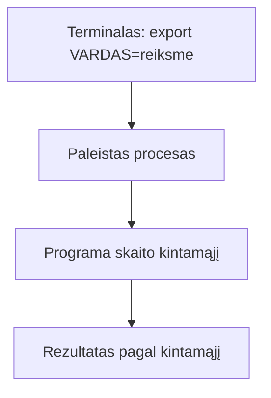

# 03 Procesai ir paketai

Data: 2026-11-16 (pirmadienis)

## Klasės darbas

1. Pasitikrinimas po 02 paskaitos (~15 min): dėstytojas parodo 02 sprendimą gyvai; kam neveikė `chmod` ar PR, kartu randame priežastį
2. Procesai (~30 min):
   1. Kas yra procesas, PID, tėvinis procesas
   2. Peržiūra: `ps`, `top` (arba `htop`, jei įdiegta), kaip filtruoti per `grep`
   3. Pirmas planas ir fonas: `&`, `jobs`, `Ctrl+C`, `Ctrl+Z`
   4. Procesų stabdymas: `kill`, signalai (`SIGTERM` ir `SIGKILL`) ir kodėl pirma bandoma švelniai
   5. Kodėl Flask serveris yra tiesiog procesas, kuris klauso porto (ryšys su konteineriais vėliau)
3. Aplinkos kintamieji (~25 min):
   1. Kas yra aplinkos kintamasis; `env`, `echo $VARDAS`
   2. `export` ir kintamojo gyvavimo trukmė (tik šis terminalas)
   3. `PATH`: kaip terminalas randa komandas
   4. Kodėl slaptos reikšmės (pvz. DB slaptažodis) laikomos kintamuosiuose, o ne kode; `.env` neina į Git
   5. Kaip kintamasis perskaitomas Python kode (žr. skyrių „Schemos“)
4. Paketų tvarkyklė (~25 min):
   1. Kodėl nesisiunčiame programų iš svetainių ranka
   2. Ubuntu (WSL): `apt` ([APT dokumentacija](https://wiki.debian.org/Apt)); Mac: `brew` ([Homebrew](https://docs.brew.sh/)); ta pati užduotis, dvi komandos
   3. Paieška, įdiegimas, versija, kur įdiegta: `apt search`, `apt install` (Ubuntu), `brew search`, `brew install` (Mac), `which`, `--version`
   4. Ubuntu: prieš pirmą diegimą `sudo apt update`; Mac: `brew` be `sudo`. Kodėl `sudo` žiūrime atsargiai
5. Python kodo skaitymas (~10 min): kaip programa paima prisijungimo duomenis iš aplinkos kintamųjų (žr. skyrių „Užduotys“)
6. Demonstracija: dėstytojas atlieka užduotį „procesai, kintamieji, paketas“ su kitais pavyzdžiais (kitas kintamojo vardas, kitas paketas, kitas procesas) (~20 min)
7. Kita paskaita: Bash skriptai: kintamieji, sąlygos, ciklai

## Kur skiriasi (Mac / Ubuntu)

| Veiksmas | Mac (Terminalas) | Ubuntu (WSL) |
|---|---|---|
| Paketų tvarkyklė | `brew` (be `sudo`) | `apt` (su `sudo`) |
| Paketų sąrašo atnaujinimas | `brew update` | `sudo apt update` |
| Įdiegti `tree` | `brew install tree` | `sudo apt install tree` |
| Ar paketas įdiegtas | `brew list tree` | `dpkg -s tree` |
| Proceso PID pagal pavadinimą | `pgrep sleep` (veikia abiejose) | `pgrep sleep` |
| Procesų sąrašas | `ps -e` ir `ps aux` (veikia abiejose) | `ps -e`, `ps aux` |
| Rūšiuotas `top` | `top -o cpu` | `top -o %CPU` |
| Laisva atmintis | `vm_stat` | `free -h` (kurse nenaudojame) |

Nenaudojame: `/proc`, `systemctl`, `journalctl`, `free -h`, `ip a`, `sed -i`: jie veikia tik vienoje sistemoje.

## Schemos

Kaip aplinkos kintamasis pasiekia programą:



Python ištrauka skaitymo užduočiai (suderinti su starteriu, kai jis bus; vardai ir numatytosios reikšmės čia pavyzdinės):

```python
import os

DB_HOST = os.environ.get("DB_HOST", "localhost")
DB_NAME = os.environ.get("DB_NAME", "app")
```

## Užduotys

### 1️⃣ Procesai

1. **Tikslas:** Pamatyti procesus ir juos sustabdyti.
2. Atnaujinkite `main` ir sukurkite šaką `pamoka-03`.
3. Paleiskite terminale ilgai veikiančią komandą (pvz. `sleep 300`) fone.
4. Kitame terminalo lange suraskite jos procesą ir jo PID.
5. Sustabdykite procesą pagal PID ir įsitikinkite, kad jo nebėra.

### 2️⃣ Aplinkos kintamasis skripte

1. **Tikslas:** Parašyti skriptą, kuris naudoja aplinkos kintamąjį su numatytąja reikšme.
2. Sukurkite `scripts/aplinka.sh`, kuris išveda kintamojo `PROJEKTO_VARDAS` reikšmę (o jei nenustatytas, „nenustatyta“) ir kiek eilučių yra procesų sąrašo išvestyje.
3. Paleiskite skriptą be kintamojo.
4. Paleiskite jį su `PROJEKTO_VARDAS=mano` (kintamasis tik šiai komandai).
5. Abiejų paleidimų išvestis įrašykite į `docs/procesai.md`.

### 3️⃣ Paketas

1. **Tikslas:** Įdiegti paketą su savo paketų tvarkykle ir žinoti abi komandų versijas.
2. Įdiekite nedidelį paketą (pvz. `tree`).
3. Faile `docs/procesai.md` lentelėje užrašykite komandą, kurią naudojote, ir atitinkamą kitos sistemos komandą (Mac: `brew`, Ubuntu/WSL: `apt`).
4. Užrašykite komandą, kuri rodo įdiegto paketo versiją.
5. Suraskite, kaip savo paketų tvarkyklėje patikrinti, ar paketas jau įdiegtas (pagal oficialią dokumentaciją; žingsnių čia nėra, tik tikslas), ir užrašykite komandą `docs/procesai.md`.

### 4️⃣ `DB_HOST` ir Pull Request

1. **Tikslas:** Perskaityti Python kodą ir sulieti darbą per Pull Request.
2. Faile `docs/procesai.md` paaiškinkite, ką daro šis kodas ir kokia reikšmė bus `DB_HOST`, jei nieko nenustatyta, o kokia po `export DB_HOST=duombaze` (suderinti su starteriu, kai jis bus):

   ```python
   import os

   DB_HOST = os.environ.get("DB_HOST", "localhost")
   DB_NAME = os.environ.get("DB_NAME", "app")
   ```

3. Vienu sakiniu paaiškinkite, kodėl DB slaptažodis laikomas aplinkos kintamajame, o ne kode.
4. Padarykite bent 2 commit'us šakoje `pamoka-03`, nusiųskite į GitHub, atidarykite Pull Request į `main` ir sulieskite. Kompiuteryje atnaujinkite `main`.
5. Patikrinkite, kad nėra slaptažodžių, raktų, tokenų ar `.env` turinio.
6. **Papildomai:** paaiškinkite skirtumą tarp `kill` ir `kill -9` ir kada naudotumėte antrą.

## Komandos

## 1️⃣ Procesai

2. `git switch main`, `git pull`, `git switch -c pamoka-03`
3. `sleep 300 &`
4. `ps aux | grep sleep` (PID yra antras stulpelis; `grep` eilutė yra paties `grep` procesas)
5. `kill <PID>`, tada vėl `ps aux | grep sleep`

## 2️⃣ Aplinkos kintamasis skripte

2. Pirma eilutė `#!/usr/bin/env bash`; numatytoji reikšmė `${PROJEKTO_VARDAS:-nenustatyta}`; eilutėms skaičiuoti `ps aux | wc -l`
3. `bash scripts/aplinka.sh`
4. `PROJEKTO_VARDAS=mano bash scripts/aplinka.sh`

## 3️⃣ Paketas

2. Mac: `brew install tree`; Ubuntu/WSL: `sudo apt update`, tada `sudo apt install tree`
4. `tree --version`
5. Mac: `brew list`; Ubuntu: `dpkg -s tree` (arba `apt list --installed`)

## 4️⃣ `DB_HOST` ir Pull Request

4. `git push -u origin pamoka-03`, GitHub'e **Compare & pull request**, sulieti, tada `git switch main` ir `git pull`

## Sprendimas (dėstytojui)

Patikrinta: `scripts/aplinka.sh` paleistas macOS (bash), `sleep` + `kill` išbandyta. Nepatikrinta: `apt` dalis (Ubuntu / WSL2), `dpkg -s tree`, `brew list tree` ir `top -o`. Išbandyti prieš pamoką abiejose sistemose.

### Kaip rodyti klasėje

1. (~10 min) Praeitos pamokos (02) sprendimas gyvai: parodykite 02 pamokos sprendimą (skyrius „Sprendimas“): paleiskite `scripts/terminalas.sh` jūsų demo repo. Parodykite `ls -l` su `x`.
2. (~20 min) Procesai: `sleep 600 &`, `ps`, `jobs`, `kill`. Kitas pavyzdys nei mokinių: rodykite `python3 -m http.server 8000 &` ir `curl` į jį, tada `kill`. Dažna klaida: `kill` su PID iš `grep` eilutės, kur PID yra paties `grep` procesas.
3. (~20 min) Aplinkos kintamieji: `export DEMO=1`, `echo $DEMO`, naujas terminalo langas jo nemato. Kitas nei mokinių kintamasis (ne `PROJEKTO_VARDAS`). Dažna klaida: `export` tame pačiame lange, o skriptas paleidžiamas kitame.
4. (~20 min) Paketas: įdiegti `htop` (ne `tree`) abiem būdais: Mac `brew install htop`, Ubuntu `sudo apt update` ir `sudo apt install htop`; parodyti `which`, `--version`. Dažna klaida: `sudo apt install` be `apt update` ir „Unable to locate package“; Mac studentas rašo `sudo brew`; Windows studentas diegia į PowerShell, ne WSL.
5. (~10 min) `os.environ.get("DB_HOST", "localhost")`: ką grąžina be kintamojo ir su juo.
6. Mokiniai daro užduotis; kitą pamoką parodote sprendimą.

### Sprendimas pagal darbus

| Darbas | Kur sprendime |
|---|---|
| Procesas fone ir PID | `docs/procesai.md`, skyrius „Procesas“ |
| Procesas sustabdytas | `ps` jo nebemato (`kill <PID>`) |
| Skriptas `aplinka.sh` | `scripts/aplinka.sh` |
| Išvestis be kintamojo ir su juo | `docs/procesai.md`, skyrius „Skripto išvestis“ |
| Paketo įdiegimas ir versija | `docs/procesai.md`, skyrius „Paketas“ |
| Kuris paketas atitinka komandą | `docs/procesai.md`, skyrius „Paketas“ |
| `DB_HOST` kodo skaitymas | `docs/procesai.md`, skyrius `DB_HOST` |
| ≥ 2 commit'ai ir sulietas PR | `git log --oneline` ir GitHub **Merged** |

Dėstytojas kasdienių užduočių netikrina, tik rodo sprendimą; tikrinimas yra tik atsiskaitymuose (vertinimas.md).

### Pavyzdiniai failai

#### `docs/procesai.md`

````markdown
# Procesai ir paketai

## Procesas

`sleep 300 &` paleido procesą fone. `ps | grep sleep` parodė jo PID. `kill <PID>` jį sustabdė, `ps` daugiau jo nerodo.

## Skripto išvestis

Be kintamojo:

```
PROJEKTO_VARDAS: nenustatyta
Proceso eilučių ps išvestyje: 543
```

Su `PROJEKTO_VARDAS=mano`:

```
PROJEKTO_VARDAS: mano
Proceso eilučių ps išvestyje: 543
```

(Skaičius priklauso nuo kompiuterio, pavyzdinė išvestis.)

## Paketas

| Veiksmas | Mac | Ubuntu (WSL) |
|---|---|---|
| Įdiegti | `brew install tree` | `sudo apt update` ir `sudo apt install tree` |
| Versija | `tree --version` | `tree --version` |
| Ar įdiegtas | `brew list tree` | `dpkg -s tree` |

## DB_HOST

Kodas paima kintamąjį `DB_HOST` iš aplinkos; jei jo nėra, naudoja `"localhost"`. Nieko nenustačius `DB_HOST` yra `localhost`, po `export DB_HOST=duombaze` yra `duombaze`.

## Kodėl slaptažodis kintamajame

Kode jis patektų į Git ir į visų žmonių kopijas; kintamasis lieka tik toje aplinkoje, kur programa paleista.
````

#### `scripts/aplinka.sh`

````bash
#!/usr/bin/env bash
# aplinka.sh – parodo kintamąjį PROJEKTO_VARDAS ir procesų eilučių skaičių.
# Naudojimas: ./scripts/aplinka.sh   arba   PROJEKTO_VARDAS=mano ./scripts/aplinka.sh
set -euo pipefail

echo "PROJEKTO_VARDAS: ${PROJEKTO_VARDAS:-nenustatyta}"
echo "Proceso eilučių ps išvestyje: $(ps -e | wc -l | tr -d ' ')"
````
