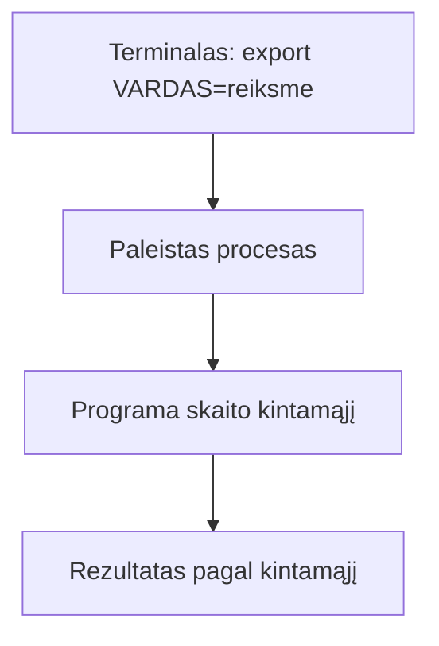
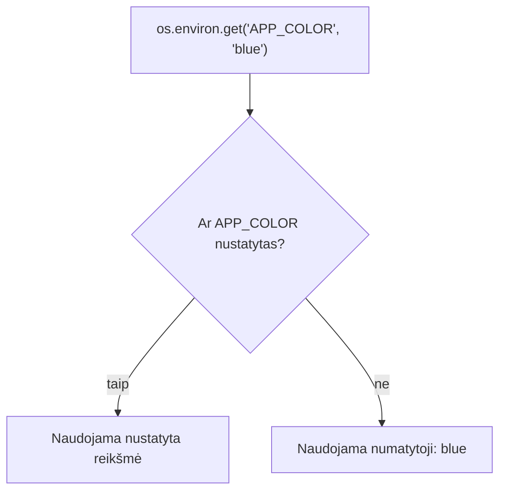

# 03 Procesai ir paketai

Data: 2026-11-16 (pirmadienis)

## Klasės darbas

3 val. Skaidrėse **N** rodo pastabas. Ritmas kiekvienai temai: teorija (skaidrės) → dėstytojas gyvai parodo **kitu pavyzdžiu** → Teams'e paskelbiama užduotis → jūs darote savo `devops-projektas`. Užduotys sudaro vieną giją: paleidžiate procesą ir jį sustabdote, parašote skriptą, kuris skaito aplinkos kintamąjį, įdiegiate paketą ir pamatote, kaip tikra programa (`app.py`) skaito savo nustatymus iš aplinkos; viską pateikiate per Pull Request. Kitą užduotį gaunate tik baigę ankstesnę. Naujovė: procesai, `PATH`, aplinkos kintamieji ir paketų tvarkyklė.

1. Pasitikrinimas po 02 (~10 min): dėstytojas parodo 02 sprendimą gyvai (02 `pamoka.md`, skyrius „Pamokos eiga“); kam neveikė `chmod` ar Pull Request, kartu randame priežastį
2. Procesai (~10 min teorijos ir demonstracijos), tada Užduotis 1 (~15 min): [skaidrės](https://raw.githack.com/dkoncius/Techin-DevOps/main/kursas/03%20Procesai%20ir%20paketai/skaidres/skaidres.html), 1–5 skaidrės
   - Kas yra procesas, PID, tėvinis procesas
   - Peržiūra: `ps`, `top`, filtravimas per `grep` (srautus jau moka iš 02)
   - Fonas ir priekis: `&`, `jobs`, `Ctrl+C`, `Ctrl+Z`
   - Stabdymas: `kill`, signalai (`SIGTERM` ir `SIGKILL`); kodėl pirma bandoma švelniai
   - Kodėl Flask serveris yra tiesiog procesas, kuris klauso porto (ryšys su konteineriais vėliau)
   - Demonstracija: dėstytojas atlieka „Procesai“ su `python3 -m http.server 8000` (~5 min)
3. Aplinkos kintamieji (~10 min teorijos ir demonstracijos), tada Užduotis 2 (~25 min): skaidrės 6–8
   - Kas yra aplinkos kintamasis; `env`, `echo $VARDAS`
   - `export`: kintamasis gyvena tik tame terminale; kintamasis tik vienai komandai (`VARDAS=x komanda`)
   - `PATH`: kaip terminalas randa komandas ir kodėl `./skriptas.sh` reikia `./`
   - Kodėl nustatymai ir slaptos reikšmės laikomos kintamuosiuose, o ne kode
   - Demonstracija: dėstytojas atlieka „Aplinkos kintamasis skripte“ su `DEMO` ir `labas.sh` (~8 min)
4. Pertrauka (~15 min)
5. Paketų tvarkyklė (~10 min teorijos ir demonstracijos), tada Užduotis 3 (~20 min): skaidrė 9
   - Kodėl nesisiunčiame programų iš svetainių ranka
   - Ubuntu (WSL): `apt` ([APT dokumentacija](https://wiki.debian.org/Apt)); Mac: `brew` ([Homebrew](https://docs.brew.sh/)); ta pati užduotis, dvi komandos
   - Paieška, įdiegimas, versija, kur įdiegta: `which`, `--version`
   - Kodėl prieš pirmą diegimą `sudo apt update` ir kodėl `sudo` žiūrime atsargiai
   - Demonstracija: dėstytojas atlieka „Paketas“ su `htop` (~8 min)
6. Programa skaito aplinką, Pull Request (~10 min teorijos ir demonstracijos), tada Užduotis 4 (~25 min): skaidrės 10–11
   - `os.environ.get("VARDAS", "numatytoji")`: ką grąžina be kintamojo ir su juo
   - Kodėl `.env` neina į Git; kuo skiriasi `.env.example`
   - Demonstracija: dėstytojas atlieka „Kodas ir Pull Request“ su kitu kintamuoju (`APP_VERSION`) (~8 min)
7. Kita paskaita: Bash skriptai: kintamieji, sąlygos, ciklai

Nuorodos: [APT](https://wiki.debian.org/Apt), [Homebrew](https://docs.brew.sh/), [GNU Bash: aplinka](https://www.gnu.org/software/bash/manual/bash.html#Environment)

## Kur skiriasi (Mac / Ubuntu)

| Veiksmas | Mac (Terminalas) | Ubuntu (WSL) |
|---|---|---|
| Paketų tvarkyklė | `brew` (be `sudo`) | `apt` (su `sudo`) |
| Paketų sąrašo atnaujinimas | `brew update` | `sudo apt update` |
| Įdiegti `tree` | `brew install tree` | `sudo apt install tree` |
| Ar paketas įdiegtas | `brew list tree` | `dpkg -s tree` |
| Proceso PID pagal pavadinimą | `pgrep sleep` (veikia abiejose) | `pgrep sleep` |
| Procesų sąrašas | `ps -e` ir `ps aux` (veikia abiejose) | `ps -e`, `ps aux` |
| Rūšiuotas `top` | `top -o cpu` | `top -o %CPU` |

Nenaudojame: `/proc`, `systemctl`, `journalctl`, `free -h`, `ip a`, `sed -i`: jie veikia tik vienoje sistemoje.

## Schemos

Kaip aplinkos kintamasis pasiekia programą:



Kaip `app.py` renkasi reikšmę (jūsų starteris, `app.py`):



## Užduotys

Užduotys yra atskiruose failuose `uzduotys/1-uzduotis.md` … `4-uzduotis.md` (dėstytojas skelbia Teams'e po vieną: pirma demonstracija, tada darbas). Jos eina viena gija: procesas → skriptas su kintamuoju → paketas → kodas → Pull Request. Dėstytojo sprendimai su komandomis: `uzduotys/N-uzduotis-sprendimas.md`.

## Pamokos eiga (dėstytojui)

Patikrinta (2026-11-12): macOS (bash 3.2): `uzduotys/N-uzduotis-sprendimas.md` komandos (procesai, `scripts/aplinka.sh`, `os.environ`, `git check-ignore`) ir žemiau esančios demonstracijos paleistos iš eilės su tikru šablonu `devops-projektas-starter-template` ir laikina nuotoline repozitorija vietoj GitHub. Nepatikrinta: **`apt` dalis (Ubuntu / WSL2)**, `brew install`, `dpkg -s`, `top -o`, Pull Request GitHub svetainėje; išbandyti ranka prieš pamoką abiejose sistemose.

### Demonstracijos žingsniai

Laiko juosta (~150 min be pertraukos, rezervas ~30 min). Kiekviena tema: skaidrės → jūsų demonstracija su KITU pavyzdžiu → skelbiate užduotį Teams'e → mokiniai daro savo.

| Trukmė | Kas |
|---|---|
| 10 min | 02 sprendimas gyvai |
| 10 + 15 min | Užduotis 1: procesai |
| 10 + 25 min | Užduotis 2: aplinkos kintamasis skripte |
| 15 min | Pertrauka |
| 10 + 20 min | Užduotis 3: paketas |
| 10 + 25 min | Užduotis 4: kodas ir Pull Request |

**Kaip naudoti.** Kiekviena dalis žemiau yra tos pačios komandos, kurios rodomos atitinkamoje skaidrėje (pavadinimas nurodytas), ta pačia tvarka. Galite rodyti arba iš skaidrių, arba iš šio failo: jie vienas kitą dubliuoja. Demonstracija vyksta viename terminalo lange be papildomo pasiruošimo.

**1. (~10 min) 02 sprendimas.** Paleiskite savo demo `labas.sh` (žr. 02 `pamoka.md`) ir `uzduotys/2-uzduotis-sprendimas.md` komandas: `ls -l` rodo `x`. Pasakykite: šiandien užduotys vėl eina viena gija (procesas → skriptas su kintamuoju → paketas → kodas → PR). Kam neveikė `chmod` ar Pull Request, kartu randame priežastį.

**2. Procesai (~10 min demonstracija, tada Užduotis 1 ~15 min).** Skaidrės „Procesai: paleisti, rasti, sustabdyti“, „Signalai“. `<PID>` imkite iš `sleep` eilutės, ne iš `grep` eilutės.

```bash
sleep 600 &
ps aux | grep sleep
```

```bash
kill <PID>
```

Paskelbkite 1 užduotį. Dažna klaida: `kill` su PID iš `grep` eilutės (tai paties `grep` procesas); `Ctrl+Z` vietoj `Ctrl+C`, procesas lieka fone.

**3. Aplinkos kintamasis skripte (~10 min demonstracija, tada Užduotis 2 ~25 min).** Skaidrės „Aplinkos kintamieji“, „PATH“. Naujas terminalo langas kintamojo nemato.

```bash
export DEMO=1
echo $DEMO
env | grep DEMO
```

```bash
printf '#!/usr/bin/env bash\necho "DEMO: ${DEMO:-nenustatyta}"\n' > labas.sh
chmod +x labas.sh
./labas.sh
DEMO=2 ./labas.sh
env -u DEMO ./labas.sh
```

```bash
echo $PATH
which ls
```

Paskelbkite 2 užduotį. Dažna klaida: `export` viename lange, skriptas kitame; skriptas be `x` (`Permission denied`, žr. 02).

**4. (~15 min) Pertrauka.**

**5. Paketas (~10 min demonstracija, tada Užduotis 3 ~20 min).** Skaidrė „Paketai: Mac ir Ubuntu“ (lentelė pildoma balsu, joje yra komandos). Pavyzdys `htop` (ne `tree`); komandas paleiskite savo sistemoje: Mac `brew …`, Ubuntu/WSL `sudo apt …`; abiejose `htop --version`, `which htop`.

Paskelbkite 3 užduotį. Dažna klaida: `sudo apt install` be `apt update` ir „Unable to locate package“; Mac studentas rašo `sudo brew`; Windows studentas diegia ne WSL terminale.

**6. Kodas ir Pull Request (~10 min demonstracija, tada Užduotis 4 ~25 min).** Skaidrė „Kaip programa skaito aplinką“ (viršuje Python kodas, žemiau komandos).

```bash
APP_COLOR=red python3 -c "import os; print(os.environ.get('APP_COLOR', 'blue'))"
python3 -c "import os; print(os.environ.get('APP_COLOR', 'blue'))"
```

Parodykite `.env.example` ir paaiškinkite, kodėl `.env` ignoruojamas. Pull Request kartojamas kaip 02: `git push -u origin <šaka>`, **Compare & pull request**, **Files changed**, **Merge**, `git switch main`, `git pull`.

Paskelbkite 4 užduotį. Dažna klaida: PR sulietas GitHub'e, bet `main` kompiuteryje neatnaujintas (`git pull`); `git branch -d` atsisako, jei `main` neatnaujintas.

Sprendimai pagal užduotis: `uzduotys/1-uzduotis-sprendimas.md` … `4-uzduotis-sprendimas.md`. Dėstytojas kasdienių užduočių netikrina, tik rodo sprendimą.
