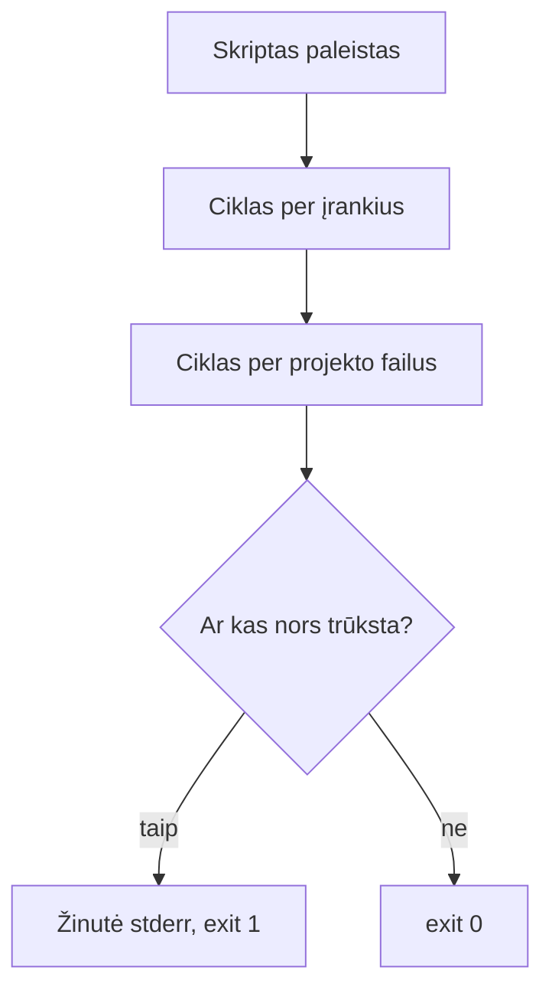

# 04 Bash skriptai

Data: 2026-11-17 (antradienis)

## Klasės darbas

3 val. Skaidrėse **N** rodo pastabas. Ritmas kiekvienai temai: teorija (skaidrės) → dėstytojas gyvai parodo **kitu pavyzdžiu** → Teams'e paskelbiama užduotis → jūs darote savo `devops-projektas`. Užduotys sudaro vieną giją: viename skripte `scripts/patikra.sh` auga tikrintuvas: pirma tikrina vieną įrankį, paskui jų sąrašą, paskui projekto failus; ketvirtoje užduotyje perskaitote tikrą `run.sh`, patvarkote `.gitignore` ir pateikiate darbą per Pull Request. Šis skriptas yra `paleisti.sh` (atsiskaitymui) užuomazga. Kitą užduotį gaunate tik baigę ankstesnę. Jūs jau rašėte paprastus skriptus (02, 03): einame greitai; naujovė yra argumentai, `if`, `for` ir išėjimo kodai.

1. Pasitikrinimas po 03 (~10 min): dėstytojas parodo 03 sprendimą gyvai (03 `pamoka.md`, skyrius „Pamokos eiga“); kam neveikė `kill`, `apt`/`brew` ar PR, kartu randame priežastį
2. Argumentai, `if` ir išėjimo kodas (~25 min teorijos ir demonstracijos), tada Užduotis 1 (~20 min): [skaidrės](https://raw.githack.com/dkoncius/Techin-DevOps/main/kursas/04%20Bash%20skriptai/skaidres/skaidres.html), 1–6 skaidrės
   - Kodėl skriptas: tą pačią seką paleidžiame kartą ar šimtą kartų vienodai
   - Pakartojimas: `#!/usr/bin/env bash`, `chmod +x`, kintamieji, `$(...)`; Mac Terminale numatytasis apvalkalas yra zsh, bet skriptai paleidžiami su Bash
   - Argumentai: `$1`, `$#`, `"$@"`; kodėl kintamieji rašomi kabutėse
   - `if`, `elif`, `else`, `fi`; testai `[ ]` failams (`-e`, `-f`, `-d`), tekstui (`=`, `-z`), skaičiams (`-eq`, `-gt`) ([Bash Reference Manual: Conditional Constructs](https://www.gnu.org/software/bash/manual/bash.html#Conditional-Constructs))
   - Ar komanda yra: `command -v irankis`
   - Išėjimo kodas: `$?`, `exit 0`, `exit 1`, `exit 2`; klaidų kanalas `>&2`; kodėl kiti įrankiai (CI, `&&`) žiūri į kodą, o ne į tekstą
   - Demonstracija: dėstytojas atlieka „Argumentai ir `if`“ su `pridek.sh` ir `docker` tikrinimu (~8 min)
3. `for` ir saugus skriptas (~10 min teorijos ir demonstracijos), tada Užduotis 2 (~20 min): skaidrė 7
   - `for` per sąrašą ir per failus; masyvas paprastai: `(a b c)` ir `"${masyvas[@]}"`
   - Aritmetika: `$((x + 1))`
   - `set -euo pipefail`: ką daro kiekviena dalis ir kodėl skriptas turi sustoti pirmoje klaidoje
   - Demonstracija: dėstytojas atlieka „Ciklas“ su `for` per `*.txt` (~5 min)
4. Pertrauka (~15 min)
5. Failų patikra (~5 min demonstracijos), tada Užduotis 3 (~20 min): skaidrė 8 (Failų patikra)
   - Tas pats `if`, bet su `-f` ir `-d`; skriptas paleidžiamas iš projekto šaknies
   - Demonstracija: dėstytojas atlieka „Failų patikra“ su kito projekto failais (~5 min)
6. Tikras Bash ir Git (~15 min teorijos ir demonstracijos), tada Užduotis 4 (~35 min): skaidrės 9–10
   - `run.sh` eilutė po eilutės: `set -euo pipefail`, `cd "$(dirname "$0")"`, `||`, `&&`, `exec`, `${PORT:-5001}`
   - `.gitignore` ir `git check-ignore -v`; `git restore`, `git restore --staged`; kodėl `git reset --hard` pavojingas
   - Demonstracija: dėstytojas atlieka „`.gitignore` ir `restore`“ su `*.tmp` (~8 min)
7. Kita paskaita: Tinklų pagrindai: IP, portai, DNS, HTTP, `curl`

## Kur skiriasi (Mac / Ubuntu)

| Veiksmas | Mac (Terminalas) | Ubuntu (WSL) |
|---|---|---|
| Numatytasis apvalkalas | zsh (skriptams nurodykite `bash`) | bash |
| Bash versija | 3.2 (sena) | 5.x |
| Skripto paleidimas | `bash scripts/x.sh` arba `./scripts/x.sh` | tas pats |

Skriptuose nenaudokite: `${var,,}`, `mapfile`, asociatyvių masyvų (`declare -A`), `&>>`: Mac Bash 3.2 jų neturi.

## Schemos

Kaip `patikra.sh` nusprendžia, kokį kodą grąžinti:



## Užduotys

Užduotys yra atskiruose failuose `uzduotys/1-uzduotis.md` … `4-uzduotis.md` (dėstytojas skelbia Teams'e po vieną: pirma demonstracija, tada darbas). 1–3 užduotys plečia tą patį skriptą `scripts/patikra.sh`, 4 užduotis baigiama Pull Request. Dėstytojo sprendimai su komandomis: `uzduotys/N-uzduotis-sprendimas.md`.

## Pamokos eiga (dėstytojui)

Patikrinta (2026-11-12): macOS (Bash 3.2): `uzduotys/N-uzduotis-sprendimas.md` komandos (visos trys `patikra.sh` versijos, išėjimo kodai, `git check-ignore`, `git restore`) ir žemiau esančios demonstracijos paleistos iš eilės su tikru šablonu ir laikina nuotoline repozitorija vietoj GitHub. Nepatikrinta: tas pats Ubuntu (WSL, Bash 5), Pull Request GitHub svetainėje; išbandyti prieš pamoką.

### Demonstracijos žingsniai

Laiko juosta (~155 min be pertraukos, rezervas ~25 min). Kiekviena tema: skaidrės → jūsų demonstracija su KITU pavyzdžiu → skelbiate užduotį Teams'e → mokiniai daro savo.

| Trukmė | Kas |
|---|---|
| 10 min | 03 sprendimas gyvai |
| 25 + 20 min | Užduotis 1: argumentai, `if`, kodai |
| 10 + 20 min | Užduotis 2: ciklas |
| 15 min | Pertrauka |
| 5 + 20 min | Užduotis 3: failų patikra |
| 15 + 35 min | Užduotis 4: `run.sh`, Git ir PR |

**Kaip naudoti.** Kiekviena dalis žemiau yra tos pačios komandos, kurios rodomos atitinkamoje skaidrėje (pavadinimas nurodytas), ta pačia tvarka. Galite rodyti arba iš skaidrių, arba iš šio failo: jie vienas kitą dubliuoja. Failai (`pridek.sh`, `pasveikink.sh`) kuriami `cat > … <<'EOS'` komandomis, todėl viskas vyksta viename lange be papildomo pasiruošimo.

**1. (~10 min) 03 sprendimas.** Paleiskite savo demo `labas.sh` su `DEMO` (žr. 03 `pamoka.md`) ir `uzduotys/2-uzduotis-sprendimas.md` komandas. Pasakykite: šiandien visos užduotys plečia vieną skriptą.

**2. Argumentai, `if` ir kodai (~25 min demonstracija, tada Užduotis 1 ~20 min).** Skaidrės „Skriptas ir argumentai“, „Sąlygos ir testai“, „Išėjimo kodas“. `pridek.sh` kitoks nei mokinių `patikra.sh`.

```bash
mkdir -p ~/devops/demo-bash/scripts
cd ~/devops/demo-bash
cat > scripts/pridek.sh <<'EOS'
#!/usr/bin/env bash
echo $(($1 + $2))
EOS
```

```bash
chmod +x scripts/pridek.sh
./scripts/pridek.sh 2 3
```

```bash
cat > pasveikink.sh <<'EOS'
#!/usr/bin/env bash
if [ "$#" -lt 1 ]; then
  echo "Naudojimas: $0 <vardas>" >&2
  exit 1
fi
echo "Sveiki, $1!"
EOS
```

```bash
chmod +x pasveikink.sh
./pasveikink.sh; echo $?
./pasveikink.sh Ona
```

```bash
command -v git; echo $?
command -v neegzistuoja; echo $?
```

Paskelbkite 1 užduotį. Dažna klaida: `$1` be kabučių, kai reikšmėje tarpas; trūksta tarpų aplink `[` ir `]`; `=` vietoj `-eq`; pamirštas `chmod +x`; `echo $?` po kitos komandos.

**3. Ciklas (~10 min demonstracija, tada Užduotis 2 ~20 min).** Skaidrė „Ciklas ir saugus skriptas“. `set -euo pipefail` paaiškinkite skaidrės sąrašu.

```bash
for failas in *.sh; do
  echo "$failas"
done
```

Paskelbkite 2 užduotį. Dažna klaida: `for f in *.md`, kai failų nėra (cikle lieka pats šablonas); Mac studentas naudoja `${var,,}` ar `mapfile`.

**4. (~15 min) Pertrauka.**

**5. Failų patikra (~5 min demonstracija, tada Užduotis 3 ~20 min).** Skaidrė „Failų patikra“ (tas pats `if`, bet su `-f` ir `-d`).

```bash
touch README.md
for failas in README.md package.json; do
  if [ -f "$failas" ]; then echo "OK      $failas"; else echo "TRŪKSTA $failas"; fi
done
if [ -d src ]; then echo "OK      src/"; else echo "TRŪKSTA src/"; fi
```

Paskelbkite 3 užduotį. Dažna klaida: skriptas paleistas ne projekto šaknyje ir viskas „TRŪKSTA“; `-f` vietoj `-d`.

**6. `run.sh`, Git ir PR (~15 min demonstracija, tada Užduotis 4 ~35 min).** Skaidrės „Realus skriptas: run.sh“ (lentelė pildoma balsu), „Git: ignoravimas ir atšaukimas“ (lentelė pildoma balsu).

```bash
cd ~/devops/devops-projektas
cat run.sh
```

```bash
mkdir -p ~/devops/demo-git
cd ~/devops/demo-git
git init -q
echo "b" > b.txt
git add b.txt
git commit -qm "Pradinis"
```

```bash
echo "*.tmp" > .gitignore
touch a.tmp
git status --short
echo "pakeista" >> b.txt
git restore b.txt
```

Paskelbkite 4 užduotį. Dažna klaida: failas jau buvo `git add`, todėl `.gitignore` jam nebeveikia (`git rm --cached`); `git reset --hard` tik parodykite lentelėje, kad jis ištrina pakeitimus; PR sulietas GitHub'e, bet `main` kompiuteryje neatnaujintas (`git pull`).

Sprendimai pagal užduotis: `uzduotys/1-uzduotis-sprendimas.md` … `4-uzduotis-sprendimas.md`. Dėstytojas kasdienių užduočių netikrina, tik rodo sprendimą; tikrinimas yra tik atsiskaityme.
