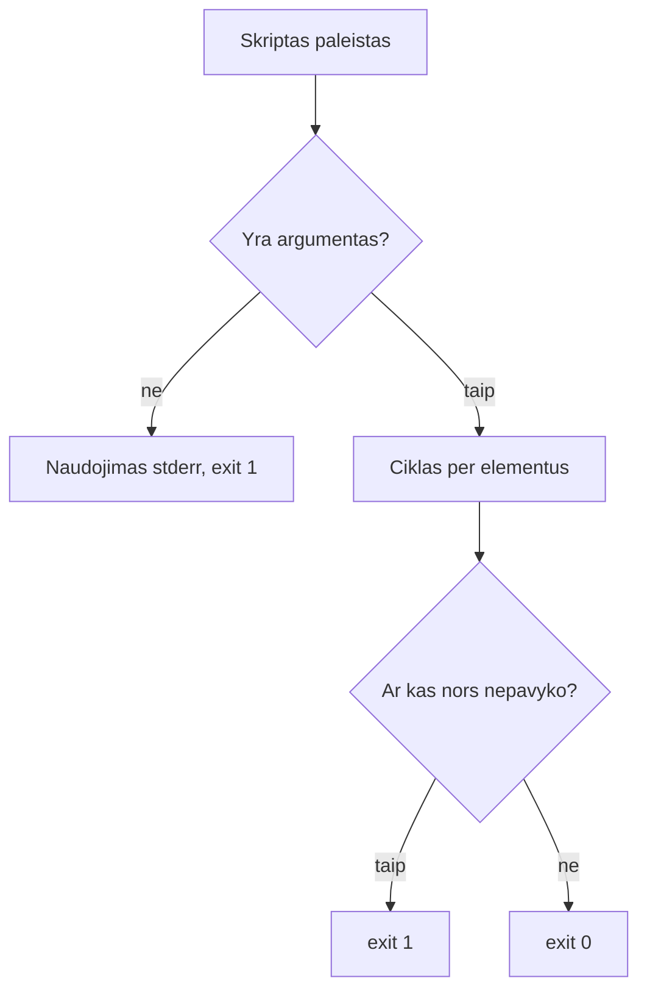

# 04 Bash skriptai

Data: 2026-11-17 (antradienis)

## Klasės darbas

1. Pasitikrinimas po 03 paskaitos (~10 min): dėstytojas parodo 03 sprendimą gyvai; kam neveikė `kill`, `apt`/`brew` ar PR, kartu randame priežastį
2. Skriptas ir argumentai (~20 min): jūs jau rašėte paprastus skriptus, todėl pradžia yra greitas pakartojimas
   1. Pakartojimas (~5 min): `#!/usr/bin/env bash`, `chmod +x`, kintamieji, `$(...)`; Mac Terminale numatytasis apvalkalas yra zsh, bet skriptai paleidžiami su Bash
   2. Argumentai: `$1`, `$2`, `$#`, `"$@"`; kodėl kintamieji rašomi kabutėse
   3. Išvesties kanalai: `echo ... >&2` klaidoms
3. Sąlygos (~25 min): [Bash Reference Manual: Conditional Constructs](https://www.gnu.org/software/bash/manual/bash.html#Conditional-Constructs)
   1. `if`, `elif`, `else`, `fi`
   2. Testai: `[ ]` ir `[[ ]]`; failams (`-e`, `-f`, `-d`), tekstui (`=`, `-z`), skaičiams (`-eq`, `-gt`, `-lt`)
   3. Ar komanda yra: `command -v irankis`
   4. Išėjimo kodas: `$?`, `exit 0` ir `exit 1`; kodėl kiti įrankiai (CI, `&&`) žiūri į kodą, o ne į tekstą
4. Pertrauka (~15 min)
5. Ciklai ir saugus skriptas (~25 min)
   1. `for` per sąrašą ir per failus (`for f in docs/*.md`); masyvai paprastai: `(a b c)` ir `"${masyvas[@]}"`
   2. Aritmetika: `$((x + 1))`
   3. `set -euo pipefail`: ką daro kiekviena dalis ir kodėl skriptas turi sustoti pirmoje klaidoje
   4. `&&` ir `||` (vienos eilutės sąlygos)
6. Bash kodo skaitymas (~10 min): projekto `run.sh` eilutė po eilutės (žr. skyrių „Užduotys“); tai pirmoji dalis būsimo `paleisti.sh` atsiskaitymui
7. Git: `.gitignore` ir atšaukimas (~10 min, pakartojimas): `.gitignore` ir `git check-ignore`; `git restore`, `git restore --staged`; kodėl `git reset --hard` pavojingas
8. Demonstracija: dėstytojas atlieka užduotis „argumentai, `if`, `for`“ su kitais pavyzdžiais (kitas skriptas, kiti vardai) (~20 min)
9. Kita paskaita: Tinklų pagrindai: IP, portai, DNS, HTTP, `curl`

## Kur skiriasi (Mac / Ubuntu)

| Veiksmas | Mac (Terminalas) | Ubuntu (WSL) |
|---|---|---|
| Numatytasis apvalkalas | zsh (skriptams nurodykite `bash`) | bash |
| Bash versija | 3.2 (sena) | 5.x |
| Skripto paleidimas | `bash scripts/x.sh` arba `./scripts/x.sh` | tas pats |

Skriptuose nenaudokite: `${var,,}`, `mapfile`, asociatyvių masyvų (`declare -A`), `&>>`: Mac Bash 3.2 jų neturi.

## Schemos

Kaip skriptas nusprendžia, kokį kodą grąžinti:



## Užduotys

Jei kas neveikia: perskaitykite klaidą, ieškokite dokumentacijoje arba klauskite LLM, ir užsirašykite, kas padėjo. Nuorodos yra pamoka.md. Komandos yra skyriuje „Komandos“: žiūrėkite tik įstrigę.

Užduotis skelbiu po vieną (Teams): pirma parodau gyvai, tada darote jūs.

### 1️⃣ Argumentai ir `if`

1. **Tikslas:** Parašyti skriptą, kuris priima argumentą ir nusprendžia, ką daryti, kai jo nėra.
2. Atnaujinkite `main` ir sukurkite šaką `pamoka-04`.
3. Sukurkite `scripts/sveiki.sh`, kuris išveda „Sveiki, <vardas>!“ su vardu iš pirmo argumento.
4. Jei argumento nėra, skriptas turi į klaidų kanalą parašyti naudojimo žinutę ir baigti su kodu 1.
5. Padarykite jį vykdomą ir paleiskite su vardu ir be vardo; po kiekvieno paleidimo pažiūrėkite išėjimo kodą.
6. Padarykite commit.

### 2️⃣ `for` ir išėjimo kodas

1. **Tikslas:** Patikrinti sąrašą įrankių cikle ir grąžinti kodą pagal rezultatą.
2. Sukurkite `scripts/patikra.sh`: be argumentų tikrina `git`, `python3`, `curl`; su argumentais tikrina juos.
3. Kiekvienam įrankiui išveskite „OK“ arba „TRŪKSTA“ ir pavadinimą.
4. Jei trūksta bent vieno, išveskite į klaidų kanalą, kiek jų trūksta, ir baikite su kodu 1; kitaip su kodu 0.
5. Paleiskite be argumentų ir su išgalvotu įrankiu; užrašykite abu išėjimo kodus faile `docs/bash.md`.
6. Padarykite commit.

### 3️⃣ Failai kataloge

1. **Tikslas:** Praeiti per failus ir apdoroti netinkamą įvestį.
2. Sukurkite `scripts/md-eilutes.sh`, kuris priima vieną katalogą ir kiekvienam `.md` failui jame išveda eilučių skaičių ir failo vardą.
3. Be argumento ar su nesančiu katalogu skriptas baigia su kodu 2 ir žinute klaidų kanale.
4. Paleiskite su `docs`, su nesančiu katalogu ir su katalogu be `.md` failų.
5. Pagal oficialią dokumentaciją suraskite, kuo skiriasi `[ ]` ir `[[ ]]` (žingsnių čia nėra, tik tikslas), ir vienu sakiniu užrašykite `docs/bash.md`.
6. Padarykite commit.

### 4️⃣ `run.sh`, `.gitignore` ir Pull Request

1. **Tikslas:** Perskaityti realų Bash skriptą, patikrinti `.gitignore` ir sulieti darbą per Pull Request.
2. Faile `docs/bash.md` paaiškinkite, ką daro kiekviena šio `run.sh` eilutė (be pirmos eilutės su `#!`):

   ```bash
   set -euo pipefail
   cd "$(dirname "$0")"
   [ -d .venv ] || python3 -m venv .venv
   .venv/bin/pip install -q -r requirements.txt
   [ -f .env ] && { set -a; . ./.env; set +a; }
   exec .venv/bin/flask --app app run --port "${PORT:-5001}"
   ```

3. Nukopijuokite `.env.example` į `.env` ir įsitikinkite, kad `git status` jo nerodo; komanda turi pasakyti, kuri `.gitignore` eilutė jį ignoruoja.
4. Pridėkite į `.gitignore` eilutę `*.log`, sukurkite failą `bandymas.log` ir įsitikinkite, kad Git jo nemato.
5. Sugadinkite `scripts/sveiki.sh` (ištrinkite eilutę) ir atšaukite pakeitimą nenaudodami `git reset --hard`. Tada pakeiskite jį, įtraukite į staging ir atšaukite staging.
6. Nusiųskite šaką `pamoka-04` į GitHub, atidarykite Pull Request į `main` ir sulieskite. Kompiuteryje atnaujinkite `main`.
7. Patikrinkite, kad commit'e nėra `.env` ar slaptažodžių.
8. **Papildomai:** parašykite skriptą `scripts/dydis.sh`, kuris priima katalogą ir išveda, kiek jame yra failų ir kiek aplankų.

## Komandos

Žiūrėkite tik įstrigę. Numeriai atitinka užduoties žingsnius.

## 1️⃣ Argumentai ir `if`

2. `git switch main`, `git pull`, `git switch -c pamoka-04`
3. Pirma eilutė `#!/usr/bin/env bash`; argumentas `$1`
4. `if [ "$#" -lt 1 ]; then ... fi`; klaidos kanalas `echo "..." >&2`; `exit 1`
5. `chmod +x scripts/sveiki.sh`, `./scripts/sveiki.sh Jonas`, `./scripts/sveiki.sh`, `echo $?`
6. `git add scripts/sveiki.sh`, `git commit -m "..."`

## 2️⃣ `for` ir išėjimo kodas

2. Masyvas `irankiai=(git python3 curl)`, argumentai `irankiai=("$@")`
3. `for irankis in "${irankiai[@]}"; do ... done`; ar komanda yra: `command -v "$irankis" >/dev/null 2>&1`
4. Skaitiklis `truksta=$((truksta + 1))`
5. `./scripts/patikra.sh`, `./scripts/patikra.sh git neegzistuoja`, `echo $?`

## 3️⃣ Failai kataloge

2. `for failas in "$1"/*.md; do ... done`; eilutės: `wc -l < "$failas"`
3. `[ ! -d "$1" ]`; `exit 2`
5. Oficiali dokumentacija: Bash Reference Manual, skyrius „Conditional Constructs“

## 4️⃣ `run.sh`, `.gitignore` ir Pull Request

3. `cp .env.example .env`, `git status`, `git check-ignore -v .env`
4. `echo "*.log" >> .gitignore`, `touch bandymas.log`, `git status`
5. `git restore scripts/sveiki.sh`; `git add scripts/sveiki.sh`, `git restore --staged scripts/sveiki.sh`
6. `git push -u origin pamoka-04`, GitHub'e **Compare & pull request**, sulieti, tada `git switch main` ir `git pull`

## Sprendimas (dėstytojui)

Patikrinta: `sveiki.sh`, `patikra.sh` ir `md-eilutes.sh` paleisti macOS (Bash 3.2) su visais pavyzdiniais atvejais ir išėjimo kodais; `.gitignore` eilutės (`.env`) esamas starteris jau turi. Nepatikrinta: tie patys skriptai Ubuntu (WSL, Bash 5) ir `git check-ignore -v` išvestis; išbandyti prieš pamoką.

### Kaip rodyti klasėje

1. (~10 min) Praeitos pamokos (03) sprendimas gyvai: paleiskite `scripts/aplinka.sh` be kintamojo ir su juo; parodykite `docs/procesai.md`.
2. (~20 min) Argumentai: kitas pavyzdys nei mokinių: `scripts/pridek.sh`, kuris sudeda du skaičius iš `$1` ir `$2` (`$(($1 + $2))`), be argumentų rodo naudojimą. Dažna klaida: `$1` be kabučių, kai reikšmėje tarpas; `chmod +x` pamirštas („Permission denied“).
3. (~25 min) Sąlygos: `if [ -f "$1" ]`, `[[ ]]` ir `command -v`; kitas pavyzdys: skriptas, kuris tikrina, ar yra `docker`. Parodykite `echo $?` po `exit 0` ir `exit 1`. Dažna klaida: trūksta tarpų aplink `[` ir `]`; `=` vietoj `-eq` su skaičiais; `[ $x = ... ]` be kabučių, kai `$x` tuščias.
4. (~25 min) Ciklai ir `set -euo pipefail`: `for` per `*.txt` kitame kataloge; parodykite, kas nutinka su `set -e` ir be jo, kai komanda nepavyksta. Dažna klaida: Mac studentas naudoja `${var,,}` ar `mapfile` (Bash 3.2 nepalaiko); `for f in *.md`, kai failų nėra (cikle lieka pats šablonas).
5. (~10 min) `run.sh` eilutė po eilutės; ypač `[ -d .venv ] || ...`, `exec` ir `${PORT:-5001}` (jau matė aplinkos kintamuosius 03).
6. (~10 min) Git: `.gitignore`, `git check-ignore -v`, `git restore`, `git restore --staged`; `git reset --hard` tik parodykite, kad jis ištrina pakeitimus. Dažna klaida: failas jau buvo `git add`, todėl `.gitignore` jam nebeveikia (`git rm --cached`).
7. Mokiniai daro užduotis; kitą pamoką parodote sprendimą.

### Sprendimas pagal darbus

| Darbas | Kur sprendime |
|---|---|
| Argumentai ir `if`, išėjimo kodas 1 | `scripts/sveiki.sh` |
| `for`, `command -v`, išėjimo kodai 0 ir 1 | `scripts/patikra.sh`, `docs/bash.md` |
| Failų ciklas, kodas 2 | `scripts/md-eilutes.sh` |
| `[ ]` ir `[[ ]]` | `docs/bash.md`, skyrius „Testai“ |
| `run.sh` paaiškinimas | `docs/bash.md`, skyrius `run.sh` |
| `.env` ir `*.log` ignoruojami | `git status` nerodo; `git check-ignore -v .env` |
| `restore` | `git status` švarus po `git restore` |
| Sulietas PR | GitHub **Merged** |

Dėstytojas kasdienių užduočių netikrina, tik rodo sprendimą; tikrinimas yra tik atsiskaitymuose (vertinimas.md).

### Pavyzdiniai failai

#### `scripts/sveiki.sh`

````bash
#!/usr/bin/env bash
# sveiki.sh – pasisveikina su vardu iš argumento.
# Naudojimas: ./scripts/sveiki.sh Vardas
set -euo pipefail

if [ "$#" -lt 1 ]; then
  echo "Naudojimas: $0 <vardas>" >&2
  exit 1
fi

echo "Sveiki, $1!"
````

#### `scripts/patikra.sh`

````bash
#!/usr/bin/env bash
# patikra.sh – patikrina, ar įrankiai įdiegti.
# Naudojimas: ./scripts/patikra.sh [įrankis ...]  (be argumentų: git, python3, curl)
set -euo pipefail

if [ "$#" -gt 0 ]; then
  irankiai=("$@")
else
  irankiai=(git python3 curl)
fi

truksta=0
for irankis in "${irankiai[@]}"; do
  if command -v "$irankis" >/dev/null 2>&1; then
    echo "OK      $irankis"
  else
    echo "TRŪKSTA $irankis"
    truksta=$((truksta + 1))
  fi
done

if [ "$truksta" -gt 0 ]; then
  echo "Trūksta įrankių: $truksta" >&2
  exit 1
fi
````

#### `scripts/md-eilutes.sh`

````bash
#!/usr/bin/env bash
# md-eilutes.sh – kiekvieno .md failo kataloge eilučių skaičius.
# Naudojimas: ./scripts/md-eilutes.sh docs
set -euo pipefail

if [ "$#" -ne 1 ]; then
  echo "Naudojimas: $0 <katalogas>" >&2
  exit 2
fi
if [ ! -d "$1" ]; then
  echo "Nėra katalogo: $1" >&2
  exit 2
fi

for failas in "$1"/*.md; do
  if [ ! -e "$failas" ]; then
    echo "Kataloge nėra .md failų"
    exit 0
  fi
  echo "$(wc -l < "$failas" | tr -d ' ') $failas"
done
````

#### `docs/bash.md`

````markdown
# Bash skriptai

## Išėjimo kodai

`./scripts/patikra.sh` su `git`, `python3`, `curl` baigėsi kodu 0. Su `git neegzistuoja` baigėsi kodu 1, nes vieno įrankio trūko.

## Testai

`[ ]` yra sena komanda, o `[[ ]]` yra Bash žodis: jame saugiau su tuščiais kintamaisiais ir galima naudoti `&&` bei `||`. Bet `[[ ]]` veikia tik Bash'e, o ne kituose apvalkaluose.

## run.sh

1. `set -euo pipefail` sustabdo skriptą pirmoje klaidoje, nenustatytame kintamajame ir nepavykusioje vamzdyje.
2. `cd "$(dirname "$0")"` pereina į skripto aplanką, kad jis veiktų iš bet kur.
3. `[ -d .venv ] || python3 -m venv .venv` sukuria virtualią aplinką tik jei jos dar nėra.
4. `.venv/bin/pip install -q -r requirements.txt` įdiegia priklausomybes tyliai.
5. `[ -f .env ] && { set -a; . ./.env; set +a; }` jei yra `.env`, įkelia jo kintamuosius į aplinką.
6. `exec .venv/bin/flask ... --port "${PORT:-5001}"` paleidžia serverį porte iš `PORT` arba 5001.
````
