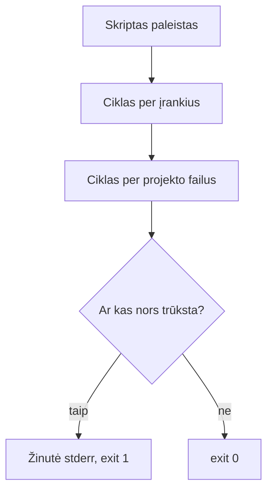

# 04 Bash skriptai

Data: 2026-11-17 (antradienis)

## Klasės darbas

3 val. Skaidrėse **N** rodo pastabas. Ritmas kiekvienai temai: teorija (skaidrės) → dėstytojas gyvai parodo **kitu pavyzdžiu** → Teams'e paskelbiama užduotis → jūs darote savo `devops-projektas`. Užduotys sudaro vieną giją: viename skripte `scripts/patikra.sh` auga tikrintuvas: pirma tikrina vieną įrankį, paskui jų sąrašą, paskui projekto failus; ketvirtoje užduotyje perskaitote tikrą `run.sh`, patvarkote `.gitignore` ir pateikiate darbą per Pull Request. Šis skriptas yra `paleisti.sh` (atsiskaitymui) užuomazga. Kitą užduotį gaunate tik baigę ankstesnę. Jūs jau rašėte paprastus skriptus (02, 03): einame greitai; naujovė yra argumentai, `if`, `for` ir išėjimo kodai.

1. Pasitikrinimas po 03 (~10 min): dėstytojas parodo 03 sprendimą gyvai (03 `pamoka.md`, skyrius „Sprendimas“); kam neveikė `kill`, `apt`/`brew` ar PR, kartu randame priežastį
2. Argumentai, `if` ir išėjimo kodas (~25 min teorijos ir demonstracijos), tada Užduotis 1 (~20 min): [skaidrės](https://raw.githack.com/dkoncius/Techin-DevOps/main/kursas/04%20Bash%20skriptai/skaidres/skaidres.html), 1–6 skaidrės
   1. Kodėl skriptas: tą pačią seką paleidžiame kartą ar šimtą kartų vienodai
   2. Pakartojimas: `#!/usr/bin/env bash`, `chmod +x`, kintamieji, `$(...)`; Mac Terminale numatytasis apvalkalas yra zsh, bet skriptai paleidžiami su Bash
   3. Argumentai: `$1`, `$#`, `"$@"`; kodėl kintamieji rašomi kabutėse
   4. `if`, `elif`, `else`, `fi`; testai `[ ]` failams (`-e`, `-f`, `-d`), tekstui (`=`, `-z`), skaičiams (`-eq`, `-gt`) ([Bash Reference Manual: Conditional Constructs](https://www.gnu.org/software/bash/manual/bash.html#Conditional-Constructs))
   5. Ar komanda yra: `command -v irankis`
   6. Išėjimo kodas: `$?`, `exit 0`, `exit 1`, `exit 2`; klaidų kanalas `>&2`; kodėl kiti įrankiai (CI, `&&`) žiūri į kodą, o ne į tekstą
   7. Demonstracija: dėstytojas atlieka „Argumentai ir `if`“ su `pridek.sh` ir `docker` tikrinimu (~8 min)
3. `for` ir saugus skriptas (~10 min teorijos ir demonstracijos), tada Užduotis 2 (~20 min): skaidrė 7
   1. `for` per sąrašą ir per failus; masyvas paprastai: `(a b c)` ir `"${masyvas[@]}"`
   2. Aritmetika: `$((x + 1))`
   3. `set -euo pipefail`: ką daro kiekviena dalis ir kodėl skriptas turi sustoti pirmoje klaidoje
   4. Demonstracija: dėstytojas atlieka „Ciklas“ su `for` per `*.txt` (~5 min)
4. Pertrauka (~15 min)
5. Failų patikra (~5 min demonstracijos), tada Užduotis 3 (~20 min): skaidrė 5 dar kartą
   1. Tas pats `if`, bet su `-f` ir `-d`; skriptas paleidžiamas iš projekto šaknies
   2. Demonstracija: dėstytojas atlieka „Failų patikra“ su kito projekto failais (~5 min)
6. Tikras Bash ir Git (~15 min teorijos ir demonstracijos), tada Užduotis 4 (~35 min): skaidrės 8–10
   1. `run.sh` eilutė po eilutės: `set -euo pipefail`, `cd "$(dirname "$0")"`, `||`, `&&`, `exec`, `${PORT:-5001}`
   2. `.gitignore` ir `git check-ignore -v`; `git restore`, `git restore --staged`; kodėl `git reset --hard` pavojingas
   3. Demonstracija: dėstytojas atlieka „`.gitignore` ir `restore`“ su `*.tmp` (~8 min)
7. Kita paskaita: Tinklų pagrindai: IP, portai, DNS, HTTP, `curl`

## Kur skiriasi (Mac / Ubuntu)

| Veiksmas | Mac (Terminalas) | Ubuntu (WSL) |
|---|---|---|
| Numatytasis apvalkalas | zsh (skriptams nurodykite `bash`) | bash |
| Bash versija | 3.2 (sena) | 5.x |
| Skripto paleidimas | `bash scripts/x.sh` arba `./scripts/x.sh` | tas pats |

Skriptuose nenaudokite: `${var,,}`, `mapfile`, asociatyvių masyvų (`declare -A`), `&>>`: Mac Bash 3.2 jų neturi.

## Schemos

Kaip `patikra.sh` nusprendžia, kokį kodą grąžinti:



## Užduotys

Jei kas neveikia: perskaitykite klaidą, ieškokite dokumentacijoje ir užsirašykite, kas padėjo (1 etape dirbtinio intelekto užduotyse nenaudojame; DI leidžiamas nuo Docker etapo). Nuorodos yra klasės darbe. Komandos yra skyriuje „Komandos“: žiūrėkite tik įstrigę.

Užduotis skelbiu po vieną (Teams). Pirmiausia parodau gyvai kitu pavyzdžiu, tada darote savo kompiuteryje ir tik baigę gaunate kitą. Užduotys eina viena gija ir visos vyksta jūsų `devops-projekte`: 1–3 plečia tą patį skriptą `scripts/patikra.sh`. Atsakymus į „Kodėl“ rašote faile `docs/bash.md`.

### 1️⃣ Argumentas ir `if`

1. **Tikslas:** Parašyti skriptą, kuris tikrina vieną įrankį pagal argumentą ir grąžina išėjimo kodą.
2. Eikite į savo `devops-projektas`, persijunkite į `main` ir atnaujinkite jį iš GitHub.
3. Sukurkite šaką `pamoka-04` ir persijunkite į ją.
4. Sukurkite `scripts/patikra.sh` su `#!/usr/bin/env bash` ir `set -euo pipefail`.
5. Skriptas priima vieną argumentą: įrankio pavadinimą.
6. Jei argumento nėra, skriptas į klaidų kanalą parašo naudojimo žinutę ir baigia su kodu 2.
7. Jei įrankis yra, skriptas išveda „OK“ ir pavadinimą; jei jo nėra, išveda „TRŪKSTA“ ir pavadinimą ir baigia su kodu 1.
8. Padarykite skriptą vykdomą.
9. Paleiskite jį su `git`, su `neegzistuoja` ir be argumento; po kiekvieno paleidimo pažiūrėkite išėjimo kodą.
10. Faile `docs/bash.md` (aplanką `docs` turite iš 02 ir 03) parašykite antraštę „# Bash skriptai“ ir skyrių „## Išėjimo kodai“ su trimis kodais, kuriuos gavote.
11. **Kodėl:** skyriuje „Išėjimo kodai“ vienu sakiniu užrašykite, kodėl naudojimo žinutę rašome į klaidų kanalą, o ne į įprastą išvestį.
12. Padarykite commit su žinute „Pridėtas patikra.sh“.

### 2️⃣ Ciklas per įrankius

1. **Tikslas:** Išplėsti tą patį skriptą, kad jis patikrintų įrankių sąrašą ir suskaičiuotų, kiek trūksta.
2. Pakeiskite `scripts/patikra.sh`: dabar jis priima bet kiek argumentų (įrankių), o be argumentų tikrina `git`, `python3`, `curl`.
3. Kiekvienam įrankiui išveskite „OK“ arba „TRŪKSTA“ ir pavadinimą ciklu.
4. Suskaičiuokite, kiek įrankių trūksta.
5. Jei trūksta bent vieno, išveskite į klaidų kanalą, kiek jų trūksta, ir baikite su kodu 1; kitaip su kodu 0.
6. Paleiskite be argumentų, su `git neegzistuoja kitas` ir su vienu įrankiu; po kiekvieno paleidimo pažiūrėkite išėjimo kodą.
7. Skyriuje „Išėjimo kodai“ užrašykite, kuris paleidimas koks kodas buvo.
8. **Kodėl:** to paties skyriaus pabaigoje vienu sakiniu paaiškinkite, kodėl CI ir `&&` žiūri į išėjimo kodą, o ne į tekstą „OK“.
9. Padarykite commit su žinute „Skriptas tikrina įrankių sąrašą“.

### 3️⃣ Projekto failų patikra

1. **Tikslas:** Pridėti tam pačiam skriptui projekto failų patikrą ir suprasti `[ ]` ir `[[ ]]`.
2. Papildykite `scripts/patikra.sh`: po įrankių ciklo tikrina failus `app.py`, `requirements.txt`, `run.sh`, `.env.example` (kiekvienam „OK“ arba „TRŪKSTA“) ir aplanką `docs`.
3. Į bendrą trūkstamų dalykų skaičių įtraukite ir trūkstamus failus bei aplanką.
4. Jei skriptas paleistas ne projekto šaknyje, jis trūkstamus failus pažymi „TRŪKSTA“ ir baigia su kodu 1; paleiskite jį iš `docs` aplanko ir iš projekto šaknies.
5. Pagal oficialią dokumentaciją suraskite, kuo skiriasi `[ ]` ir `[[ ]]` (žingsnių čia nėra, tik tikslas), ir skyriuje „Testai“ faile `docs/bash.md` užrašykite vienu sakiniu.
6. Išsaugokite skripto išvestį iš projekto šaknies faile `docs/patikra.txt`.
7. **Kodėl:** skyriuje „Testai“ vienu sakiniu užrašykite, kodėl su `set -e` skriptas sustoja pirmoje klaidoje, o ne važiuoja toliau.
8. Padarykite commit su žinute „Patikra tikrina projekto failus“.

### 4️⃣ `run.sh`, `.gitignore` ir Pull Request

1. **Tikslas:** Perskaityti tikrą Bash skriptą, patikrinti `.gitignore` ir pateikti visą darbą per Pull Request.
2. Faile `docs/bash.md` pridėkite skyrių „## run.sh“ ir paaiškinkite, ką daro kiekviena `run.sh` eilutė (be pirmos eilutės su `#!`; skriptas yra jūsų projekto šaknyje).
3. Nukopijuokite `.env.example` į `.env` ir įsitikinkite, kad `git status` jo nerodo; viena komanda parodykite, kuri `.gitignore` eilutė jį ignoruoja.
4. Pridėkite į `.gitignore` eilutę `*.log`, sukurkite failą `bandymas.log` ir įsitikinkite, kad Git jo nemato.
5. Sugadinkite `scripts/patikra.sh` (ištrinkite bet kurią eilutę) ir atšaukite pakeitimą nenaudodami `git reset --hard`.
6. Pakeiskite jį dar kartą, įtraukite į staging ir atšaukite staging.
7. **Kodėl:** skyriuje „run.sh“ vienu sakiniu užrašykite, kodėl `.env` neina į Git, o `.env.example` eina.
8. Padarykite commit'ą su `.gitignore` (žinutė „Ignoruojami .log failai“) ir atskirą commit'ą su `docs` aplanku (žinutė „Pridėtas bash.md“).
9. Patikrinkite, kad `docs`, `scripts` ir commit'uose nėra `.env` ar slaptažodžių.
10. Nusiųskite šaką `pamoka-04` į GitHub ir atidarykite Pull Request į `main` pavadinimu „Bash skriptai“ su vieno sakinio aprašu.
11. Peržiūrėkite **Files changed**: turi matytis visi penki commit'ai ir jūsų failai.
12. Sulieskite Pull Request, kompiuteryje persijunkite į `main` ir atnaujinkite jį.
13. Ištrinkite šaką `pamoka-04` kompiuteryje ir GitHub'e.
14. **Papildomai:** parašykite skriptą `scripts/dydis.sh`, kuris priima katalogą ir išveda, kiek jame yra failų ir kiek aplankų.

## Komandos

Žiūrėkite tik įstrigę. Numeriai atitinka užduoties žingsnius.

## 1️⃣ Argumentas ir `if`

2. `cd ~/devops/devops-projektas`, `git switch main`, `git pull`
3. `git switch -c pamoka-04`
4. `mkdir -p scripts`; pirma eilutė `#!/usr/bin/env bash`, antra `set -euo pipefail`
5. Argumentas `$1`; kiek jų: `$#`
6. `if [ "$#" -lt 1 ]; then ... fi`; klaidų kanalas `echo "..." >&2`; `exit 2`
7. Ar komanda yra: `command -v "$1" >/dev/null 2>&1`; `exit 1`
8. `chmod +x scripts/patikra.sh`
9. `./scripts/patikra.sh git`, `./scripts/patikra.sh neegzistuoja`, `./scripts/patikra.sh`, po kiekvieno `echo $?`
10. `mkdir -p docs`, tada redaktoriumi arba `printf '# Bash skriptai\n\n## Išėjimo kodai\n' > docs/bash.md`
12. `git add scripts docs`, `git commit -m "Pridėtas patikra.sh"`

## 2️⃣ Ciklas per įrankius

2. Masyvas `irankiai=(git python3 curl)`; argumentai `irankiai=("$@")`
3. `for irankis in "${irankiai[@]}"; do ... done`
4. `truksta=0`, tada `truksta=$((truksta + 1))`
5. `if [ "$truksta" -gt 0 ]; then echo "..." >&2; exit 1; fi`
6. `./scripts/patikra.sh`, `./scripts/patikra.sh git neegzistuoja kitas`, `echo $?`
7. `docs/bash.md` redaguokite redaktoriumi arba `>>`
9. `git add scripts docs`, `git commit -m "Skriptas tikrina įrankių sąrašą"`

## 3️⃣ Projekto failų patikra

2. `failai=(app.py requirements.txt run.sh .env.example)`; failui `[ -f "$failas" ]`, aplankui `[ -d docs ]`
4. `cd docs`, `../scripts/patikra.sh`, `echo $?`, `cd ..`
5. Oficiali dokumentacija: Bash Reference Manual, skyrius „Conditional Constructs“
6. `./scripts/patikra.sh > docs/patikra.txt`
8. `git add scripts docs`, `git commit -m "Patikra tikrina projekto failus"`

## 4️⃣ `run.sh`, `.gitignore` ir Pull Request

2. `cat run.sh`; `docs/bash.md` redaguokite redaktoriumi arba `>>`
3. `cp .env.example .env`, `git status`, `git check-ignore -v .env`
4. `echo "*.log" >> .gitignore`, `touch bandymas.log`, `git status`
5. Ištrinkite eilutę `scripts/patikra.sh`, tada `git restore scripts/patikra.sh`
6. Pakeiskite failą, `git add scripts/patikra.sh`, `git restore --staged scripts/patikra.sh`, tada `git restore scripts/patikra.sh`
8. `git add .gitignore`, `git commit -m "Ignoruojami .log failai"`, tada `git add docs`, `git commit -m "Pridėtas bash.md"`
10. `git push -u origin pamoka-04`, GitHub'e **Compare & pull request**
11–12. **Files changed**, **Merge pull request**; tada `git switch main`, `git pull`
13. `git branch -d pamoka-04`, `git push origin --delete pamoka-04` (arba GitHub'e **Delete branch**)

## Sprendimas (dėstytojui)

Patikrinta: macOS (Bash 3.2): `scripts/patikra.sh` galutinė versija su visais atvejais ir išėjimo kodais (be argumentų, su `git neegzistuoja kitas`, iš `docs` ir iš šaknies); `git check-ignore -v .env`, `git restore`. Nepatikrinta: tas pats Ubuntu (WSL, Bash 5), Pull Request GitHub svetainėje; išbandyti prieš pamoką.

### Kaip rodyti klasėje

Laiko juosta (~155 min be pertraukos, rezervas ~25 min):

| Trukmė | Kas |
|---|---|
| 10 min | 03 sprendimas gyvai |
| 25 + 20 min | Argumentai, `if`, kodai (demonstracija + Užduotis 1) |
| 10 + 20 min | Ciklas (demonstracija + Užduotis 2) |
| 15 min | Pertrauka |
| 5 + 20 min | Failų patikra (demonstracija + Užduotis 3) |
| 15 + 35 min | `run.sh`, Git ir PR (demonstracija + Užduotis 4) |

1. (~10 min) 03 sprendimas: parodykite 03 `pamoka.md` skyrių „Sprendimas“: `scripts/aplinka.sh` be kintamojo ir su juo, `docs/procesai.md`. Pasakykite, kad šiandien visos užduotys plečia vieną skriptą.
2. Užduotis 1 (~25 min demonstracija, ~20 min darbas): kitas pavyzdys nei mokinių: `pridek.sh`, kuris sudeda du skaičius iš `$1` ir `$2` (`$(($1 + $2))`) ir be argumentų rodo naudojimą; tada skriptas, kuris tikrina, ar yra `docker`. Parodykite `echo $?` po `exit 0`, `exit 1`, `exit 2`. Dažna klaida: `$1` be kabučių, kai reikšmėje tarpas; trūksta tarpų aplink `[` ir `]`; `=` vietoj `-eq` su skaičiais; `chmod +x` pamirštas („Permission denied“); `echo $?` po kitos komandos.
3. Užduotis 2 (~10 min demonstracija, ~20 min darbas): `for` per `*.txt` kitame kataloge; parodykite, kas nutinka su `set -e` ir be jo, kai komanda nepavyksta. Dažna klaida: Mac studentas naudoja `${var,,}` ar `mapfile` (Bash 3.2 nepalaiko); `for f in *.md`, kai failų nėra (cikle lieka pats šablonas); skaitiklis `truksta` nenustatytas prieš ciklą (`set -u`).
4. (~15 min) Pertrauka.
5. Užduotis 3 (~5 min demonstracija, ~20 min darbas): kito projekto failų patikra (pvz. `package.json`, `README.md`). Dažna klaida: skriptas paleistas ne projekto šaknyje ir viskas „TRŪKSTA“ (tai teisinga, bet mokiniai mano, kad skriptas sugedęs); `-f` vietoj `-d` aplankui.
6. Užduotis 4 (~15 min demonstracija, ~35 min darbas): `run.sh` eilutė po eilutės, ypač `[ -d .venv ] || ...`, `exec` ir `${PORT:-5001}` (jau matė aplinkos kintamuosius 03). Git: `.gitignore` su `*.tmp`, `git check-ignore -v`, `git restore`, `git restore --staged`; `git reset --hard` tik parodykite, kad jis ištrina pakeitimus. Dažna klaida: failas jau buvo `git add`, todėl `.gitignore` jam nebeveikia (`git rm --cached`); PR sulietas GitHub'e, bet `main` kompiuteryje neatnaujintas (`git pull`).

### Sprendimas pagal darbus

| Darbas | Kur sprendime |
|---|---|
| Argumentas, `if`, kodai 0/1/2 (Užduotis 1) | `scripts/patikra.sh`; `docs/bash.md`, skyrius „Išėjimo kodai“ |
| Ciklas, skaitiklis, kodas 1 (Užduotis 2) | `scripts/patikra.sh`; `docs/bash.md` |
| Failų ir aplanko patikra (Užduotis 3) | `scripts/patikra.sh`; `docs/patikra.txt` |
| `[ ]` ir `[[ ]]`, `set -e` | `docs/bash.md`, skyrius „Testai“ |
| `run.sh` paaiškinimas (Užduotis 4) | `docs/bash.md`, skyrius „run.sh“ |
| `.env` ir `*.log` ignoruojami | `git status` nerodo; `git check-ignore -v .env` |
| `restore` | `git status` švarus po `git restore` |
| 5 commit'ai ir sulietas PR | `git log --oneline` ir GitHub **Merged** |

Dėstytojas kasdienių užduočių netikrina, tik rodo sprendimą; tikrinimas yra tik atsiskaitymuose (vertinimas.md).

### Pavyzdiniai failai

#### `scripts/patikra.sh` (galutinė versija po 3 užduoties)

````bash
#!/usr/bin/env bash
# patikra.sh – patikrina, ar yra įrankiai ir projekto failai.
# Naudojimas: ./scripts/patikra.sh [įrankis ...]  (be argumentų: git, python3, curl)
# Išėjimo kodas: 0 viskas yra, 1 kažko trūksta.
set -euo pipefail

if [ "$#" -gt 0 ]; then
  irankiai=("$@")
else
  irankiai=(git python3 curl)
fi
failai=(app.py requirements.txt run.sh .env.example)

truksta=0

for irankis in "${irankiai[@]}"; do
  if command -v "$irankis" >/dev/null 2>&1; then
    echo "OK      $irankis"
  else
    echo "TRŪKSTA $irankis"
    truksta=$((truksta + 1))
  fi
done

for failas in "${failai[@]}"; do
  if [ -f "$failas" ]; then
    echo "OK      $failas"
  else
    echo "TRŪKSTA $failas"
    truksta=$((truksta + 1))
  fi
done

if [ -d docs ]; then
  echo "OK      docs/"
else
  echo "TRŪKSTA docs/"
  truksta=$((truksta + 1))
fi

if [ "$truksta" -gt 0 ]; then
  echo "Trūksta: $truksta" >&2
  exit 1
fi
````

Užduotyje 1 (kodas 2 be argumento) ir užduotyje 2 skriptas yra tarpinės versijos; galutinėje versijoje be argumentų naudojamas numatytasis sąrašas, o kodas 2 nebereikalingas.

#### `docs/bash.md`

````markdown
# Bash skriptai

## Išėjimo kodai

`./scripts/patikra.sh git` baigėsi kodu 0, `./scripts/patikra.sh neegzistuoja` kodu 1, o be argumento (1 užduoties versijoje) kodu 2.

Naudojimo žinutę rašome į klaidų kanalą (`>&2`), kad ji nesimaišytų su įprasta išvestimi, kurią kita programa gali skaityti ar įrašyti į failą.

Su `git neegzistuoja kitas` kodas 1, nes trūksta dviejų įrankių; su tik `git` kodas 0.

CI ir `&&` žiūri į išėjimo kodą, nes tekstą galima parašyti bet kaip, o kodas yra vienintelis patikimas „pavyko / nepavyko“ ženklas.

## Testai

`[ ]` yra sena komanda, o `[[ ]]` yra Bash žodis: jame saugiau su tuščiais kintamaisiais ir galima naudoti `&&` bei `||`, bet jis veikia tik Bash'e.

`set -e` sustabdo skriptą pirmoje nepavykusioje komandoje, kad klaida nesikauptų ir skriptas nesidarytų „sėkmingas“ po sugadinto žingsnio.

## run.sh

1. `set -euo pipefail` sustabdo skriptą pirmoje klaidoje, nenustatytame kintamajame ir nepavykusioje vamzdyje.
2. `cd "$(dirname "$0")"` pereina į skripto aplanką, kad jis veiktų iš bet kur.
3. `[ -d .venv ] || python3 -m venv .venv` sukuria virtualią aplinką tik jei jos dar nėra.
4. `.venv/bin/pip install -q -r requirements.txt` įdiegia priklausomybes tyliai.
5. `[ -f .env ] && { set -a; . ./.env; set +a; }` jei yra `.env`, įkelia jo kintamuosius į aplinką.
6. `exec .venv/bin/flask ... --port "${PORT:-5001}"` paleidžia serverį porte iš `PORT` arba 5001.

`.env` neina į Git, nes jame slaptos reikšmės; `.env.example` eina, nes rodo, kokių kintamųjų reikia, be pačių reikšmių.
````
