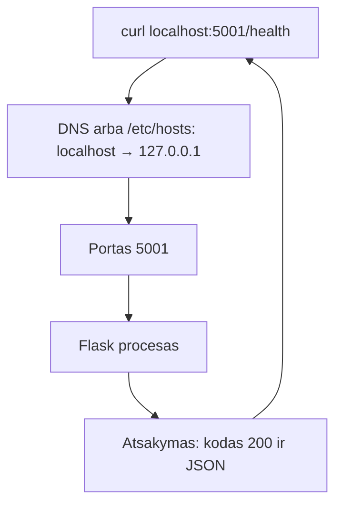

# 05 Tinklų pagrindai

Data: 2026-11-18 (trečiadienis)

## Klasės darbas

1. Pasitikrinimas po 04 paskaitos (~10 min): dėstytojas parodo 04 sprendimą gyvai; kam neveikė `if`, `for` ar išėjimo kodas, kartu randame priežastį
2. Demonstracija pradžioje (~5 min): dėstytojas paleidžia projektą ir iš kito lango kreipiasi į jį su `curl`: vienas procesas klauso, kitas klausia
3. IP, portai ir DNS (~25 min)
   1. IP adresas: kas tai, `localhost` ir `127.0.0.1`, privatus ir viešas adresas (be realių adresų pavyzdžių)
   2. Portas: kodėl vienas adresas turi daug paslaugų; įprasti portai: 22 (SSH), 80 (HTTP), 443 (HTTPS), 3306 (MySQL), 5001 (mūsų Flask)
   3. Kas klauso porto: `lsof -nP -i :5001`; kodėl du procesai negali klausyti to paties porto
   4. DNS: vardas → IP; `nslookup`; failas `/etc/hosts` (jūs jau naudojote su Apache)
4. HTTP ir `curl` (~30 min)
   1. Užklausa ir atsakymas: metodas (`GET`, `POST`), kelias, antraštės, kūnas; [MDN: HTTP apžvalga](https://developer.mozilla.org/en-US/docs/Web/HTTP/Overview)
   2. Kodai: 2xx (pavyko), 3xx (nukreipimas), 4xx (kliento klaida: 404), 5xx (serverio klaida: 500); [MDN: HTTP statuso kodai](https://developer.mozilla.org/en-US/docs/Web/HTTP/Status)
   3. `curl`: pagrindinis, `-i` (antraštės), `-s` (tyliai), `-o`, `-w "%{http_code}"` (tik kodas), `-X POST`, `-H`, `-d`; [curl dokumentacija](https://curl.se/docs/manpage.html)
   4. Kodėl `/health` grąžina 200: kaip kiti įrankiai žino, kad programa gyva
5. Pertrauka (~15 min)
6. Projektas ir tinklas (~15 min): paleidžiame `./run.sh`, kreipiamės į `/health`, `/status`, `/items`; `PORT=5002 ./run.sh` ir užimtas portas
7. Skripto ir tinklo sujungimas (~10 min): `curl` skripte ir išėjimo kodas (tai ruošia `paleisti.sh`, kuris lauks `/health` 200)
8. Demonstracija: dėstytojas atlieka užduotis „kodai, portai, DNS“ su kitais pavyzdžiais (kitas porto numeris, kitas kelias, kitas domenas) (~20 min)
9. Kita paskaita: SSH ir raktai, darbas nuotoliniame serveryje

## Kur skiriasi (Mac / Ubuntu)

| Veiksmas | Mac (Terminalas) | Ubuntu (WSL) |
|---|---|---|
| `curl` | yra | paprastai yra; jei ne: `sudo apt install curl` |
| Kas klauso porto | `lsof -nP -i :5001` (yra) | tas pats; jei nėra: `sudo apt install lsof` |
| DNS užklausa | `nslookup vardas` (yra) | `nslookup vardas`; jei nėra: `sudo apt install dnsutils` |
| Porto sąrašas | `lsof -nP -i -sTCP:LISTEN` | tas pats (`ss -ltnp` yra tik Ubuntu, kurse nenaudojame) |

## Schemos

Užklausa nuo `curl` iki programos:



## Užduotys

Jei kas neveikia: perskaitykite klaidą, ieškokite dokumentacijoje arba klauskite LLM, ir užsirašykite, kas padėjo. Nuorodos yra pamoka.md. Komandos yra skyriuje „Komandos“: žiūrėkite tik įstrigę.

Užduotis skelbiu po vieną (Teams): pirma parodau gyvai, tada darote jūs. Visoms užduotims projektas turi būti paleistas viename terminalo lange, o komandos rašomos kitame.

### 1️⃣ Pirmas `curl`

1. **Tikslas:** Paleisti projektą ir pasiekti jį per HTTP.
2. Atnaujinkite `main` ir sukurkite šaką `pamoka-05`.
3. Viename terminale paleiskite projektą (`devops-projektas` aplanke).
4. Kitame terminale su `curl` gaukite atsakymą iš `/health` ir `/status`.
5. Parodykite atsakymo antraštes iš `/health` ir suraskite eilutę su HTTP kodu.
6. Faile `docs/tinklai.md` užrašykite abiejų atsakymų turinį (kompiuterio vardo neįrašykite).

### 2️⃣ HTTP kodai ir skriptas

1. **Tikslas:** Gauti skirtingus HTTP kodus ir parašyti skriptą, kuris juos tikrina.
2. Su vienu `curl` išveskite tik HTTP kodą `/health` adresui. Tada tą patį nesančiam keliui `/nera`; užrašykite abu kodus `docs/tinklai.md`.
3. Su `curl` pridėkite daiktą per `POST /items` (JSON `{"name": "..."}`), tada gaukite sąrašą per `GET /items`.
4. Sukurkite `scripts/http-kodas.sh`: priima vieną URL, išveda HTTP kodą ir baigia su kodu 0, jei kodas 200, kitaip 1. Be argumento baigia su kodu 2 ir žinute klaidų kanale.
5. Paleiskite skriptą su `/health`, su `/nera` ir kai projektas sustabdytas. Užrašykite, kokį kodą išveda `curl`, kai niekas neklauso porto.
6. Padarykite commit.

### 3️⃣ Portai

1. **Tikslas:** Rasti, kuris procesas klauso porto, ir pamatyti užimto porto klaidą.
2. Kol projektas veikia, suraskite jo procesą ir PID pagal portą 5001.
3. Antrame lange pabandykite paleisti projektą dar kartą tame pačiame porte; užsirašykite klaidą.
4. Paleiskite antrą kopiją kitame porte ir patikrinkite, kad abi atsako.
5. Sustabdykite abi kopijas ir įsitikinkite, kad portai laisvi.
6. Faile `docs/tinklai.md` vienu sakiniu paaiškinkite, kodėl du procesai negali klausyti to paties porto.

### 4️⃣ DNS ir Pull Request

1. **Tikslas:** Suprasti DNS ir sulieti darbą per Pull Request.
2. Su DNS komanda išsiaiškinkite, į kokį adresą nurodo `localhost`; faile `docs/tinklai.md` užrašykite, ar tai viešas adresas.
3. Pagal oficialią dokumentaciją suraskite, kam skirtas `/etc/hosts` (žingsnių čia nėra, tik tikslas), ir užrašykite `docs/tinklai.md`.
4. Faile `docs/tinklai.md` lentelėje priskirkite 22, 80, 443, 3306 ir 5001 portams paslaugas.
5. Nusiųskite šaką `pamoka-05` į GitHub, atidarykite Pull Request į `main` ir sulieskite. Kompiuteryje atnaujinkite `main`.
6. Patikrinkite, kad commit'e nėra slaptažodžių, raktų ar `.env` turinio.
7. **Papildomai:** išsiaiškinkite pagal curl dokumentaciją, ką daro `-L` ir kada jis reikalingas (kokie 3xx kodai ir kuri antraštė), ir užrašykite `docs/tinklai.md`.

## Komandos

Žiūrėkite tik įstrigę. Numeriai atitinka užduoties žingsnius.

## 1️⃣ Pirmas `curl`

2. `git switch main`, `git pull`, `git switch -c pamoka-05`
3. `cd ~/devops/devops-projektas`, `./run.sh`
4. `curl localhost:5001/health`, `curl localhost:5001/status`
5. `curl -i localhost:5001/health`

## 2️⃣ HTTP kodai ir skriptas

2. `curl -s -o /dev/null -w "%{http_code}\n" localhost:5001/health`
3. `curl -X POST -H 'Content-Type: application/json' -d '{"name":"X"}' localhost:5001/items`, tada `curl localhost:5001/items`
4. Kodas: `kodas=$(curl -s -o /dev/null -w "%{http_code}" "$1" || true)`, tada `[ "$kodas" = "200" ]`
5. `./scripts/http-kodas.sh http://localhost:5001/health`, `echo $?`

## 3️⃣ Portai

2. `lsof -nP -i :5001`
3. `./run.sh` antrame lange (klaida apie užimtą portą)
4. `PORT=5002 ./run.sh`, tada `curl localhost:5002/health`
5. `Ctrl+C` kiekviename lange, tada `lsof -nP -i :5001` ir `lsof -nP -i :5002` (tuščia išvestis = laisva)

## 4️⃣ DNS ir Pull Request

2. `nslookup localhost`
5. `git push -u origin pamoka-05`, GitHub'e **Compare & pull request**, sulieti, tada `git switch main` ir `git pull`

## Sprendimas (dėstytojui)

Patikrinta: `scripts/http-kodas.sh` paleistas macOS (Bash 3.2) su `python3 -m http.server`: 200 → kodas 0, 404 → kodas 1, sustabdytas serveris → `000` ir kodas 1; `lsof -nP -i :PORTAS` rodo PID. Nepatikrinta: `curl` tiesiai prie Flask starterio, `nslookup localhost` išvestis Ubuntu, `lsof`/`dnsutils` diegimas WSL. Išbandyti prieš pamoką.

### Kaip rodyti klasėje

1. (~10 min) Praeitos pamokos (04) sprendimas gyvai: paleiskite `scripts/patikra.sh` su `git neegzistuoja` ir `echo $?`.
2. (~5 min) Demonstracija pradžioje: `./run.sh` vienoje lango dalyje, `curl localhost:5001/health` kitoje; parodykite atsakymą.
3. (~25 min) IP, portai, DNS: kitas pavyzdys nei mokinių: `python3 -m http.server 8080` ir `lsof -nP -i :8080`, kitas langas `curl -I localhost:8080`. Dažna klaida: `localhost` supainiojamas su viešu adresu; studentas klauso ne tą portą.
4. (~30 min) HTTP: `curl -i` į `/health`, `/nera`, `POST /items`; parodykite kodus 200, 404 ir `000` (niekas neklauso). Kitas pavyzdys nei mokinių: `/status` ir nesantis kelias `/pamiršau`. Dažna klaida: `-X POST` be `-H 'Content-Type: application/json'` (400); vienos kabutės Windows ne PowerShell'e; `curl` į `https://localhost`.
5. (~15 min) `PORT=5002 ./run.sh`, užimto porto klaida; dažna klaida: nepabaigtas `./run.sh` lieka fone (`Ctrl+Z` vietoj `Ctrl+C`): suraskite per `lsof` ir `kill`.
6. (~10 min) `http-kodas.sh`: eilutė po eilutės; atkreipkite dėmesį į `|| true` (be jo su `set -e` skriptas nutrūktų, kai niekas neklauso).
7. Mokiniai daro užduotis; kitą pamoką parodote sprendimą.

### Sprendimas pagal darbus

| Darbas | Kur sprendime |
|---|---|
| `/health` ir `/status` atsakymai | `docs/tinklai.md`, skyrius „Atsakymai“ |
| Kodai 200 ir 404, `POST` ir `GET /items` | `docs/tinklai.md`, skyrius „Kodai“ |
| `http-kodas.sh` | `scripts/http-kodas.sh` |
| Kodas, kai niekas neklauso | `docs/tinklai.md`: `000` |
| Procesas ir PID porte 5001, užimtas portas, antras portas | `docs/tinklai.md`, skyrius „Portai“ |
| `localhost`, `/etc/hosts`, porto lentelė | `docs/tinklai.md`, skyriai „DNS“ ir „Portai“ |
| Sulietas PR | GitHub **Merged** |

Dėstytojas kasdienių užduočių netikrina, tik rodo sprendimą; tikrinimas yra tik atsiskaitymuose (vertinimas.md).

### Pavyzdiniai failai

#### `scripts/http-kodas.sh`

````bash
#!/usr/bin/env bash
# http-kodas.sh – išveda HTTP kodą; 0 jei 200, kitaip 1.
# Naudojimas: ./scripts/http-kodas.sh http://localhost:5001/health
set -euo pipefail

if [ "$#" -ne 1 ]; then
  echo "Naudojimas: $0 <url>" >&2
  exit 2
fi

kodas=$(curl -s -o /dev/null -w "%{http_code}" "$1" || true)
echo "$kodas"

if [ "$kodas" = "200" ]; then
  exit 0
fi
exit 1
````

#### `docs/tinklai.md`

````markdown
# Tinklų pagrindai

## Atsakymai

`curl localhost:5001/health` grąžina `{"status": "ok"}`, kodas 200. `/status` grąžina versiją, kompiuterio vardą ir DB būseną (pavyzdinė išvestis, priklauso nuo kompiuterio).

## Kodai

`/health` → 200, `/nera` → 404. `POST /items` prideda daiktą, `GET /items` jį parodo. Kai projektas sustabdytas, `curl -w "%{http_code}"` išveda `000`: ryšio nėra, atsakymo kodo nėra.

## Portai

`lsof -nP -i :5001` parodė `python` procesą su PID. Antrą kartą paleidus tame pačiame porte, Flask pranešė, kad adresas užimtas: du procesai negali klausyti to paties porto, nes sistema neturėtų kam perduoti užklausos. Su `PORT=5002` antra kopija veikė šalia pirmos.

| Portas | Paslauga |
|---|---|
| 22 | SSH |
| 80 | HTTP |
| 443 | HTTPS |
| 3306 | MySQL |
| 5001 | mūsų Flask projektas |

## DNS

`nslookup localhost` rodo `127.0.0.1`: tai ne viešas adresas, o šis kompiuteris. `/etc/hosts` yra failas, kuriame galima nurodyti vardą ir adresą ranka, ir sistema jį patikrina anksčiau nei klausia DNS serverio.
````
