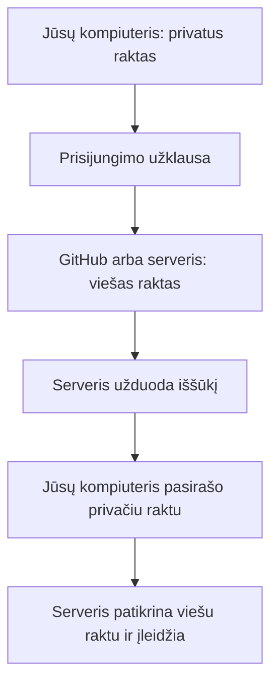
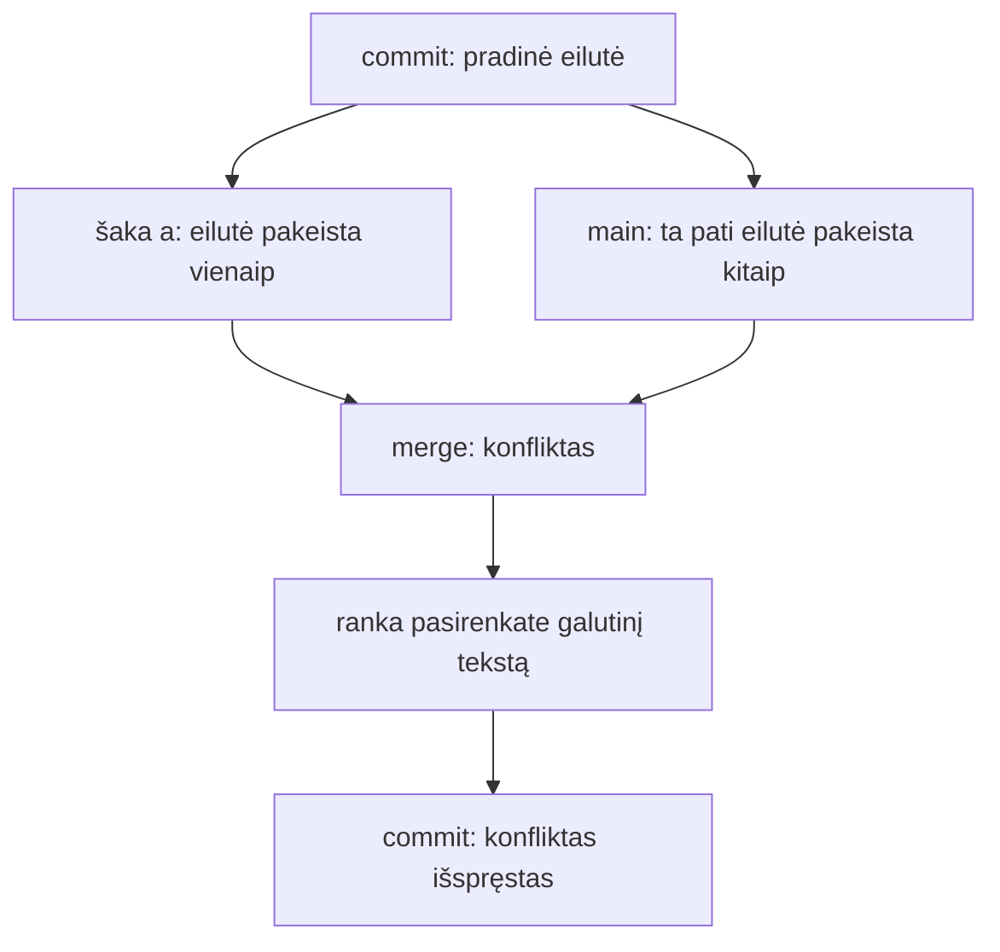

# 06 SSH ir raktai

Data: 2026-11-19 (ketvirtadienis)

## Klasės darbas

1. Pasitikrinimas po 05 paskaitos (~10 min): dėstytojas parodo 05 sprendimą gyvai; kam neveikė `curl`, `lsof` ar PR, kartu randame priežastį
2. SSH pakartojimas (~10 min): jūs jau jungėtės prie serverio su `ssh` ir kopijavote su `scp`, todėl tik prisimename
   1. Kas yra SSH: saugus ryšys su kitu kompiuteriu, portas 22
   2. Kuo prisijungimas slaptažodžiu blogesnis už prisijungimą raktu: slaptažodį galima atspėti ir nutekinti
3. Raktų pora (~25 min): [GitHub: Connecting to GitHub with SSH](https://docs.github.com/en/authentication/connecting-to-github-with-ssh)
   1. Privatus ir viešas raktas: privatus lieka tik jūsų kompiuteryje, viešas (`.pub`) gali būti kur nori
   2. `ssh-keygen -t ed25519`; kodėl kiekvienam tikslui atskiras failas (`-f`), kad nepersirašytų esamas raktas; slaptažodinė frazė (passphrase)
   3. Aplankas `~/.ssh` ir teisės: aplankas `700`, privatus raktas `600`, viešas `644`; SSH atsisako rakto, kurį mato kiti
   4. Kodėl privatus raktas niekada nekeliamas į Git, DI ar susirašinėjimą; ką daryti, jei per klaidą pakeltas (raktą pakeisti naujos poros kūrimu)
4. Pertrauka (~15 min)
5. Raktas ir GitHub (~25 min)
   1. Viešo rakto pridėjimas prie GitHub paskyros (nustatymai arba `gh`)
   2. Pirmas prisijungimas ir serverio pirštų antspaudas (`known_hosts`): kodėl klausia „yes“ ir ką tada tikrinti ([GitHub SSH raktų pirštų antspaudai](https://docs.github.com/en/authentication/keeping-your-account-and-data-secure/githubs-ssh-key-fingerprints))
   3. `~/.ssh/config`: `Host`, `HostName`, `User`, `IdentityFile`; kad nereikėtų nurodyti rakto kiekvieną kartą
   4. Patikra: `ssh -T git@github.com`; `git remote set-url`, kad `origin` naudotų SSH
   5. Prisijungimas prie serverio raktu: tas pats principas (viešas raktas serveryje, privatus pas jus); tai naudosime Azure dalyje
6. Git: merge konfliktas (~20 min): kaip atsiranda, kaip atrodo (`<<<<<<<`, `=======`, `>>>>>>>`), kaip išspręsti ir užbaigti; `git merge --abort`
7. Demonstracija: dėstytojas atlieka užduotis „raktas, `config`, konfliktas“ su kitais pavyzdžiais (kitas rakto vardas, kita eilutė faile) (~20 min)
8. Kita paskaita: Git pagrindai: commit, branch, merge, konfliktai (gilesnė dalis)

## Kur skiriasi (Mac / Ubuntu)

| Veiksmas | Mac (Terminalas) | Ubuntu (WSL) |
|---|---|---|
| `ssh`, `ssh-keygen` | yra | paprastai yra; jei ne: `sudo apt install openssh-client` |
| Teisės `~/.ssh` | `chmod 700 ~/.ssh`, `chmod 600 raktas` | tas pats; nelaikyti raktų `/mnt/c` (teisės neveikia) |
| `ssh-copy-id` | nėra pagal numatymą | yra |
| Redaktorius `config` | `nano ~/.ssh/config` arba VS Code | tas pats |

## Schemos

Kaip veikia prisijungimas raktu:



Merge konfliktas:



## Užduotys

Jei kas neveikia: perskaitykite klaidą, ieškokite dokumentacijoje arba klauskite LLM, ir užsirašykite, kas padėjo. Nuorodos yra pamoka.md. Komandos yra skyriuje „Komandos“: žiūrėkite tik įstrigę.

Užduotis skelbiu po vieną (Teams): pirma parodau gyvai, tada darote jūs. **Niekada nerodykite ir nesiųskite privataus rakto**: dalinatės tik `.pub` failu ar jo dalimi.

### 1️⃣ Raktų pora

1. **Tikslas:** Sukurti raktų porą atskirame faile ir patikrinti jos teises.
2. Atnaujinkite `main` ir sukurkite šaką `pamoka-06`.
3. Sukurkite ed25519 raktų porą faile `~/.ssh/id_ed25519_kursas` su komentaru „kursas“ ir slaptažodine fraze.
4. Išvardykite `~/.ssh` aplanką su teisėmis ir užsirašykite, kuris failas privatus, o kuris viešas.
5. Parodykite tik viešą raktą (pirmus kelis simbolius).
6. Faile `docs/ssh.md` užrašykite, kurios dvi teisės (skaičiais) turi būti privačiam raktui ir `~/.ssh` aplankui.

### 2️⃣ Raktas GitHub'e

1. **Tikslas:** Pridėti viešą raktą prie GitHub ir prisijungti juo.
2. Pagal oficialią GitHub dokumentaciją (Adding a new SSH key to your GitHub account) pridėkite `id_ed25519_kursas.pub` prie savo paskyros (žingsnių čia nėra, tik tikslas).
3. Sukurkite `~/.ssh/config` įrašą `github.com`, kuris naudoja `id_ed25519_kursas`.
4. Patikrinkite prisijungimą. Pirmą kartą palyginkite serverio pirštų antspaudą su oficialiu GitHub sąraše prieš rašydami „yes“.
5. Pakeiskite savo `devops-projektas` `origin` į SSH adresą ir patikrinkite, kad `git fetch` veikia.
6. Faile `docs/ssh.md` užrašykite, ką darytumėte, jei privatų raktą per klaidą įkeltumėte į viešą repozitoriją.

### 3️⃣ Sulaužyk ir pataisyk

1. **Tikslas:** Pamatyti, kodėl SSH atsisako per atvirų teisių, ir pataisyti.
2. Pakeiskite privataus rakto teises taip, kad jį galėtų skaityti visi.
3. Paleiskite prisijungimo patikrą ir užrašykite klaidos tekstą.
4. Grąžinkite teisingas teises ir įsitikinkite, kad prisijungimas vėl veikia.
5. Faile `docs/ssh.md` užrašykite klaidos tekstą ir vienu sakiniu paaiškinkite, kodėl SSH taip elgiasi.

### 4️⃣ Merge konfliktas ir Pull Request

1. **Tikslas:** Sąmoningai sukelti merge konfliktą, jį išspręsti ir sulieti darbą per Pull Request.
2. Faile `docs/ssh.md` skyriuje „Konfliktas“ parašykite vieną eilutę: „Raktų pora: nežinau.“ Padarykite commit šakoje `pamoka-06`.
3. Sukurkite šaką `pamoka-06-a`, joje pakeiskite tą eilutę į „Raktų pora: du failai.“ ir padarykite commit.
4. Grįžkite į `pamoka-06` ir tą pačią eilutę pakeiskite į „Raktų pora: privatus ir viešas raktas.“ Padarykite commit.
5. Sujunkite `pamoka-06-a` į `pamoka-06`; Git turi pranešti apie konfliktą.
6. Išspręskite konfliktą: paliekite vieną galutinį sakinį, kuris apima abu (pvz. „Raktų pora: du failai, privatus ir viešas“), pašalinkite visus žymeklius ir užbaikite sujungimą.
7. Nusiųskite šaką `pamoka-06` į GitHub, atidarykite Pull Request į `main` ir sulieskite. Kompiuteryje atnaujinkite `main`.
8. Patikrinkite, kad commit'e nėra privataus rakto ar jo dalies (tik žodžiai, ne turinys).
9. **Papildomai:** išsiaiškinkite pagal oficialią dokumentaciją, ką daro `git merge --abort` ir kada jį naudoti, ir užrašykite `docs/ssh.md`.

## Komandos

Žiūrėkite tik įstrigę. Numeriai atitinka užduoties žingsnius.

## 1️⃣ Raktų pora

2. `git switch main`, `git pull`, `git switch -c pamoka-06`
3. `ssh-keygen -t ed25519 -f ~/.ssh/id_ed25519_kursas -C "kursas"` (frazę įveskite, kai paprašys)
4. `ls -l ~/.ssh`
5. `cut -c1-40 ~/.ssh/id_ed25519_kursas.pub` (niekada `cat` ant failo be `.pub`)

## 2️⃣ Raktas GitHub'e

2. GitHub: Settings → SSH and GPG keys → New SSH key; arba `gh ssh-key add ~/.ssh/id_ed25519_kursas.pub --title kursas`
3. `~/.ssh/config`:

   ```
   Host github.com
     HostName github.com
     User git
     IdentityFile ~/.ssh/id_ed25519_kursas
     IdentitiesOnly yes
   ```

4. `ssh -T git@github.com` (sėkmės žinutė prasideda „Hi <vartotojas>!“)
5. `git remote set-url origin git@github.com:<vartotojas>/devops-projektas.git`, `git remote -v`, `git fetch`

## 3️⃣ Sulaužyk ir pataisyk

2. `chmod 644 ~/.ssh/id_ed25519_kursas`
3. `ssh -T git@github.com`
4. `chmod 600 ~/.ssh/id_ed25519_kursas`, `ssh -T git@github.com`

## 4️⃣ Merge konfliktas ir Pull Request

2. `git add docs/ssh.md`, `git commit -m "..."`
3. `git switch -c pamoka-06-a`; pakeitimas; `git commit -am "..."`
4. `git switch pamoka-06`; pakeitimas; `git commit -am "..."`
5. `git merge pamoka-06-a`, tada `git status`
6. Failas turi žymeklius `<<<<<<<`, `=======`, `>>>>>>>`; redaktoriumi palikite vieną tekstą, tada `git add docs/ssh.md` ir `git commit` (be `-m` atsidaro redaktorius; išeiti `:wq`)
7. `git push -u origin pamoka-06`, GitHub'e **Compare & pull request**, sulieti, tada `git switch main` ir `git pull`
9. `git merge --help` (skyrius apie `--abort`)

## Sprendimas (dėstytojui)

Patikrinta: `ssh-keygen -t ed25519 -f ... -N "" -C kursas` (teisės `-rw-------` privačiam ir `-rw-r--r--` viešam) ir merge konflikto eiga (`CONFLICT (content)`, žymekliai, `UU` būsena) paleisti macOS. Nepatikrinta: `ssh -T git@github.com` (reali GitHub paskyra, `Host key verification failed` be tinklo bandymo aplinkoje), tikslus klaidos tekstas dėl `644` teisių (`WARNING: UNPROTECTED PRIVATE KEY FILE!` / `bad permissions`), `gh ssh-key add`, Ubuntu (WSL) ir `/mnt/c` elgesys. Išbandyti prieš pamoką abiejose sistemose.

### Kaip rodyti klasėje

1. (~10 min) Praeitos pamokos (05) sprendimas gyvai: paleiskite `scripts/http-kodas.sh` su `/health` ir `/nera`; parodykite `docs/tinklai.md`.
2. (~10 min) SSH pakartojimas: parodykite paprastą `ssh` prisijungimą, jei turite serverį, arba tik schemą; atsiminkite, kad jie tai jau darė su slaptažodžiu.
3. (~25 min) Raktų pora: kitas pavyzdys nei mokinių: `ssh-keygen -t ed25519 -f ~/.ssh/id_ed25519_demo -C demo`; parodykite `ls -l`, `.pub` pradžią, `chmod 644` ir klaidą. Dažna klaida: jau yra `~/.ssh/id_ed25519` ir `ssh-keygen` klausia, ar perrašyti (atsakyti „n“ ir naudoti `-f`); Windows studentas aplanką sukuria Windows pusėje, ne WSL; slaptažodinė fraza supainiojama su paskyros slaptažodžiu.
4. (~25 min) GitHub ir `config`: parodykite savo paskyroje raktų pridėjimą ir pirštų antspaudo palyginimą; `config` su kitu `Host` pavadinimu (pvz. `github-demo`), kad matytųsi, kam skirta `IdentityFile`. Dažna klaida: `Permission denied (publickey)` (raktas neprijungtas prie paskyros arba nenurodytas `IdentityFile`); įklijuotas ne `.pub` failas; kopijuojant `.pub` į GitHub nukertama pabaiga.
5. (~20 min) Merge konfliktas: kitas pavyzdys nei mokinių: failas `pastabos.txt`, dvi šakos pakeičia tą pačią eilutę; parodykite žymeklius, ranka sutvarkykite, `git add`, `git commit`; parodykite `git merge --abort`. Dažna klaida: žymekliai palikti faile; `git commit -m` nepadarytas ir sujungimas lieka pusiau; `git commit` atidaro vim.
6. Mokiniai daro užduotis; kitą pamoką parodote sprendimą. Primename: WSL klausimas turi būti išspręstas (žr. `README.md`).

### Sprendimas pagal darbus

| Darbas | Kur sprendime |
|---|---|
| Raktų pora, teisės `700`/`600` | `docs/ssh.md`, skyrius „Raktai“ |
| Tik `.pub` rodymas | Niekur nerodomas privatus raktas |
| Raktas GitHub'e, `config`, `ssh -T` | `docs/ssh.md`, skyrius „GitHub“ |
| `origin` per SSH | `git remote -v` rodo `git@github.com:` |
| Klaida su `644` | `docs/ssh.md`, skyrius „Teisės“ |
| Konfliktas išspręstas | `docs/ssh.md`, skyrius „Konfliktas“; `git log --oneline --graph` rodo sujungimą |
| Sulietas PR | GitHub **Merged** |

Dėstytojas kasdienių užduočių netikrina, tik rodo sprendimą; tikrinimas yra tik atsiskaitymuose (vertinimas.md).

### Pavyzdiniai failai

#### `docs/ssh.md`

````markdown
# SSH ir raktai

## Raktai

Raktų pora turi du failus: `id_ed25519_kursas` (privatus) ir `id_ed25519_kursas.pub` (viešas). Privačiam raktui reikia teisių `600`, `~/.ssh` aplankui `700`. Privatus raktas lieka tik mano kompiuteryje.

## GitHub

Viešą raktą pridėjau prie GitHub paskyros, o `~/.ssh/config` nurodo `IdentityFile ~/.ssh/id_ed25519_kursas`. `ssh -T git@github.com` atsakė, kad aš prisijungęs. Jei privatų raktą per klaidą įkeltume į viešą repozitoriją, jį reikia laikyti nutekėjusiu: ištrinti iš GitHub paskyros, sukurti naują porą ir pridėti naują viešą raktą; vien ištrynus failą iš Git istorijos, kiti jau galėjo jį nukopijuoti.

## Teisės

Kai privataus rakto teisės buvo `644`, SSH atsisakė jį naudoti ir parašė, kad teisės per atviros (tikslus tekstas priklauso nuo versijos). SSH taip daro, nes raktą galėtų paimti kitas to kompiuterio vartotojas.

## Konfliktas

Raktų pora: du failai, privatus ir viešas raktas.
````

#### Konflikto žymekliai (pavyzdys prieš sprendimą)

````
<<<<<<< HEAD
Raktų pora: privatus ir viešas raktas.
=======
Raktų pora: du failai.
>>>>>>> pamoka-06-a
````
