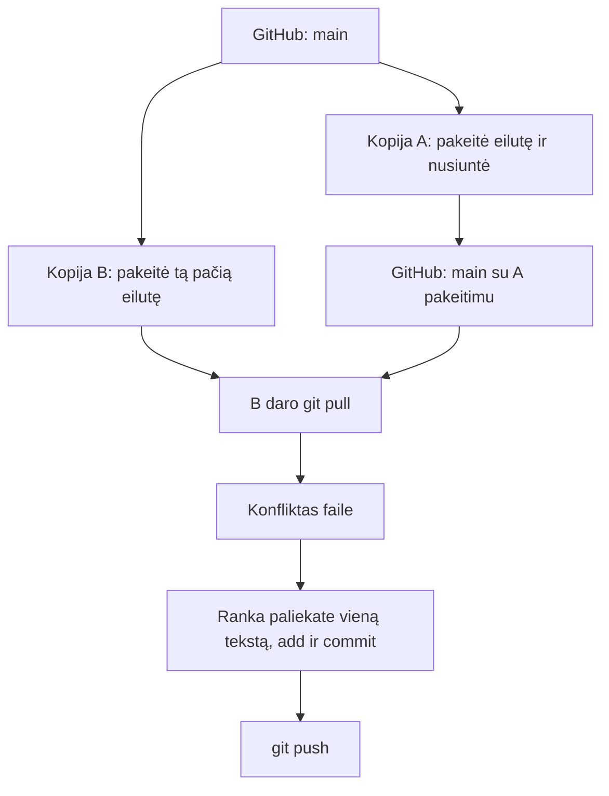

# 07 Git pagrindai

Data: 2026-11-23 (pirmadienis)

## Klasės darbas

1. Pasitikrinimas po 06 paskaitos (~10 min): dėstytojas parodo 06 sprendimą gyvai; kam neveikė SSH ar konfliktas, kartu randame priežastį
2. Ką Git jau mokate (~5 min): `init`, `add`, `commit`, `push`, `pull`, `status`, `log`, šaka, `merge`, `restore`. Šiandien gilinamės ten, kur jūs dar nedirbote
3. Geri commit'ai ir pakeitimų peržiūra (~20 min): [Pro Git: Recording Changes](https://git-scm.com/book/en/v2/Git-Basics-Recording-Changes-to-the-Repository)
   1. Kas yra geras commit'as: viena mintis, aiški žinutė (kas ir kodėl, ne „pakeitimai“)
   2. `git diff` (dar nepridėta), `git diff --staged` (jau pridėta), `git show`
   3. `git add -p` ir kodėl neverta visko pridėti iš karto
   4. `git log --oneline --graph --all` skaitymas
4. Laikinas darbas ir atšaukimas (~25 min)
   1. `git stash` ir `git stash pop`: pusiau padarytas darbas, kai reikia persijungti į kitą šaką
   2. `git revert`: pakeitimo atšaukimas naujai commit'u, istorija lieka
   3. Palyginimas su `git reset --hard`, kurį jau žinote: kada galima, kada pavojinga
   4. `git branch -d` ir `-D`, `git branch -vv`
5. Pertrauka (~15 min)
6. `fetch`, `pull` ir konfliktai (~30 min)
   1. `git fetch` (atsisiunčia, nekeičia jūsų failų) ir `git pull` (`fetch` + `merge`)
   2. Kaip atsiranda konfliktas, kai du žmonės keičia tą pačią eilutę (jūs jau sukėlėte vieną 06 pamokoje)
   3. Konflikto sprendimas: žymekliai, `git add`, `git commit`, `git merge --abort`
   4. Kaip sumažinti konfliktus: mažos šakos, dažnas `git pull`, kalbėjimas komandoje
   5. `git config --global pull.rebase false`: kad `pull` visada darytų sujungimą ir neklausinėtų
7. Demonstracija: dėstytojas atlieka užduotis „diff, stash, revert, konfliktas po `pull`“ su kitais pavyzdžiais (kitas failas, kita eilutė, antra kopija `demo-kopija`) (~20 min)
8. Kita paskaita: GitHub Pull Request: PR aprašas, code review, branch apsauga

## Schemos

Konfliktas po `git pull`, kai dvi kopijos keičia tą pačią eilutę:



## Užduotys

Jei kas neveikia: perskaitykite klaidą, ieškokite dokumentacijoje arba klauskite LLM, ir užsirašykite, kas padėjo. Nuorodos yra pamoka.md. Komandos yra skyriuje „Komandos“: žiūrėkite tik įstrigę.

Užduotis skelbiu po vieną (Teams): pirma parodau gyvai, tada darote jūs.

### 1️⃣ Commit'ai ir `diff`

1. **Tikslas:** Peržiūrėti pakeitimus prieš commit ir padaryti du aiškius commit'us.
2. Atnaujinkite `main` ir sukurkite šaką `pamoka-07`.
3. Faile `docs/git.md` užrašykite vieną sakinį apie `git diff`, o faile `README.md` pridėkite vieną eilutę apie save.
4. Pažiūrėkite pakeitimus prieš `git add`, pridėkite tik `docs/git.md`, pažiūrėkite, kas pridėta ir kas ne.
5. Padarykite du commit'us (po vieną failą) su žinutėmis, kurios sako, ką pakeitėte ir kodėl.
6. Peržiūrėkite paskutinio commit'o turinį.

### 2️⃣ `stash` ir `revert`

1. **Tikslas:** Laikinai padėti pusiau padarytą darbą ir saugiai atšaukti pakeitimą.
2. Papildykite `docs/git.md` ir nedarykite commit. Persijunkite į `main` taip, kad pakeitimas neprarastas, tada grįžkite ir atsiimkite darbą.
3. Padarykite sąmoningai blogą commit'ą (pvz. ištrinkite visą `docs/git.md` turinį).
4. Atšaukite jį nenaudodami `git reset --hard`, kad istorijoje matytųsi ir blogas, ir atšaukimo commit'as.
5. Faile `docs/git.md` užrašykite, kuo `git revert` skiriasi nuo `git reset --hard` ir kada kuris tinka (pagal oficialią dokumentaciją; žingsnių čia nėra, tik tikslas).
6. Padarykite commit.

### 3️⃣ Konfliktas po `pull`

1. **Tikslas:** Susidurti su konfliktu, kai kita kopija pakeitė tą pačią eilutę, ir jį išspręsti.
2. Nustatykite, kad `git pull` visada darytų sujungimą.
3. Nusiųskite šaką `pamoka-07` į GitHub ir sukurkite antrą savo `devops-projektas` kopiją `~/devops/devops-projektas-kopija` (kitas aplankas, tas pats GitHub projektas), tada joje pereikite į šaką `pamoka-07`.
4. Kopijoje pakeiskite `docs/git.md` pirmą eilutę, padarykite commit ir nusiųskite.
5. Originale (`devops-projektas`) tą pačią eilutę pakeiskite kitaip ir padarykite commit.
6. Originale paleiskite `git pull`: turi atsirasti konfliktas.
7. Išspręskite konfliktą: paliekite vieną galutinį tekstą be žymeklių, užbaikite sujungimą ir nusiųskite.
8. Ištrinkite kopijos aplanką.

### 4️⃣ Grafikas ir Pull Request

1. **Tikslas:** Perskaityti istoriją ir sulieti darbą per Pull Request.
2. Parodykite commit grafiką; turi matytis `revert` commit'as ir konflikto sujungimas.
3. Atidarykite Pull Request iš `pamoka-07` į `main` ir sulieskite. Kompiuteryje atnaujinkite `main`.
4. Šaką `pamoka-07` ištrinkite GitHub'e ir kompiuteryje.
5. Patikrinkite, kad commit'e nėra slaptažodžių, raktų ar `.env` turinio.
6. **Papildomai:** pažaiskite [Learn Git Branching](https://learngitbranching.js.org/) skyrių „Remote“ ir užrašykite `docs/git.md`, ką sužinojote apie `fetch`.

## Komandos

Žiūrėkite tik įstrigę. Numeriai atitinka užduoties žingsnius.

## 1️⃣ Commit'ai ir `diff`

2. `git switch main`, `git pull`, `git switch -c pamoka-07`
4. `git diff`, `git add docs/git.md`, `git diff --staged`, `git status`
5. `git commit -m "..."` du kartus (antram prieš tai `git add README.md`)
6. `git show`

## 2️⃣ `stash` ir `revert`

2. `git stash`, `git switch main`, `git switch pamoka-07`, `git stash pop`
3. `git commit -am "Blogas pakeitimas"`
4. `git revert HEAD` (arba `git revert --no-edit HEAD`)
5. `git revert --help`, `git reset --help`

## 3️⃣ Konfliktas po `pull`

2. `git config --global pull.rebase false`
3. `git push -u origin pamoka-07`, `cd ~/devops`, `git clone git@github.com:<vartotojas>/devops-projektas.git devops-projektas-kopija` (arba HTTPS adresas, jei `origin` HTTPS), `cd devops-projektas-kopija`, `git switch pamoka-07`
4. `git commit -am "..."`, `git push`
5. `cd ~/devops/devops-projektas`, `git commit -am "..."`
6. `git pull`
7. Redaktoriumi pašalinkite `<<<<<<<`, `=======`, `>>>>>>>`; `git add docs/git.md`, `git commit`, `git push`
8. `cd ~/devops`, `rm -r devops-projektas-kopija` (tik šis aplankas)

## 4️⃣ Grafikas ir Pull Request

2. `git log --oneline --graph --all`
3. GitHub'e **Compare & pull request**, sulieti, tada `git switch main` ir `git pull`
4. GitHub: **Delete branch**; kompiuteryje `git branch -d pamoka-07`

## Pamokos eiga (dėstytojui)

Patikrinta: `git stash`/`stash pop`, `git revert --no-edit HEAD` (failas grįžo į seną turinį, istorijoje lieka `blogas` ir `Revert "blogas"`) ir `git pull` konfliktas tarp dviejų kopijų (`CONFLICT (content)`, būsena `UU`) paleisti macOS su lokalia „nuotoline“ repozitorija. Nepatikrinta: tas pats su GitHub ir WSL; `git clone` per SSH ir HTTPS; elgesys be `pull.rebase false` (Git 2.27+ klausia, kaip suderinti). Išbandyti prieš pamoką.

### Demonstracijos žingsniai

1. (~10 min) Praeitos pamokos (06) sprendimas gyvai: parodykite `docs/ssh.md` ir `git log --oneline --graph`, kur matosi konflikto sujungimas.
2. (~20 min) Commit'ai ir `diff`: kitas pavyzdys nei mokinių: failai `a.txt`, `b.txt` demo repo; parodykite `diff` prieš ir po `add`, gerą ir blogą žinutę („pakeitimai“). Dažna klaida: `git diff` tuščias, nes jau `add` (reikia `--staged`); viena didelė žinutė visam darbui.
3. (~25 min) `stash`, `revert`: demo šaka `bugFix`: `stash`, persijungimas, `stash pop`; blogas commit ir `revert`. Dažna klaida: `git stash` nepaima neseklomų failų (jiems reikia `-u`); `revert` supainiojamas su `reset`; `git revert` atidaro redaktorių (išeiti `:wq`, arba `--no-edit`).
4. (~30 min) `fetch`, `pull`, konfliktas: antra kopija `demo-kopija`, ta pati eilutė; parodykite `git fetch` ir `git status` („behind“), tada `pull` ir konfliktą. Dažna klaida: Git klausia „Need to specify how to reconcile divergent branches“ (neįvykdyta `pull.rebase false`); mokinys palieka žymeklius ar daro `git commit` be `git add`; kopija klonuota iš netinkamos repozitorijos.
5. Mokiniai daro užduotis; kitą pamoką parodote sprendimą.

### Sprendimas pagal darbus

| Darbas | Kur sprendime |
|---|---|
| Du aiškūs commit'ai ir `diff` | `git log --oneline` ir `docs/git.md` |
| `stash` | `docs/git.md`, skyrius „Stash“ |
| `revert` ir palyginimas su `reset --hard` | `git log --oneline` rodo `Revert`; `docs/git.md`, skyrius „Revert“ |
| Konfliktas po `pull` išspręstas | `git log --graph` rodo sujungimą; `docs/git.md` be žymeklių |
| Kopijos aplankas ištrintas | `ls ~/devops` neberodo `devops-projektas-kopija` |
| Sulietas PR, šaka ištrinta | GitHub **Merged**; `git branch` be `pamoka-07` |

Dėstytojas kasdienių užduočių netikrina, tik rodo sprendimą; tikrinimas yra tik atsiskaitymuose (vertinimas.md).

### Pavyzdiniai failai

#### `docs/git.md`

````markdown
# Git

## Diff

`git diff` rodo pakeitimus, kurie dar nepridėti į staging; `git diff --staged` rodo jau pridėtus.

## Stash

`git stash` paslėpė nebaigtą darbą, o `git stash pop` jį grąžino.

## Revert

`git revert` sukuria naują commit'ą, kuris atšaukia ankstesnį, todėl istorija lieka ir kiti ją mato. `git reset --hard` ištrina pakeitimus ir juda atgal istorijoje: jį naudoti tik vietiniam, dar nenusiųstam darbui.

## Konfliktas

Pirmą kartą pakeitimas atsirado kopijoje ir buvo nusiųstas; originale pakeičiau tą pačią eilutę, todėl `git pull` pranešė konfliktą. Palikau vieną galutinį tekstą, pašalinau žymeklius, padariau `git add` ir `git commit`.
````
