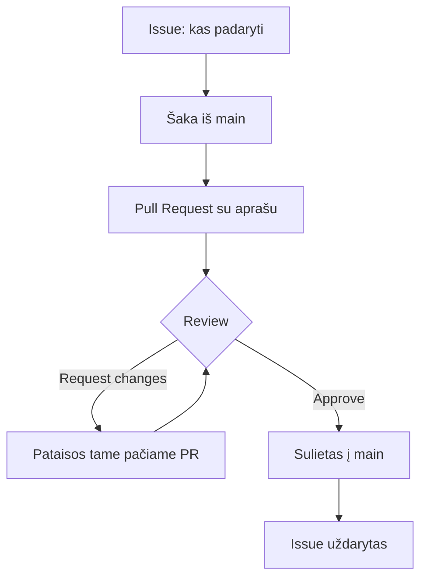

# 08 GitHub Pull Request

Data: 2026-11-24 (antradienis)

## Klasės darbas

1. Pasitikrinimas po 07 paskaitos (~10 min): dėstytojas parodo 07 sprendimą gyvai; kam neveikė `pull` konfliktas ar `stash`, kartu randame priežastį
2. Pull Request (PR) kaip darbo būdas (~20 min): jūs jau atidarėte PR 02–07 pamokose; šiandien mokomės daryti jį gerai
   1. Kam reikalingas PR: pakeitimo aptarimas prieš sujungiant, ne tik sujungimo mygtukas
   2. Geras PR: aiški antraštė, aprašas (ką ir kodėl pakeista, kaip patikrinti), mažas dydis; [GitHub: Creating a pull request](https://docs.github.com/en/pull-requests/collaborating-with-pull-requests/proposing-changes-to-your-work-with-pull-requests/creating-a-pull-request)
   3. Issue ir ryšys su PR: `Closes #1` aprašė automatiškai uždaro Issue po sujungimo
   4. `gh pr create`, `gh pr list`, `gh pr view`, `gh pr merge`; [GitHub CLI dokumentacija](https://cli.github.com/manual/)
3. Code review (~25 min): [GitHub: Reviewing proposed changes](https://docs.github.com/en/pull-requests/collaborating-with-pull-requests/reviewing-changes-in-pull-requests)
   1. Ką ieško peržiūrintis: ar daro, ką sako aprašas; ar nėra slaptų duomenų; ar aiškūs pavadinimai
   2. Komentaras eilutei, bendras komentaras, **Approve**, **Request changes**
   3. Kaip atsakyti į komentarą ir pataisyti PR (naujas commit į tą pačią šaką)
   4. Pagarbus review: klausti, ne įsakinėti
4. Pertrauka (~15 min)
5. Branch apsauga (~20 min): [GitHub: Managing a branch protection rule](https://docs.github.com/en/repositories/configuring-branches-and-merges-in-your-repository/managing-protected-branches/managing-a-branch-protection-rule)
   1. Kodėl `main` negali būti keičiamas tiesiogiai: ką sulaužo vienas neperžiūrėtas commit'as
   2. Taisyklė: reikalauti PR prieš sujungimą (ir bent vieno patvirtinimo, kai yra antras žmogus)
   3. Kaip patikrinti, kad taisyklė veikia: `git push` į `main` turi būti atmestas
   4. Kodėl tai ruošia CI nuo 22 pamokos (reikalausime, kad testai būtų žali)
6. Darbas poromis (~10 min): pasirenkame porą, pridedame vienas kitą prie savo `devops-projektas` (Settings → Collaborators) ir sutariame, kas pirmas peržiūri
7. Demonstracija: dėstytojas atlieka užduotis „Issue, PR su aprašu, review, branch apsauga“ su kitu pavyzdžiu (jo repozitorija, pagalbinis dalyvis) (~20 min)
8. Kita paskaita: Projekto paleidimas lokaliai: README, `.gitignore`, `./run.sh`

## Schemos

Pull Request ciklas su peržiūra:



## Užduotys

Jei kas neveikia: perskaitykite klaidą, ieškokite dokumentacijoje arba klauskite LLM, ir užsirašykite, kas padėjo. Nuorodos yra pamoka.md. Komandos yra skyriuje „Komandos“: žiūrėkite tik įstrigę.

Užduotis skelbiu po vieną (Teams): pirma parodau gyvai, tada darote jūs. Užduotys 2 ir 3 daromos poroje (jei žmonių nelyginis skaičius, viena grupė yra trise).

### 1️⃣ Issue ir geras PR

1. **Tikslas:** Susieti Issue su PR ir parašyti aiškų aprašą.
2. Savo `devops-projektas` repozitorijoje GitHub'e sukurkite Issue „Papildyti README paleidimo skyriumi“ su 2–3 sakinių aprašu.
3. Atnaujinkite `main` ir sukurkite šaką `readme-paleidimas`.
4. `README.md` papildykite skyriumi „Mano pastabos“ su 3 punktais, kaip paleidžiate projektą savo kompiuteryje.
5. Padarykite commit ir nusiųskite šaką.
6. Atidarykite PR su aiškia antrašte ir aprašu (ką pakeitėte, kaip patikrinti) ir su nuoroda, kuri po sujungimo uždarys Issue. **Dar nesulieskite.**

### 2️⃣ Peržiūra poroje

1. **Tikslas:** Peržiūrėti kito žmogaus PR ir atsakyti į savo.
2. Pridėkite porininką prie savo repozitorijos kaip bendradarbį ir priimkite jo kvietimą.
3. Raskite porininko PR (jo repozitorijoje) ir peržiūrėkite pakeitimus.
4. Palikite vieną komentarą prie konkrečios eilutės ir vieną bendrą komentarą; paprašykite vieno pakeitimo (Request changes).
5. Savo PR gavę komentarą atsakykite ir pataisykite (naujas commit į tą pačią šaką).
6. Porininkas patvirtina jūsų PR (Approve), jūs jį sulieti. Patikrinkite, kad Issue užsidarė.
7. Faile `docs/review.md` užrašykite: kokį komentarą gavote, kaip atsakėte ir ką išmokote peržiūrėdami kitą.

### 3️⃣ Branch apsauga

1. **Tikslas:** Apsaugoti `main` ir patikrinti, kad apsauga veikia.
2. Pagal oficialią GitHub dokumentaciją (Managing a branch protection rule) sukurkite savo `devops-projektas` šakai `main` taisyklę: prieš sujungimą reikalingas PR (žingsnių čia nėra, tik tikslas). Jei esate poroje ir turite antrą žmogų, pridėkite ir reikalavimą bent vienam patvirtinimui.
3. Atnaujinkite `main` kompiuteryje, padarykite mažą pakeitimą ir bandykite `git push` tiesiai į `main`; užsirašykite atsakymą.
4. Atšaukite vietinį pakeitimą (nenaudodami `git reset --hard`, jei jau padarytas commit'as, o ne tik pakeitimas).
5. Padarykite tą patį pakeitimą per šaką ir PR ir sulieskite.
6. Faile `docs/review.md` vienu sakiniu paaiškinkite, kodėl `main` verta apsaugoti.
7. **Papildomai:** su `gh` išvardykite savo atvirus ir sulietus PR.

## Komandos

Žiūrėkite tik įstrigę. Numeriai atitinka užduoties žingsnius.

## 1️⃣ Issue ir geras PR

2. GitHub: **Issues → New issue**; arba `gh issue create --title "..." --body "..."`
3. `git switch main`, `git pull`, `git switch -c readme-paleidimas`
5. `git commit -am "..."`, `git push -u origin readme-paleidimas`
6. `gh pr create --title "..." --body "..."` arba GitHub **Compare & pull request**; aprašo pabaigoje `Closes #<Issue numeris>`

## 2️⃣ Peržiūra poroje

2. GitHub: **Settings → Collaborators → Add people**
3. GitHub: porininko repozitorija → **Pull requests** → PR → **Files changed**
4. Eilutės komentaras: **+** prie eilutės; galutinis: **Review changes → Request changes** arba **Approve**
5. `git switch readme-paleidimas`, pakeitimas, `git commit -am "..."`, `git push`

## 3️⃣ Branch apsauga

2. GitHub: **Settings → Branches** (arba **Rules → Rulesets**), `main`, **Require a pull request before merging**
3. `git switch main`, pakeitimas, `git commit -am "..."`, `git push` (turi būti atmesta)
4. `git reset --soft HEAD~1` (palieka pakeitimą nesukommit'intą), `git restore .`
5. `git switch -c <šaka>`, `git commit -am "..."`, `git push -u origin <šaka>`, PR, sulieti
7. `gh pr list --state all`

## Pamokos eiga (dėstytojui)

Patikrinta: tik Git dalis (šaka, commit, `git push`, `git reset --soft`) paleista macOS su lokalia repozitorija. Nepatikrinta: viskas GitHub'e (Issue su `Closes #N`, bendradarbių kvietimas, review komentarai, branch apsauga su **Public** repozitorija, ar apsauga atmeta `git push`, `gh issue create`, `gh pr create`, `gh pr list`); reikia išbandyti prieš pamoką su dviem paskyromis. Pastaba: jei `devops-projektas` kopijos privačios, branch apsauga nemokamame plane gali neveikti (02 pamokoje liepiama Public).

### Demonstracijos žingsniai

1. (~10 min) Praeitos pamokos (07) sprendimas gyvai: parodykite `git log --oneline --graph` su `Revert` ir konflikto sujungimu.
2. (~20 min) PR: kitas pavyzdys nei mokinių: jūsų demo repozitorija, Issue „Pridėti `/about`“ (be kodo, tik `docs/about.md`), PR su aprašu ir `Closes #1`; parodykite, kaip PR uždaro Issue. Dažna klaida: PR atidarytas į ne tą repozitoriją (į šabloną); aprašas „pakeitimai“; Issue numeris be `#`.
3. (~25 min) Review: kviečiate pagalbinį žmogų ar antrą paskyrą; parodykite eilutės komentarą, Request changes, pataisą, Approve. Dažna klaida: kvietimas bendradarbiauti nepriimtas (laiškas el. paštu); peržiūrima ne ta repozitorija; komentaras tik bendras, o ne eilutei.
4. (~20 min) Branch apsauga: `Settings → Branches` jūsų demo repozitorijoje; bandykite `git push` į `main` ir parodykite klaidą. Dažna klaida: taisyklė nesukurta `main` (ne kitai šakai); repozitorija privati ir funkcija neprieinama; administratorius gali apeiti taisyklę (palikite „Do not allow bypassing“ pagal poreikį).
5. Mokiniai daro užduotis; kitą pamoką parodote sprendimą.

### Sprendimas pagal darbus

| Darbas | Kur sprendime |
|---|---|
| Issue ir PR su aprašu ir `Closes #N` | GitHub: PR aprašas ir uždarytas Issue |
| Review komentarai ir pataisa | GitHub: PR **Files changed** ir komentarai |
| PR sulietas po patvirtinimo | GitHub **Merged**, Issue **Closed** |
| Branch apsauga ir atmestas `push` | `git push` klaidos tekstas; `docs/review.md` |
| `docs/review.md` | pavyzdys žemiau |

Dėstytojas kasdienių užduočių netikrina, tik rodo sprendimą; tikrinimas yra tik atsiskaitymuose (vertinimas.md).

### Pavyzdiniai failai

#### `docs/review.md`

````markdown
# Review ir branch apsauga

## Review

Gavau komentarą: „README pastaboje trūksta, kaip sustabdyti serverį“. Atsakiau, kad pridėsiu, ir naujame commit'e papildžiau README. Peržiūrėdamas porininko PR išmokau, kad skaitant svetimą kodą pastebi nesutapimus tarp aprašo ir pakeitimo.

## Branch apsauga

Tiesioginis `git push` į `main` buvo atmestas, nes taisyklė reikalauja PR. `main` verta apsaugoti, nes jame yra tai, kas paleidžiama vartotojams; neperžiūrėtas pakeitimas gali sugadinti visiems.
````
