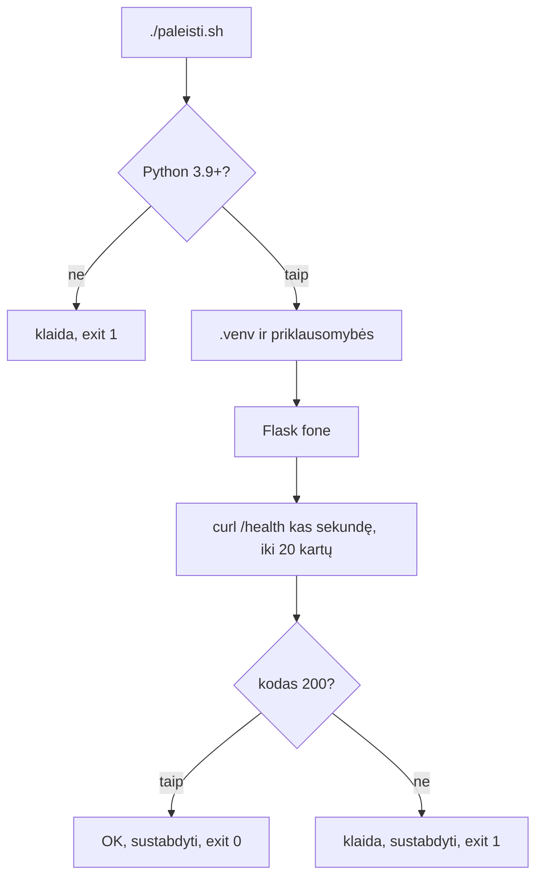

# 09 Projekto paleidimas lokaliai

Data: 2026-11-26 (ketvirtadienis)

## Klasės darbas

1. Pasitikrinimas po 08 paskaitos (~10 min): dėstytojas parodo 08 sprendimą gyvai; kam neveikė review ar branch apsauga, kartu randame priežastį
2. Demonstracija pradžioje (~5 min): dėstytojas vienu `./run.sh` paleidžia projektą, atidaro puslapį, `/health` ir `/status`; paskui pakeičia spalvą per `.env` ir parodo skirtumą
3. Kaip projektas veikia (~20 min)
   1. Aplankų žemėlapis: `app.py`, `requirements.txt`, `run.sh`, `tests/`, `static/`, `schema.sqlite.sql`, `.env.example`
   2. Maršrutai pagal `README.md`: `/`, `/health`, `/status`, `/items`
   3. Python priklausomybės: kas yra `requirements.txt`, virtuali aplinka `.venv`, kodėl nediegiame į visą sistemą
   4. SQLite pagal numatymą; MySQL bus nuo 18 pamokos
4. Konfigūracija per aplinkos kintamuosius (~20 min)
   1. `.env.example` ir `.env`: ką rodo `APP_VERSION`, `APP_COLOR`, `APP_ENV` (`/status` ir puslapio juosta)
   2. Kodėl `.env` niekada nekeliamas į Git; `.gitignore` peržiūra ir papildymas
   3. Kaip `run.sh` įkelia `.env` (jūs ją skaitėte 04 pamokoje)
   4. 12 faktorių idėja: ta pati programa, skirtingi nustatymai skirtingose aplinkose; [The Twelve-Factor App: Config](https://12factor.net/config)
5. Pertrauka (~15 min)
6. Testai (~15 min)
   1. Kam testai: greitas atsakymas, ar po pakeitimo viskas veikia
   2. `.venv/bin/pytest`: ką rodo žalia ir raudona, kaip skaityti klaidą
   3. Kaip testas naudoja programą (trumpas žvilgsnis į `tests/test_app.py`)
7. README ir `paleisti.sh` (~15 min)
   1. Geras README: ką daro projektas, kaip paleisti, kaip patikrinti, kaip nustatyti
   2. `paleisti.sh`: Python versijos patikra, `.venv`, paleidimas fone, laukimas `/health` 200, sustabdymas; kodėl viskas tai jau mokėjote (04 `if`/`for`, 05 `curl`, išėjimo kodas)
8. Savo projektas kaip šablonas (~10 min)
   1. Šablonas, fork ir clone: kuo skiriasi (žr. skyrių „Schemos“); šablonas sukuria naują repozitoriją be senos istorijos
   2. GitHub: **Settings → General → Template repository**; atsiranda **Use this template**
   3. Komandinė eilutė: `gh repo create <vardas> --public --template <savininkas>/<šablonas> --clone`
   4. Kodėl tai naudinga: pradiniai failai (`Dockerfile`, workflow) vėliau kopijuojami vienu paspaudimu
9. Demonstracija: dėstytojas atlieka užduotis „paleidimas, `.env`, `paleisti.sh`, šablonas“ su kitu projektu (mažas Flask failas iš kito aplanko) (~20 min)
10. Kita paskaita: Atsiskaitymas 1 (testas ir praktika)

## Kur skiriasi (Mac / Ubuntu)

| Veiksmas | Mac (Terminalas) | Ubuntu (WSL) |
|---|---|---|
| Python | `python3` jau yra (3.9+) | `python3`; gali reikėti `sudo apt install python3-venv` |
| Portas | 5001 (5000 užima AirPlay Receiver) | 5001 |
| Failų vieta | ne `Desktop`/`Documents` | ne `/mnt/c` |

## Schemos

Kaip `./paleisti.sh` tikrina projektą:



## Užduotys

Jei kas neveikia: perskaitykite klaidą, ieškokite dokumentacijoje arba klauskite LLM, ir užsirašykite, kas padėjo. Nuorodos yra pamoka.md. Komandos yra skyriuje „Komandos“: žiūrėkite tik įstrigę.

Užduotis skelbiu po vieną (Teams): pirma parodau gyvai, tada darote jūs. Dabar `main` apsaugotas (08), todėl kiekvieną darbą darote per šaką ir PR.

### 1️⃣ Paleiskite ir pažiūrėkite

1. **Tikslas:** Paleisti projektą ir atpažinti jo dalis.
2. Atnaujinkite `main` ir sukurkite šaką `pamoka-09`.
3. Paleiskite projektą viena komanda ir naršyklėje atidarykite pagrindinį puslapį.
4. Su `curl` gaukite `/health` ir `/status` ir užrašykite atsakymus `docs/paleidimas.md`.
5. Sustabdykite projektą ir patikrinkite, kad portas laisvas.

### 2️⃣ `.env`

1. **Tikslas:** Pakeisti elgesį be kodo keitimo ir nepaviešinti `.env`.
2. Nukopijuokite `.env.example` į `.env` ir pakeiskite spalvą bei versiją.
3. Paleiskite projektą iš naujo ir `/status` patikrinkite, ar pakeitimas matosi; puslapio juosta turi pakeisti spalvą.
4. Įsitikinkite, kad `git status` `.env` nerodo, ir kuri `.gitignore` eilutė jį ignoruoja.
5. Pridėkite į `.gitignore` dar vieną eilutę (pvz. `*.log`) ir patikrinkite, kad ji veikia.
6. Faile `docs/paleidimas.md` vienu sakiniu paaiškinkite, kodėl `.env` nekeliamas į Git.

### 3️⃣ Testai

1. **Tikslas:** Paleisti testus ir perskaityti rezultatą.
2. Paleiskite testus ir užrašykite, kiek jų praėjo.
3. Atidarykite `tests/test_app.py` ir faile `docs/paleidimas.md` vienu sakiniu paaiškinkite, ką tikrina `test_health`.
4. Laikinai sugadinkite programą (pvz. pakeiskite `/health` atsakymo tekstą), paleiskite testus, užsirašykite klaidos eilutę ir grąžinkite pakeitimą nenaudodami `git reset --hard`.

### 4️⃣ `paleisti.sh` ir Pull Request

1. **Tikslas:** Parašyti skriptą, kuris paleidžia projektą ir patikrina, ar jis veikia.
2. Projekto šaknyje sukurkite `paleisti.sh` ir padarykite jį vykdomą.
3. Skriptas turi: patikrinti, ar Python 3.9 ar naujesnis (kitaip klaida ir kodas 1); sukurti `.venv`, jei jo nėra, ir įdiegti priklausomybes; paleisti projektą fone numatytame porte arba nurodytame `PORT`; laukti, kol `/health` atsakys 200 (iki 20 kartų po sekundę).
4. Jei `/health` atsakė 200, išveskite „OK“ ir baikite su kodu 0; jei ne, klaidą ir kodą 1. Skriptas visada turi sustabdyti paleistą projektą.
5. Paleiskite jį sėkmingai, su kitu portu ir su užimtu portu; užsirašykite išėjimo kodus `docs/paleidimas.md`.
6. Papildykite `README.md` skyriumi „Paleidimas“: kaip paleisti, kaip patikrinti, kokie nustatymai per `.env`.
7. Padarykite commit'us, nusiųskite šaką, atidarykite PR į `main` ir sulieskite. Kompiuteryje atnaujinkite `main`.
8. Patikrinkite, kad commit'e nėra `.env` ar slaptažodžių.
9. **Papildomai:** paleiskite `paleisti.sh` ir iš kito aplanko (`cd /tmp && ~/devops/devops-projektas/paleisti.sh`); jei neveikia, pataisykite.

### 5️⃣ Savo šablonas

1. **Tikslas:** Paversti savo projektą šablonu ir sukurti iš jo naują kopiją.
2. Įsitikinkite, kad 4 užduoties PR sulietas, o `main` kompiuteryje atnaujintas (šablone turi būti `paleisti.sh`).
3. GitHub'e savo `devops-projektas` nustatymuose įjunkite **Template repository** ir patikrinkite, ar atsirado mygtukas **Use this template**.
4. Sukurkite iš savo šablono naują **Public** repozitoriją `projekto-kopija` ir nuklonuokite ją į `~/devops`.
5. Naujoje kopijoje patikrinkite, kad `origin` rodo `projekto-kopija`, o istorijoje yra vienas commit'as.
6. Naujoje kopijoje paleiskite `./paleisti.sh` (kodas 0).
7. Naujoje kopijoje sukurkite `docs/sablonas.md`: vienu sakiniu paaiškinkite, kuo šablonas skiriasi nuo fork ir nuo clone; commit ir `git push` į `main` (šioje naujoje repozitorijoje apsaugos nėra).

## Komandos

Žiūrėkite tik įstrigę. Numeriai atitinka užduoties žingsnius.

## 1️⃣ Paleiskite ir pažiūrėkite

2. `git switch main`, `git pull`, `git switch -c pamoka-09`
3. `cd ~/devops/devops-projektas`, `./run.sh`, naršyklėje `http://localhost:5001`
4. `curl localhost:5001/health`, `curl localhost:5001/status`
5. `Ctrl+C`, `lsof -nP -i :5001` (tuščia išvestis = laisva)

## 2️⃣ `.env`

2. `cp .env.example .env`; redaktoriumi pakeiskite `APP_COLOR` ir `APP_VERSION`
3. `./run.sh`, `curl localhost:5001/status`
4. `git status`, `git check-ignore -v .env`
5. `echo "*.log" >> .gitignore`, `touch bandymas.log`, `git status`

## 3️⃣ Testai

2. `.venv/bin/pytest`
4. `git restore app.py` (jei dar nebuvo commit)

## 4️⃣ `paleisti.sh` ir Pull Request

2. `touch paleisti.sh`, `chmod +x paleisti.sh`; pirma eilutė `#!/usr/bin/env bash`
3. Python versija: `python3 -c 'import sys; sys.exit(0 if sys.version_info >= (3, 9) else 1)'`; fone `&` ir `pid=$!`; sustabdymas `trap 'kill "$pid"' EXIT`; laukimas `for _ in $(seq 1 20); do ... sleep 1; done`; kodas `curl -s -o /dev/null -w "%{http_code}"`
5. `./paleisti.sh`, `echo $?`, `PORT=5002 ./paleisti.sh`; užimtas portas: kitame lange `python3 -m http.server 5003`, tada `PORT=5003 ./paleisti.sh`
7. `git push -u origin pamoka-09`, GitHub'e **Compare & pull request**, sulieti, tada `git switch main` ir `git pull`

## 5️⃣ Savo šablonas

3. GitHub: `Settings → General → Template repository`
4. `cd ~/devops`, `gh repo create projekto-kopija --public --template <vartotojas>/devops-projektas --clone` (arba naršyklėje **Use this template** ir `git clone`)
5. `cd projekto-kopija`, `git remote -v`, `git log --oneline`
6. `./paleisti.sh`, `echo $?`
7. `git add docs/sablonas.md`, `git commit -m "..."`, `git push`

## Sprendimas (dėstytojui)

Patikrinta: `paleisti.sh` paleistas macOS su tikru starteriu: sėkmė (`OK: /health atsakė 200`, kodas 0), kitas portas, užimtas portas (po 20 s kodas 1); `pytest` (3 praėjo); `.env` su `APP_COLOR=green` ir `APP_VERSION=1.2` pasirodė `/status`. Nepatikrinta: **Template repository** nustatymas ir `gh repo create --template ... --clone` (užduotis 5), Ubuntu (WSL; `python3-venv`), pirmas paleidimas su lėtu `pip` (laukimas 20 s gali nepakakti, pip diegimas vyksta prieš laukimo ciklą). Išbandyti prieš pamoką.

### Kaip rodyti klasėje

1. (~10 min) Praeitos pamokos (08) sprendimas gyvai: parodykite PR su review ir branch apsaugos klaidą `git push` į `main`.
2. (~5 min) Demonstracija: `./run.sh`, puslapis, `/health`, `/status`; `.env` su `APP_COLOR` ir pakartotinis paleidimas.
3. (~20 min) Projekto žemėlapis: aplankai ir maršrutai; kitas pavyzdys nei mokinių: parodykite `app.py` dalį su `/items` ir `README.md` lentelę. Dažna klaida: projektas paleidžiamas ne projekto aplanke; `python3 -m venv` nusiskundžia Ubuntu (`sudo apt install python3-venv`); Mac `Desktop` (iCloud).
4. (~20 min) `.env` ir `.gitignore`: kitas nei mokinių kintamasis (`APP_ENV=dev`); parodykite, kodėl `.env` nematomas Git'e. Dažna klaida: `.env` jau buvo `git add` ir `.gitignore` nebeveikia (`git rm --cached .env`); pakeitimas neįsigalioja, nes serveris nepaleistas iš naujo.
5. (~15 min) `pytest` ir kaip skaityti klaidą: sugadinkite `/health` ir parodykite raudoną rezultatą. Dažna klaida: paleidžiamas `pytest` iš sistemos, ne `.venv/bin/pytest`.
6. (~15 min) `paleisti.sh` eilutė po eilutės: `trap`, `$!`, laukimo ciklas. Dažna klaida: pamirštas `chmod +x`; `kill` po `exit` nesustabdo (reikia `trap`); `curl` ne ten, kur klauso (portas); `set -e` nutraukia skriptą, kai `curl` nepavyksta (reikia `|| true`).
7. Mokiniai daro užduotis; kitą pamoką parodote sprendimą. Primename: kitą paskaitą atsiskaitymas (testas ir praktika).

### Sprendimas pagal darbus

| Darbas | Kur sprendime |
|---|---|
| Projektas paleistas, `/health` ir `/status` | `docs/paleidimas.md`, skyrius „Paleidimas“ |
| `.env` pakeitė `/status`, ignoruojamas | `curl /status`; `git check-ignore -v .env` |
| Testai paleisti | `docs/paleidimas.md`, skyrius „Testai“ |
| `paleisti.sh` ir kodai | `paleisti.sh`; `docs/paleidimas.md` |
| README skyrius „Paleidimas“ | `README.md` |
| Sulietas PR | GitHub **Merged** |
| Šablonas ir kopija | `projekto-kopija`: `git log --oneline` (1 commit), `docs/sablonas.md` |

Dėstytojas kasdienių užduočių netikrina, tik rodo sprendimą; tikrinimas yra tik atsiskaitymuose (vertinimas.md).

### Pavyzdiniai failai

#### `paleisti.sh`

````bash
#!/usr/bin/env bash
# paleisti.sh – paleidžia projektą, laukia /health 200 ir sustabdo.
# Naudojimas: ./paleisti.sh   (kitas portas: PORT=5002 ./paleisti.sh)
set -euo pipefail
cd "$(dirname "$0")"
PORT="${PORT:-5001}"

# 1. Python versija
if ! python3 -c 'import sys; sys.exit(0 if sys.version_info >= (3, 9) else 1)'; then
  echo "Reikia Python 3.9 ar naujesnio" >&2
  exit 1
fi

# 2. Virtuali aplinka ir priklausomybės
[ -d .venv ] || python3 -m venv .venv
.venv/bin/pip install -q -r requirements.txt

# 3. Paleidimas fone; išėjus visada sustabdomas
[ -f .env ] && { set -a; . ./.env; set +a; }
.venv/bin/flask --app app run --port "$PORT" >/dev/null 2>&1 &
pid=$!
trap 'kill "$pid" 2>/dev/null || true' EXIT

# 4. Laukimas, kol /health atsakys 200 (iki 20 bandymų)
for _ in $(seq 1 20); do
  kodas=$(curl -s -o /dev/null -w "%{http_code}" "http://localhost:$PORT/health" || true)
  if [ "$kodas" = "200" ]; then
    echo "OK: /health atsakė 200"
    exit 0
  fi
  sleep 1
done

echo "Nepavyko: /health neatsakė per 20 s" >&2
exit 1
````

#### `docs/paleidimas.md`

````markdown
# Projekto paleidimas

## Paleidimas

`./run.sh` paleido projektą. `curl localhost:5001/health` grąžino `{"status": "ok"}`, `/status` grąžino versiją, kompiuterio vardą ir `db: up` (pavyzdinė išvestis).

## .env

Pakeičiau `APP_COLOR` ir `APP_VERSION`, paleidau iš naujo, ir `/status` parodė naujas reikšmes. `.env` nekeliamas į Git, nes jame gali būti slaptažodžių, o Git istorija lieka visiems.

## Testai

`.venv/bin/pytest`: 3 testai praėjo. `test_health` kreipiasi į `/health` ir tikrina, kad kodas 200 ir atsakymas `{"status": "ok"}`.

## paleisti.sh

Sėkmingas paleidimas: kodas 0. Su `PORT=5002`: kodas 0. Kai portą užėmė kita programa: po 20 sekundžių kodas 1.
````
