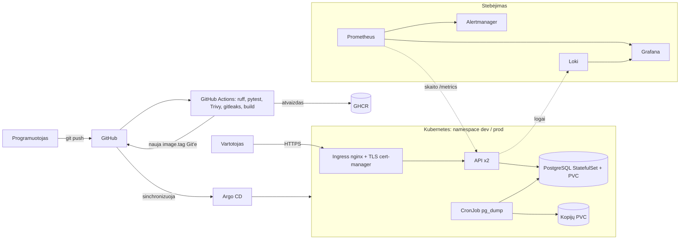

# Architektūra

## Aplinkos
| Aplinka | Įrankis | Paskirtis |
|---|---|---|
| Compose | `docker-compose.yml` | 1 etapas, greitas lokalus paleidimas |
| Kubernetes dev / prod | Helm (`values-dev.yaml`, `local/values-local.yaml`) | 2 etapas; tas pats chart'as, skirtingos values |
| VM | Terraform (`azure/terraform`) + Ansible (`ansible/`) | A reikalavimas |
| Lokalus Terraform | `terraform/local` | 28 sav. pamokos pavyzdys be debesies |
