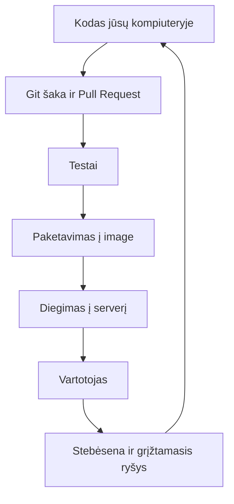
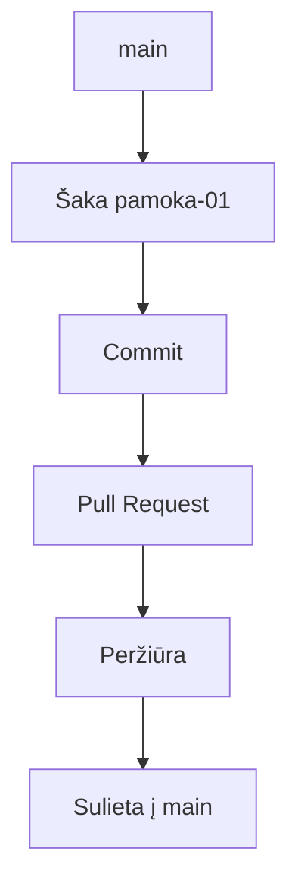

# 01 Kas yra DevOps

Data: 2026-11-11 (trečiadienis)

## Klasės darbas

Visa paskaita telpa į 3 val.: teorija ir darbas gyvai ~95 min., savarankiškos užduotys ~1 val. (likęs laikas yra rezervas, pertraukoms ir diegimui).

1. Prisistatymas (~5 min): dėstytojas prisistato
   1. Kas esu: [ĮRAŠYTI: trumpa mano patirtis]
   2. Kaip su manimi susisiekti: [ĮRAŠYTI: kaip su manimi susisiekti]
   3. Ko tikiuosi iš grupės: [ĮRAŠYTI: ko tikiuosi iš grupės]
2. Greita apklausa (~5 min). Atsakymus rinkti anoniminėje formoje (nuoroda arba QR kodas lentoje) arba, jei formos nėra, rankų pakėlimu su dėstytojo užrašais. Klausimai:
   1. Kokią sistemą naudojate: Windows ar Mac?
   2. Ar jau veikia Ubuntu (WSL) Windows arba Terminalas Mac: taip / ne / nežinau?
   3. Ar turite GitHub paskyrą: taip / ne?
   4. Patirtis nuo 1 (nieko) iki 5 (laisvai), keturiose eilutėse: Git, Linux, Python, Docker
   5. Kas jus labiausiai neramina šiame kurse (laisvas atsakymas, vienas sakinys)?
3. Kurso eiga ir kaip dirbsime (~10 min):
   1. 80 paskaitų, 7 etapai, po kiekvieno atsiskaitymas (testas + praktika); patvirtinti atsiskaitymai: 2026-11-30 ir 2026-12-17
   2. Kasdienių užduočių dėstytojas netikrina: pamokos pradžioje parodo sprendimą gyvai, jūs darote užduotis ir tikrinatės su `check.sh`
   3. Kas savaitę `git pull` iš `devops-kursas` (žr. `README.md`)
   4. Diegimas fone (jums nieko iš anksto nesiunčiama, aplinka ruošiama pamokoje): kol dėstytojas pasakoja 3 ir 4 punktus (~30 min), Windows studentai PowerShell kaip administratorius paleidžia `wsl --install`, Mac studentai terminale paleidžia `xcode-select --install`
   5. DI taisyklės: ką galima (paaiškinti klaidą, pasiūlyti komandą); kaip tikrinti (paleisti, perskaityti, patikrinti dokumentacijoje); ko niekada nekelti į DI ar į Git (slaptažodžių, raktų, tokenų, `.env`)
4. Kas yra DevOps (~20 min):
   1. Kodo kelias nuo kūrėjo iki vartotojo: kodas → versijų kontrolė → testai → paketavimas → diegimas → stebėsena → grįžtamasis ryšys
   2. Kodėl atsirado: kūrėjai nori keisti greitai, administratoriai nori stabilumo; DevOps juos sujungia automatizavimu
   3. Ką daro DevOps inžinierius ir kur matysime tai per metus: Linux ir Git → Docker → GitHub Actions → Kubernetes → Azure
   4. [roadmap.sh/devops](https://roadmap.sh/devops): kelias ir temos vienoje diagramoje
   5. Kurso projektas: vienas Python (Flask) web API su MySQL, kurį visą kursą pakeisime, supakuosime ir paleisime
   6. Pertrauka (~15 min): Windows studentai perkrauna kompiuterį ir vieną kartą paleidžia Ubuntu (sukuria vartotoją); Mac studentai patikrina, ar baigėsi `xcode-select` diegimas
5. Aplinkos patikra (~10 min) po pertraukos, pagal `README.md` skyrių „Aplinka“:
   1. Visi paleidžia `git --version` ir `gh auth status`
   2. Kam kažko trūksta, tas tvarkosi pagal `README.md` (Windows: WSL2 Ubuntu; Mac: Terminalas; `gh`: [GitHub CLI installation](https://github.com/cli/cli#installation)); likusieji tęsia toliau
   3. Kam dar trūksta WSL ar `gh`, tas diegia dabar (kam trūksta GitHub paskyros, susikuria), likusieji tęsia
   4. Projektai klonuojami į `~/`, ne į `/mnt/c`
6. GitHub gyvai su studentais (~35 min): dėstytojas rodo, visi kartu daro savo kompiuteryje:
   1. Vardas ir el. paštas Git'ui (`user.name`, `user.email`); jei dar neprisijungta, `gh auth login` (HTTPS) pagrindinis kelias, SSH tik papildomas ([Connecting to GitHub with SSH](https://docs.github.com/en/authentication/connecting-to-github-with-ssh)); GitHub paprasto slaptažodžio nebepriima
   2. Trys žodžiai: **clone** (visos repozitorijos kopija jūsų kompiuteryje), **šaka (branch)** (atskira darbo linija, `main` lieka nepaliesta), **pull request (PR)** (prašymas sulieti šaką į `main`, kur kiti mato ir komentuoja)
   3. Šablonas: Use this template → Create a new repository, savo `devops-projektas`
   4. Klonavimas (savo `devops-projektas` ir `devops-kursas`), aplankų apžiūra: kur kodas, kur README, kas yra `.gitignore`
   5. Šaka, pakeitimas, commit, push, Pull Request, sulieti, `git pull`
   6. Nuorodos: [GitHub Hello World](https://docs.github.com/en/get-started/start-your-journey/hello-world), [Learn Git Branching](https://learngitbranching.js.org/), [Pro Git knyga](https://git-scm.com/book/en/v2)
7. Python kodo skaitymas (~10 min): trumpa Flask ištrauka, ką daro maršrutas `/health` (žr. skyrių „Schemos“ ir `uzduotys.md`)
8. Demonstracija: dėstytojas atlieka visą ciklą su savo bandomuoju repo kaip dalį 6 punkto (šaka → pakeitimas → commit → push → Pull Request → sulieti → pull), o studentai kartoja savo projekte (įskaičiuota į ~35 min)
9. Kita paskaita: Linux terminalas: navigacija, failai, teisės

## Schemos

Kodo kelias nuo kūrėjo iki vartotojo (kurso pabaigoje visa grandinė veiks automatiškai):



Šaka ir Pull Request:



Python ištrauka skaitymo užduočiai (suderinti su starteriu, kai jis bus):

```python
from flask import Flask

app = Flask(__name__)


@app.route("/health")
def health():
    return {"status": "ok"}, 200
```
