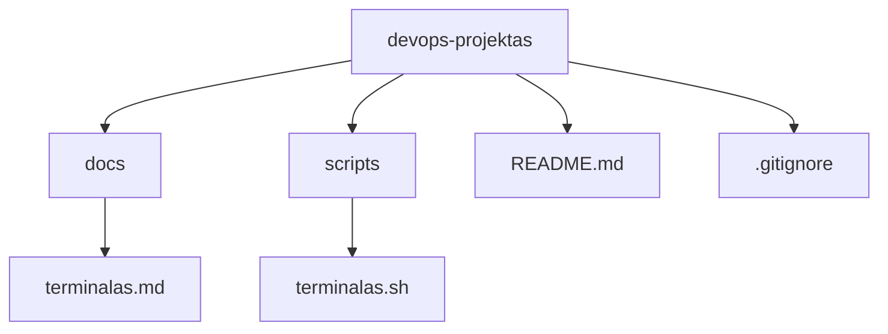
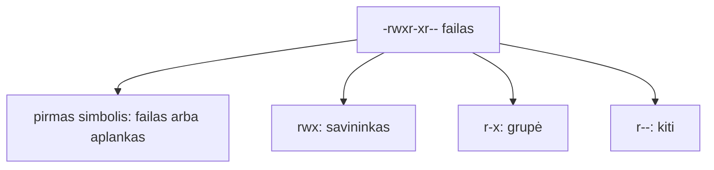

# 02 Linux terminalas

Data: 2026-11-12 (ketvirtadienis)

## Klasės darbas

1. Pasitikrinimas po 01 paskaitos (~15 min): kam kas liko neaišku su šablonu, klonavimu ir PR; dėstytojas trumpai parodo 01 sprendimą gyvai
2. Terminalas ir apvalkalas (~10 min):
   1. Kas yra terminalas, apvalkalas (shell) ir Bash; kodėl DevOps darbas vyksta terminale
   2. Prašymo eilutė: komanda, parametrai, argumentai
   3. Pagalba: `--help`, `man`, [GNU Coreutils dokumentacija](https://www.gnu.org/software/coreutils/manual/)
3. Navigacija (~15 min):
   1. Kur esu ir kas čia: `pwd`, `ls`, `ls -l`, `ls -a`
   2. Judėjimas: `cd`, `~`, `.`, `..`, absoliutūs ir santykiniai keliai
   3. Tab užbaigimas ir istorija (rodyklė aukštyn, `Ctrl+R`)
   4. Mac ir Ubuntu skiriasi smulkmenomis: žr. lentelę „Kur skiriasi (Mac / Ubuntu)“ žemiau
4. Failai ir aplankai (~30 min):
   1. Kūrimas: `mkdir`, `mkdir -p`, `touch`
   2. Kopijavimas ir perkėlimas: `cp`, `mv` (kodėl kopijuoti saugiau nei trinti)
   3. Turinio peržiūra: `cat`, `less`, `head`, `tail`
   4. Paieška: `grep`, `find` (tik pagal vardą)
   5. Srautai: `|`, `>`, `>>`
   6. Jokių `rm -rf` iš atminties: ką daro trynimas ir kodėl šiame kurse jo vengiame
5. Teisės (~25 min):
   1. Vartotojas, grupė, kiti; `r`, `w`, `x` ir skaičiai (`644`, `755`)
   2. `ls -l` skaitymas; `chmod`
   3. Kodėl `.sh` failas negali būti paleistas be `x`
   4. Kodėl `.env` ir privatūs raktai neturi būti skaitomi kitų
6. Python kodo skaitymas (~10 min): trumpa Flask ištrauka su maršrutu `/items` (žr. `uzduotys.md`)
7. Demonstracija: dėstytojas atlieka užduoties „terminalas projekto kataloge“ kitą pavyzdį, kitame aplanke ir su kitais failų vardais (~20 min)
8. Kita paskaita: Procesai, aplinkos kintamieji, paketų tvarkyklė

## Kur skiriasi (Mac / Ubuntu)

Pamokos komandos parinktos taip, kad veiktų abiejose sistemose. Šie dalykai skiriasi, todėl kurse jų venkite arba naudokite abi versijas:

| Veiksmas | Mac (Terminalas) | Ubuntu (WSL) |
|---|---|---|
| Spalvotas `ls` | `ls -G` | `ls --color=auto` |
| Failų dydžiai žmonėms | `ls -lh` (veikia abiejose) | `ls -lh` |
| Rūšiavimas pagal dydį | `ls -lS` (veikia abiejose) | `ls -lS` |
| Failo teisės skaičiumi | `stat -f %Lp failas` | `stat -c %a failas` |
| Pakeisti tekstą faile vietoje | `sed -i '' 's/a/b/' f` | `sed -i 's/a/b/' f` (kurse nenaudojame) |
| Atidaryti failą programoje | `open failas` | `xdg-open failas` arba `explorer.exe failas` |
| Kopijuoti į iškarpinę | `pbcopy` | `clip.exe` (WSL) |

Kurse naudokite tik tai, kas veikia abiejose: `ls -la`, `cp`, `mv`, `cat`, `grep`, `find . -name`, `chmod`.

## Schemos

Aplankų medis, nuo kurio dirbsime (jūsų projekte; tikrasis starteris gali skirtis):

Teisių skaitymas `ls -l` išvestyje:

