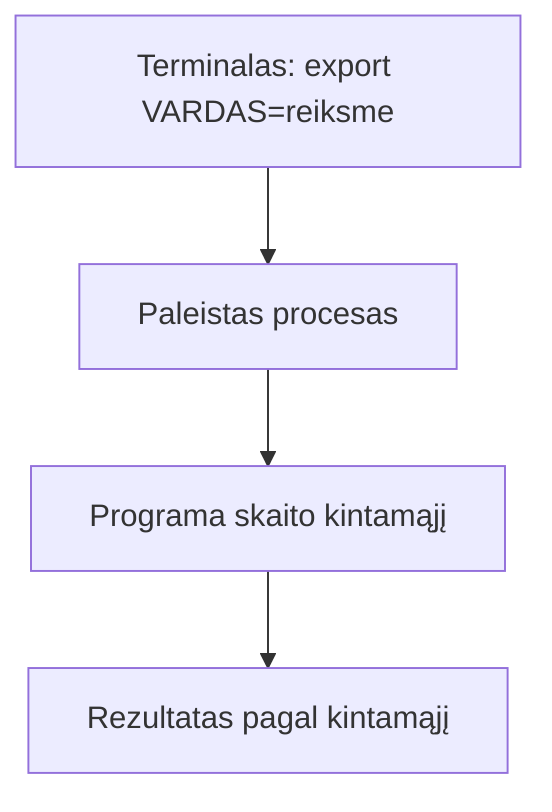

# 03 Procesai ir paketai

Data: 2026-11-16 (pirmadienis)

## Klasės darbas

1. Pasitikrinimas po 02 paskaitos (~15 min): dėstytojas parodo 02 sprendimą gyvai; kam neveikė `chmod` ar PR, kartu randame priežastį
2. Procesai (~30 min):
   1. Kas yra procesas, PID, tėvinis procesas
   2. Peržiūra: `ps`, `top` (arba `htop`, jei įdiegta), kaip filtruoti per `grep`
   3. Pirmas planas ir fonas: `&`, `jobs`, `Ctrl+C`, `Ctrl+Z`
   4. Procesų stabdymas: `kill`, signalai (`SIGTERM` ir `SIGKILL`) ir kodėl pirma bandoma švelniai
   5. Kodėl Flask serveris yra tiesiog procesas, kuris klauso porto (ryšys su konteineriais vėliau)
3. Aplinkos kintamieji (~25 min):
   1. Kas yra aplinkos kintamasis; `env`, `echo $VARDAS`
   2. `export` ir kintamojo gyvavimo trukmė (tik šis terminalas)
   3. `PATH`: kaip terminalas randa komandas
   4. Kodėl slaptos reikšmės (pvz. DB slaptažodis) laikomos kintamuosiuose, o ne kode; `.env` neina į Git
   5. Kaip kintamasis perskaitomas Python kode (žr. skyrių „Schemos“)
4. Paketų tvarkyklė (~25 min):
   1. Kodėl nesisiunčiame programų iš svetainių ranka
   2. Ubuntu (WSL): `apt` ([APT dokumentacija](https://wiki.debian.org/Apt)); Mac: `brew` ([Homebrew](https://docs.brew.sh/)); ta pati užduotis, dvi komandos
   3. Paieška, įdiegimas, versija, kur įdiegta: `apt search`, `apt install` (Ubuntu), `brew search`, `brew install` (Mac), `which`, `--version`
   4. Ubuntu: prieš pirmą diegimą `sudo apt update`; Mac: `brew` be `sudo`. Kodėl `sudo` žiūrime atsargiai
5. Python kodo skaitymas (~10 min): kaip programa paima prisijungimo duomenis iš aplinkos kintamųjų (žr. `uzduotys.md`)
6. Demonstracija: dėstytojas atlieka užduotį „procesai, kintamieji, paketas“ su kitais pavyzdžiais (kitas kintamojo vardas, kitas paketas, kitas procesas) (~20 min)
7. Kita paskaita: Bash skriptai: kintamieji, sąlygos, ciklai

## Kur skiriasi (Mac / Ubuntu)

| Veiksmas | Mac (Terminalas) | Ubuntu (WSL) |
|---|---|---|
| Paketų tvarkyklė | `brew` (be `sudo`) | `apt` (su `sudo`) |
| Paketų sąrašo atnaujinimas | `brew update` | `sudo apt update` |
| Įdiegti `tree` | `brew install tree` | `sudo apt install tree` |
| Ar paketas įdiegtas | `brew list tree` | `dpkg -s tree` |
| Proceso PID pagal pavadinimą | `pgrep sleep` (veikia abiejose) | `pgrep sleep` |
| Procesų sąrašas | `ps -e` ir `ps aux` (veikia abiejose) | `ps -e`, `ps aux` |
| Rūšiuotas `top` | `top -o cpu` | `top -o %CPU` |
| Laisva atmintis | `vm_stat` | `free -h` (kurse nenaudojame) |

Nenaudojame: `/proc`, `systemctl`, `journalctl`, `free -h`, `ip a`, `sed -i`: jie veikia tik vienoje sistemoje.

## Schemos

Kaip aplinkos kintamasis pasiekia programą:



Python ištrauka skaitymo užduočiai (suderinti su starteriu, kai jis bus; vardai ir numatytosios reikšmės čia pavyzdinės):

```python
import os

DB_HOST = os.environ.get("DB_HOST", "localhost")
DB_NAME = os.environ.get("DB_NAME", "app")
```
