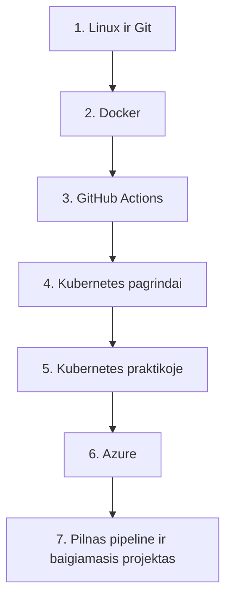

# DevOps kursas VH-DO: ką išmoksite ir link ko einame

Kursas: 80 paskaitų po 3 valandas (17:30–20:40), keturios per savaitę, 2026-11-11 – 2027-05-27 (datos nuo 2027 m. orientacinės). Dėstytojas Deividas Koncius.

## Kursas vienu sakiniu

Paimsite mažą Python (Flask) web programą su MySQL duomenų baze ir per metus išmoksite ją **supakuoti, patikrinti, paleisti ir prižiūrėti taip, kaip tai daro DevOps inžinieriai**: nuo komandos terminale iki automatinio diegimo į debesį (Azure).

## Kelias

Po kiekvieno etapo yra atsiskaitymas (testas + praktika). Tarp etapų žinios sudedamos vienos ant kitų: tą pačią programą pirma paleidžiate lokaliai, tada konteineryje, paskui automatizuojate, perkeliate į Kubernetes ir galiausiai į Azure.

## Etapai

### 1. DevOps pagrindai, Linux, Git (01–10, iki 2026-11-30)

**Ką išmoksite:**
1. Kas yra DevOps ir kuo jis padeda: kodo kelias nuo kūrėjo iki vartotojo.
2. Linux terminalas: navigacija, failai, teisės, procesai, paketai, aplinkos kintamieji.
3. Bash skriptai: kintamieji, sąlygos, ciklai.
4. Tinklai: IP, portai, DNS, HTTP, `curl`; SSH ir raktai.
5. Git ir GitHub: commit, šakos, sujungimas, konfliktai, Pull Request, code review.
6. Kurso projekto paleidimas lokaliai.

**Rezultatas:** jaučiatės patogiai terminale ir dirbate su Git per Pull Request'us. Atsiskaitymas 2026-11-30.

### 2. Docker (11–21, iki 2026-12-17)

**Ką išmoksite:**
1. Kodėl konteineriai (problema „pas mane veikia“), Docker komandos, image'ai ir registrai.
2. Savo Dockerfile projektui, gerosios praktikos ir multi-stage build.
3. Volume'ai ir duomenų išsaugojimas, Docker tinklai.
4. Docker Compose: programa ir MySQL kartu.
5. Docker saugumas (ne root, image skenavimas) ir sugadintų konteinerių taisymas.

**Rezultatas:** projektas su duomenų baze paleidžiamas viena komanda bet kuriame kompiuteryje. Atsiskaitymas 2026-12-17.

### 3. GitHub Actions (22–32, sausis 2027)

**Ką išmoksite:**
1. CI/CD idėja, pirmas workflow, runner'iai ir actions iš Marketplace.
2. Testai ir lint'as per kiekvieną Pull Request, branch apsauga.
3. Secrets ir aplinkos, Docker image build'as ir push'as į GitHub Container Registry.
4. Cache, matrix, artefaktai, image tag'ai ir release'ai, pakartotiniai workflow.

**Rezultatas:** kiekvienas commit automatiškai patikrinamas, o `main` šakoje sukuriamas ir išsaugomas image.

### 4. Kubernetes pagrindai (33–45, sausis – kovas 2027)

**Ką išmoksite:**
1. Kam reikia Kubernetes ir kaip jis sudėtas; lokalus klasteris ir `kubectl`.
2. Pod, Deployment, rolling update ir rollback.
3. Service, Ingress, ConfigMap, Secret, namespace'ai ir labels.
4. Probe'ai, resursų requests ir limits, sugedusių Kubernetes objektų taisymas.

**Rezultatas:** projektas veikia lokaliame klasteryje ir pasiekiamas iš naršyklės.

### 5. Kubernetes praktikoje (46–56, kovas 2027)

**Ką išmoksite:**
1. Duomenų saugojimas: PersistentVolume, StatefulSet duomenų bazei, Jobs ir CronJobs (atsarginė kopija).
2. Helm: esami ir savo chart'ai, values skirtingoms aplinkoms.
3. Automatinis plėtimasis (HPA) ir apkrovos testas.
4. Stebėsena (Prometheus, Grafana), log'ai ir trikčių paieška.
5. Saugumas: RBAC, ServiceAccount, NetworkPolicy.

**Rezultatas:** projektas supakuotas kaip Helm chart, stebimas ir pats prisitaiko prie apkrovos.

### 6. Azure (57–68, balandis – gegužė 2027)

**Ką išmoksite:**
1. Debesų pagrindai, Azure portalas, Azure CLI, kaštų kontrolė.
2. Prieigos valdymas (Entra ID, RBAC), konteinerių registras (ACR).
3. Container Apps ir AKS klasteris, Helm į AKS.
4. Valdomos paslaugos (MySQL, Key Vault), Azure Monitor.
5. Infrastruktūra kodu: Bicep arba Terraform.

**Rezultatas:** visa infrastruktūra aprašyta kodu ir sukuriama bei ištrinama viena komanda, kad kreditai būtų naudojami tik pamokų metu.

### 7. Pilnas pipeline ir baigiamasis projektas (69–80, gegužė 2027)

**Ką išmoksite:**
1. Diegimas į Azure iš GitHub Actions per OIDC, pilnas pipeline: testas → build → ACR → AKS.
2. Aplinkos (staging, production), patvirtinimai, deploy strategijos (rolling, blue-green, canary), rollback.
3. Infrastruktūros pipeline, GitOps apžvalga, DevSecOps.
4. Incidentų imitacija: kažkas sulūžta, komanda taiso.
5. Baigiamasis projektas ir jo gynimas.

**Rezultatas:** `push` į `main` automatiškai pasiekia AKS, o jūs galite paaiškinti kiekvieną žingsnį.

## Kaip vyksta pamoka

1. Dėstytojas trumpai paaiškina temą ir gyvai parodo kitu pavyzdžiu.
2. Užduotis atsiduria Teams'e; ją darote savo kompiuteryje, baigę gaunate kitą.
3. Kitos pamokos pradžioje dėstytojas parodo sprendimą ir aptariate, kas liko neaišku.
4. Kasdienių užduočių dėstytojas netikrina, vertinama atsiskaitymuose.
5. Kiekvieną užduotį galite daryti su DI pagalba (paaiškinti klaidą, pasiūlyti komandą), bet atsakymą visada patikrinate patys. Slaptažodžių, raktų, tokenų ir `.env` turinio niekada nekeliate į DI ar į Git.

## Kurso projektas

Vienas projektas visą kursą: Python (Flask) web API su MySQL (`/health` ir 2–3 maršrutai, pvz. `/items`). Jį gaunate kaip GitHub šabloną `devops-projektas`, susikuriate savo kopiją ir kiekvienoje pamokoje joje keičiate. Iš pradžių projektą tik skaitote ir paleidžiate lokaliai, o Dockerfile, Compose, workflow ir Helm chart'us kuriate patys.

## Atsiskaitymai

Kiekvienas atsiskaitymas: teorijos testas (30 klausimų, 35 min.) ir praktika (~2 val.).

| Nr | Data | Sritis |
|---|---|---|
| 1 | 2026-11-30 | Linux, Bash, Git, GitHub, projekto paleidimas |
| 2 | 2026-12-17 | Docker, Compose, MySQL konteineryje |
| 3 | 2027-01-20 | GitHub Actions: CI, image push |
| 4 | 2027-03-04 | Kubernetes pagrindai |
| 5 | 2027-03-25 | Helm, duomenys, stebėsena, derinimas |
| 6 | 2027-05-06 | Azure, infrastruktūra kodu, AKS |
| 7 | 2027-05-27 | Baigiamojo projekto gynimas |

Pirmų dviejų datos patvirtintos, kitos orientacinės. Atsiskaitymų praktikos įvertinimai skaičiuojami paprastu vidurkiu ir sudaro 40 % egzamino praktikos įvertinimo (žr. žemiau).

## Baigiamasis projektas

Individualus (galima daryti poroje, gynimas individualus). Užduotys pagal lygius, kiekvienas apima ankstesnį, ir etaloninis sprendimas yra aplanke `kursas/Finalinis projektas/`.

## DI kurse

DI galima naudoti klaidoms paaiškinti ir komandoms pasiūlyti, bet rezultatą reikia paleisti ir patikrinti patiems. Slaptų duomenų į DI nekeliame. Atsiskaitymuose ir testuose DI nenaudojamas. Kiekviename etape bus trumpa užduotis: paprašyti DI, patikrinti rezultatą ir pataisyti bent vieną dalyką. Daugiau: `medziaga/di-kurse.md`.

## Egzaminai kurso pabaigoje

Kurso pabaigoje laikomi du egzaminai (tikėtina birželio 15–25 d., datas mokykla paskelbs 2027 sausį):

1. **Teorijos egzaminas.** 80–100 klausimų iš visų modulių, 2 val., kompiuteriu, niekuo naudotis negalima. Rezultatas iškart.
2. **Praktikos egzaminas.** 3–4 val., mokyklos kompiuteriais. Jį laikyti galite tik jei teorijos egzamine surinkote **50 % ar daugiau**. Neišlaikius teorijos, rašomas prašymas perlaikymui (nauja data po 1–3 mėn.).

Kurso eigoje surinkti **praktinių atsiskaitymų** įvertinimai sudaro 40 % egzamino praktikos įvertinimo (visi atsiskaitymai 10 → 4 balai). Egzaminą vis tiek reikia laikyti. Baigiamasis projektas yra praktinis atsiskaitymas ir didesnio svorio neturi. Pažymiai du: už teoriją ir už praktiką.

Praktikos egzamine galima naudotis savo darbais, sukeltais į GitHub, todėl užduotis ir sprendimus laikykite savo GitHub paskyroje. Egzaminų uždavinių nerašo dėstytojas; praktikos pavyzdį mokykla gali duoti likus nuo mėnesio iki kelių dienų. Komisijoje: išorės vertintojas ir du TECHIN dėstytojai. Pasiruošti padeda atsiskaitymai kurso eigoje ir kartojimo pamoka (79). Klausimus apie egzaminų organizavimą spręskite su IT skyriaus vadybininke Justina.

## Ką žinoti dar

1. Datos po 2027-01-01 skaičiuotos ir gali keistis (pavasario atostogos, kito mokytojo savaitės, duomenų bazių modulis 2027-02-01 – 02-19).
2. Detali 80 pamokų lentelė, datos ir darbo sprendimai: `medziaga/kurso-planas.md`.
