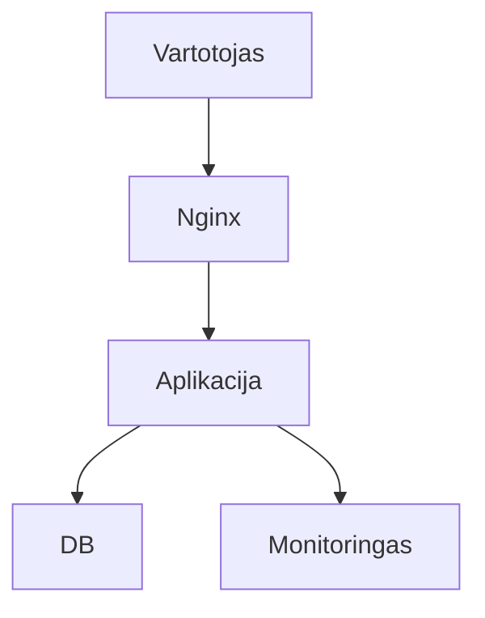

# 10.2 Informacinių sistemų platformos: gyvavimo ciklas ir serverių tipai

## Klasės darbas

1. Kas yra IS platforma:
   1. Aplikacija, duomenų bazė, proxy (pvz. Nginx), monitoringas, kopijos
   2. Kas su kuo kalbasi ir kur viskas veikia (serveris)
   3. Dėstytojo etalonas (aplikacija, PostgreSQL, Kubernetes, Argo CD): pamokoje rodoma jo schema, kaip ji atrodo pradžioje ir po metų
2. IS gyvavimo ciklas: analizė → projektavimas → diegimas → priežiūra
   1. Ką kiekviename etape daro platformų inžinierius ir DevOps
   2. Kodėl ciklas kartojasi: plėtra grįžta į analizę
   3. Įžanga apie debesį ir programų kūrimo ciklą (SDLC): žr. žemiau; apibrėžimas: [Systems development life cycle](https://en.wikipedia.org/wiki/Systems_development_life_cycle)
3. Serverių tipai:
   1. Fizinis, virtualus, debesijos: kaina, lankstumas, kas prižiūri
   2. Formos: rack, tower, blade
4. Nuotolinis valdymas, kai serveris neįjungtas:
   1. iLO (HPE), iDRAC (Dell), IPMI; IPMI apibrėžimas: [Intelligent Platform Management Interface](https://en.wikipedia.org/wiki/Intelligent_Platform_Management_Interface); iLO ir iDRAC raskite gamintojų oficialioje dokumentacijoje
   2. Kodėl valdymo sąsaja neturi būti prieinama iš interneto
5. Schemų braižymas:
   1. [Excalidraw](https://excalidraw.com/) veikia naršyklėje, be registracijos; dokumentacija: [docs.excalidraw.com](https://docs.excalidraw.com/)
   2. [Mermaid flowchart sintaksė](https://mermaid.js.org/syntax/flowchart.html): diagramos aprašas tekstu, kurį galima importuoti į Excalidraw
   3. DI kelias: paprašyti DI Mermaid aprašo, importuoti per Excalidraw meniu „Mermaid to Excalidraw“, eksportuoti `.png`
6. Demonstracija: dėstytojas braižo IS platformos schemą (~25 min)
7. Kita paskaita: serverio komponentai (CPU, RAM, diskai) ir jų testavimas

### Įžanga: debesis ir programų kūrimo ciklas

Šaltinis: AzureDevOps-Zero-to-Hero, Day1, autorius Piyush Sachdeva, išversta autoriaus leidimu. [pritaikyta: kursas apie Azure DevOps, čia tik SDLC samprata]

Norint paleisti programą, reikia nusipirkti skaičiavimo galią, duomenų saugyklą ir įrangą; debesų kompiuterija šias pradines išlaidas sumažina, nes įrangą galima nuomoti iš tiekėjų, tokių kaip AWS, Azure ar GCP. Day1 toliau aiškina IaaS/PaaS/SaaS, Waterfall, Agile, DevOps ir CI/CD (originale daugiausia paveikslėliai). Originalas: [Day1](https://github.com/piyushsachdeva/AzureDevOps-Zero-to-Hero/tree/main/Day1). IS gyvavimo ciklas yra programų kūrimo ciklo dalis, o DevOps siekia, kad diegimas ir priežiūra būtų greiti ir saugūs.

## Schemos

Mermaid pradžia IS schemai (tik pradžia DI prompt'ui, ne galutinė schema; užduotis 1):

