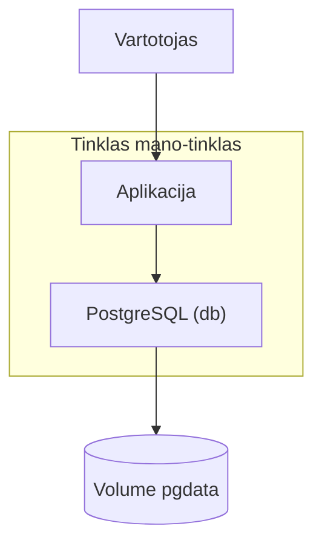

# 12.2 Dockerfile ir PostgreSQL

## Klasės darbas

1. Dockerfile pagrindai:
   1. Atvaizdas (image) ir konteineris, sluoksniai, cache; instrukcijos `FROM`, `WORKDIR`, `COPY`, `RUN`, `ENV`, `EXPOSE`, `USER`, `CMD`
   2. Dokumentacija: [Dockerfile reference](https://docs.docker.com/reference/dockerfile/)
   3. Kodėl `COPY requirements.txt` ir `pip install` rašomi prieš `COPY . .`
2. Multi-stage build:
   1. Build etapas ir galutinis etapas, `COPY --from`
   2. Kodėl galutinis atvaizdas mažesnis ir saugesnis
   3. Dokumentacija: [Multi-stage builds](https://docs.docker.com/build/building/multi-stage/)
3. Saugus atvaizdas:
   1. Ne root vartotojas (`USER`), `docker run --rm <atvaizdas> id`
   2. `.dockerignore`: kas neturi patekti į atvaizdą (tests, `__pycache__`, `.git`, paslaptys)
4. PostgreSQL konteineryje:
   1. Oficialus atvaizdas ir aplinkos kintamieji (`POSTGRES_USER`, `POSTGRES_PASSWORD`, `POSTGRES_DB`); aprašas: [postgres Docker Hub puslapyje](https://hub.docker.com/_/postgres)
   2. Slaptažodis iš aplinkos kintamojo, ne iš failo ir ne iš repozitorijos
   3. `docker exec ... psql` užklausoms
5. Duomenų išlikimas:
   1. Konteinerio rašomas sluoksnis dingsta kartu su konteineriu
   2. Volume ir bind mount; dokumentacija: [Volumes](https://docs.docker.com/engine/storage/volumes/)
   3. Schema: žr. skyrių „Schemos“ žemiau
6. Custom tinklas:
   1. Konteineriai kalbasi per vardą (`db`), ne per `localhost`
   2. Dokumentacija: raskite oficialioje Docker dokumentacijoje skyrių apie tinklus (user-defined bridge)
7. Demonstracija: dėstytojas atlieka knygų aplikacijos Dockerfile ir PostgreSQL su volume (~25 min)
8. Kita paskaita: Docker Compose, trys sugadintos bylos, Nginx balansavimas

## Schemos

Aplikacija, DB ir volume viename tinkle:

