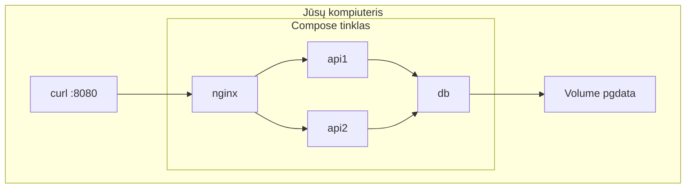

# 12.3 Docker Compose

## Klasės darbas

1. Kodėl Compose:
   1. Problema: kelios `docker run` komandos su daugybe parametrų
   2. Vienas YAML failas aprašo visą aplikaciją; dokumentacija: [Docker Compose](https://docs.docker.com/compose/)
2. Compose failo sandara:
   1. `services`, `volumes`, `networks`; raskite [Compose file reference](https://docs.docker.com/reference/compose-file/)
   2. Servisai: `image` arba `build`, `ports`, `environment`, `volumes`
   3. Tinklas: servisai kreipiasi vienas į kitą serviso vardu, `localhost` konteinerio viduje yra pats konteineris
3. Kintamieji ir paslaptys:
   1. `.env` ir `${KINTAMASIS}`; `.env.example` į Git, `.env` į `.gitignore`
4. Paleidimo tvarka ir patvarumas:
   1. `depends_on` ir `healthcheck` (`pg_isready`), `condition: service_healthy`
   2. Pavadinti volume; `down` prieš `down -v`
   3. `restart: unless-stopped`
5. Pagrindinės komandos kaip temos: `up -d --build`, `ps`, `logs`, `config`, `exec`, `stop`, `down`
6. Nginx kaip reverse proxy ir balansuotojas:
   1. `proxy_pass`, `upstream`, `zone`, round-robin; dokumentacija: [ngx_http_upstream_module](https://nginx.org/en/docs/http/ngx_http_upstream_module.html)
   2. Antraštė `X-Upstream` (`$upstream_addr`) parodo, kas atsakė
7. HTTP pažiūra per `curl -v`: metodas, kelias, statuso kodas, antraštės; REST metodai (GET, POST)
8. Sugadintų bylų diagnozė: klaidos tekstas → hipotezė → pataisymas → patikra (`config`, `logs`, `ps`)
9. Schemos: žr. skyrių „Schemos" žemiau
10. Demonstracija: dėstytojas atlieka kino bilietų Compose su dviem kasomis (~25 min)
11. Kita paskaita: 12.4 Atsiskaitymas 1 (testas ir praktika)

## Schemos

Užklausos kelias Compose tinkle:

